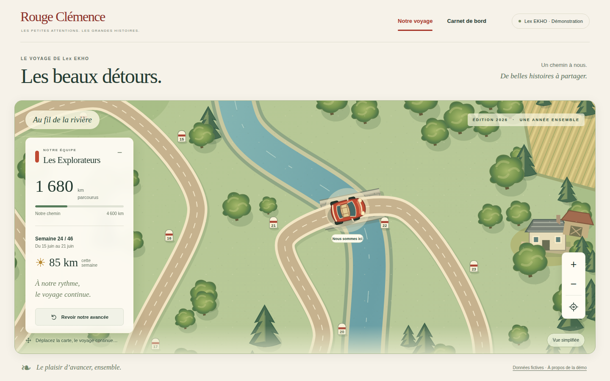
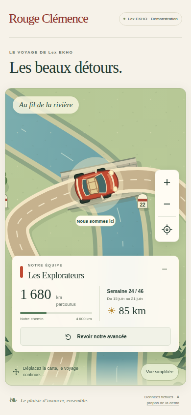

# V3-A — route et vue équipe

27 octobre 2026. CDC V3, sections 8.1–8.3, 8.5–8.6 et 10. Démonstration locale fictive, aucune connexion Firebase.

## Réalisation

- Route SVG versionnée `wallonie-imaginaire-v1`, repère 4800 × 2600, 44 segments cubiques continus : S, épingles et longues courbes. Quatre ensembles paysagers : bocage/vergers, vallée/rivière/ponts, forêt, collines/falaises. Illustration vectorielle originale, sans carte géographique ni image externe.
- Géométrie échantillonnée adaptativement ; abscisse curviligne puis tangente analytique. Conversion de la distance exacte uniquement à la frontière du rendu. Bornes de décor : 58, indépendantes du calendrier et des seuils.
- Une instance `team-car` ; dessin vintage générique, couleur d'équipe, orientation sur la tangente. Aucun véhicule concurrent.
- Caméra : déplacement libre, molette, commandes de zoom borné, clavier (flèches, +/−, Début), gestes tactiles de déplacement et pincement, recentrage. Panneau repliable, mode de décor simplifié, dialogues accessibles et réduction du mouvement.
- Relecture explicite de la dernière semaine : animation sur la route, sans modifier les kilomètres acquis. Aucun mouvement automatique à un rafraîchissement.
- Démonstration de 24 semaines calculée au build par le moteur existant : cycle fictif 55/70/70/85 km, total 1 680 km, dernière semaine 85 km. Ce jeu n'atteste aucun résultat de Lex EKHO.
- Projection à liste de champs autorisés : une équipe, kilomètres, calendrier déjà parcouru. Aucun seuil cadeau, contenu futur, autre équipe, réponse individuelle ou budget servi.
- Sortie web isolée et contrôlée : huit fichiers autorisés. Le serveur local ne sert que `dist-web`, jamais la racine du dépôt. Aucun SDK, endpoint ni identifiant Firebase dans cette sortie.

## Fichiers

`src/map/` : géométrie et carte. `src/web/` : rendu, paysage et caméra. `src/presentation/journey-view.ts` : projection destinée au serveur. `web/` : structure et styles. `scripts/build-web.mjs`, `demo-journey.mjs`, `serve-web.mjs` : construction isolée et serveur local. `tests/visual/`, `tests/browser/`, `playwright.config.mjs`, `.github/workflows/visual.yml` : recette ciblée et captures. Le moteur `src/domain/` et la maquette historique sont inchangés.

## Reproduction

```sh
npm ci --ignore-scripts
npm run typecheck
npm run build:web
npm run test:visual
npm run dev
```

Pour la recette navigateur sur une machine de développement ou la CI : `npx playwright install --with-deps chromium`, puis `npm run test:browser`. Cette recette démarre son serveur local si nécessaire. Dans l'environnement Work, la prévisualisation utilise le service `sites-preview` et la vérification manuelle utilise le navigateur fourni.

Le build utilise le compilateur TypeScript existant en ligne de commande. Son répertoire de compilation intermédiaire est supprimé après copie des seuls modules publics autorisés. Il n'embarque pas l'état privé du moteur. Les paramètres de calcul des cadeaux de démonstration restent dans le générateur de fixtures non servi.

## Vérifications et preuves

- `npm run typecheck` : réussi.
- `npm run build:web` : réussi.
- `npm run test:visual` : 10 tests réussis : 1001 positions sur le tracé, extrémités et milieu, tangentes continues, pas de sortie de route, 58 repères, grandes valeurs exactes, zoom ancré, projection et accès de portée, immutabilité du domaine, fixture déterministe et absence de données privées dans la sortie.
- Première passe : l'ancienne API JavaScript `transpileModule` n'existe pas dans le TypeScript 7 installé ; remplacée par son compilateur CLI. Le chargement Node des tests refusait les propriétés de constructeur TypeScript ; remplacées par des champs explicites. Ces deux erreurs ont été corrigées, puis les commandes précédentes ont réussi.
- `npm run test:browser` : **16 tests réussis, 2 ignorés** dans [Journey map V3 — exécution 40504328647](https://github.com/gkerckhofs-a11y/le_voyage/actions/runs/40504328647), commit fonctionnel `3abb0c4fa931cfa729917e0f31556785da13f429`. Les deux cas ignorés sont le scénario tactile dans les deux profils desktop ; ce scénario s'exécute et réussit dans le profil mobile. Tailles 1920×1080, 1440×900 et 390×844 : une voiture, marqueurs, cohérence avec la géométrie native SVG, absence de chevauchement avec le panneau, pas de débordement horizontal, chemins privés HTTP 404, zoom/pan/clavier, tactile, relecture/refresh, réduction du mouvement, dialogues et repli en cas de chargement impossible. La même CI confirme le typecheck, le build et les 10 tests ciblés.
- `npm test` : **29 tests moteur réussis** dans [Domain engine — exécution 40504328591](https://github.com/gkerckhofs-a11y/le_voyage/actions/runs/40504328591), au même commit. L'instantané de simulation de 12 semaines reste identique. Aucun changement dans `src/domain/`.
- Vérification manuelle dans le navigateur de prévisualisation : recentrage, zoom, déplacement clavier, relecture de la dernière progression et carnet des 24 semaines. Inspection des trois captures CI ci-dessous. Aucune régression constatée dans le périmètre testé ; ce résultat ne couvre pas l'authentification, Firebase ou les parcours encore absents.
- [PR de suivi n° 1](https://github.com/gkerckhofs-a11y/le_voyage/pull/1), branche `work/v2-phase1-engine`. Les captures PNG originales de la CI sont conservées dans `docs/evidence/` ; l'artefact temporaire `journey-map-evidence` de la CI est conservé 14 jours. Le commit documentaire suivant ne change pas le code testé.

### Captures réelles de la démonstration

Desktop 1440×900 :



[Capture desktop 1920×1080](evidence/v3a-desktop-1920.png)

Mobile 390×844 :



## Limites

La projection vérifie la portée tenant/campagne/équipe fournie ; elle n'authentifie pas un utilisateur. Le futur serveur devra établir cette portée depuis la session et l'appartenance vérifiées. Aucune isolation réseau réelle n'est déclarée validée ici.

Aucun cadeau n'est présenté dans V3-A, même acquis : les événements de révélation, leur persistance et la présentation après rafraîchissement relèvent de V3-C. Le bouton de relecture ne déclenche ni droit ni récompense. Le questionnaire, le vote, les préférences, les invitations, le cockpit et la réception collective ne sont pas développés dans cette tranche.

Les images de référence ont guidé l'ambiance ; le rendu livré est une première illustration vectorielle, plus sobre que les moodboards peints. Pas de mesure sur un téléphone physique ni de certification d'accessibilité. Le carnet historique est accessible depuis la navigation desktop ; cette navigation est masquée sur mobile et son accès mobile reste à compléter. Le mode simplifié allège le décor après chargement ; aucun chargement progressif par zone n'est encore réalisé. Aucun staging Firebase, aucun déploiement de production, aucune activation payante et aucune fusion sur `main`.

## Suite

V3-B : réutiliser le composant pour une carte collective dédiée, avec un seul véhicule commun, niveaux festifs visibles, base garantie et gel indépendant de la progression post-gel. Captures kiosque 16:9 et tests ciblés. V3-C : révélations et événements persistants ; raccordement sur émulateur ensuite.
