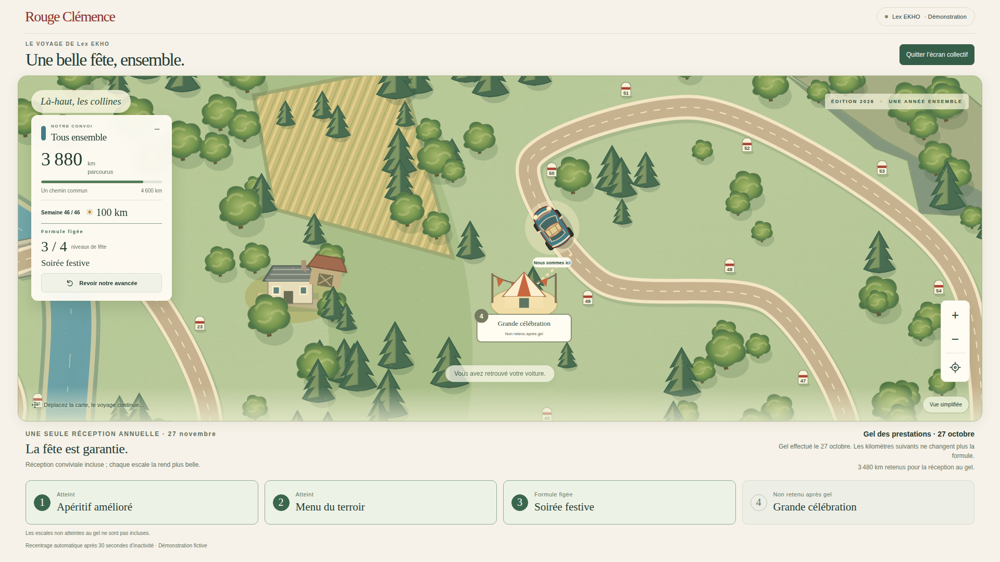
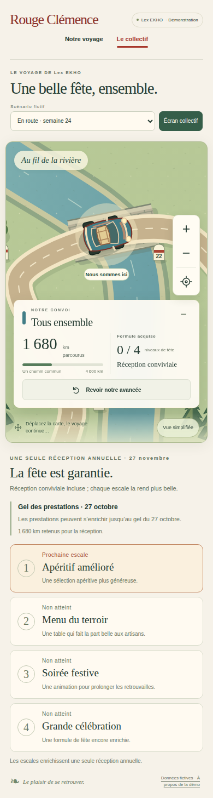

# V3-B — carte collective et réception figée

27 octobre 2026. CDC V3, §§4.4, 5.2, 8.4–8.7 et 10. Suite de V3-A, depuis le HEAD vérifié `1cfaa072b19781654c022279e96889f10aae0090`, branche `work/v2-phase1-engine`, PR n° 1. Aucune mutation Firebase ni modification du moteur `src/domain/`.

## Exigences couvertes

- Page `collectif.html` distincte de la carte équipe. Une seule instance `collective-car`, aucun véhicule d'équipe, classement, montant ou résultat individuel.
- Réemploi de la route continue et des quatre paysages V3-A. Le rendu de route, les 58 repères, la voiture, la caméra et la relecture sont partagés dans `src/web/journey-map.ts`. La logique métier reste dans le moteur.
- Quatre escales festives configurées dans la démonstration : Apéritif amélioré, Menu du terroir, Soirée festive, Grande célébration. Décors originaux : tablées, guirlandes, musique et chapiteau. Les cartes des escales permettent de les retrouver sur la route sans montrer tout le parcours à la fois.
- Réception de base garantie, date de réception et date de gel explicites. États atteint, prochain, non atteint, formule figée ; après gel, les niveaux non acquis sont indiqués « Non retenu après gel ».
- Projection serveur à liste de champs autorisés : kilomètres issus de `convoyDistance`, formule issue de `receptionLevel`, aucun calcul de droits dans le navigateur. Le cumul du convoi peut continuer après gel ; le cumul retenu pour la réception reste celui du moteur au gel.
- Mode écran collectif, sans plein écran imposé, avec recentrage après 30 secondes d'inactivité de navigation sur la carte. Réduction des mouvements, zoom, clavier, gestes tactiles et panneau repliable réutilisés.
- Navigation équipe/collectif et carnet de bord désormais accessibles sur mobile.

## Scénarios fictifs reproductibles

Les quatre ressources publiques sont générées au build par le moteur existant, sans connexion Firebase. Les variantes s'ouvrent depuis le sélecteur « Scénario fictif » ; elles ne modifient aucun état partagé.

| Scénario | Semaines closes | Convoi | Distance retenue réception | Formule |
|---|---:|---:|---:|---|
| En route | 24 | 1 680 km | 1 680 km | Base garantie |
| Avant gel | 42 | 3 480 km | 3 480 km | Niveau 3 acquis |
| Après gel | 46 | 3 880 km | 3 480 km | Niveau 3 figé |
| TPE, deux personnes fictives | 24 | 1 680 km | 1 680 km | Base garantie |

Les 24 premières semaines des quatre équipes tournent sur 55/70/70/85 km, donc une moyenne de 70 km et un total de 1 680 km. Les semaines suivantes sont volontairement simulées à 100 km afin d'exercer les franchissements : 1 680 + 18 × 100 = 3 480 au gel ; + 4 × 100 = 3 880 ensuite. Le quatrième seuil (3 860 km) est ainsi réellement dépassé après gel sans modifier la formule de niveau 3. Ce scénario de test ne prédit aucun résultat humain ou économique.

La date limite de traitement du moteur est inclusive, le 26 octobre ; le gel intervient le 27 octobre ; la réception fictive est datée du 27 novembre 2026. Les seuils réception restent [2 440, 2 910, 3 390, 3 860], calculés sur 42 semaines. Les budgets restent des coûts totaux privés, jamais transmis au navigateur. Une formule figée n'atteste pas une réservation effective de prestataire.

## Fichiers et recette

Nouveaux modules : `src/presentation/collective-view.ts`, `src/web/collective.ts`, `src/web/festive-stops.ts`, `src/web/journey-map.ts`, `scripts/demo-collective.mjs`, `web/collectif.html`, `web/collective.css`. Adaptations limitées : entrée équipe, navigation/styles, construction des ressources publiques, tests et workflow visuel.

Commandes exécutées localement : `npm run typecheck`, `npm run build:web`, `npm run test:visual` — **16 tests réussis**. Les six cas nouveaux couvrent moyenne et projection minimale, portée refusée, métadonnées publiques, gel malgré franchissement postérieur et sérialisation, TPE, formule de base gelée, clôture répétée sans doublon. La sortie publique contient exactement 17 fichiers autorisés.

La [CI visuelle 40508584189](https://github.com/gkerckhofs-a11y/le_voyage/actions/runs/40508584189), au commit fonctionnel `b4f456cf605e6053af8ef83b27dc34a65d975572`, est réussie : typecheck, build, **16 tests ciblés**, **28 tests navigateur réussis et 2 ignorés** (tactile sur desktop uniquement, réussi sur mobile), recette navigateur en 26,8 secondes. La [CI moteur 40508584188](https://github.com/gkerckhofs-a11y/le_voyage/actions/runs/40508584188) est réussie : 29 tests et instantané de simulation inchangé.

La recette couvre les vues équipe et collective en 1440×900, 1920×1080 et 390×844 ; capture kiosque 1920×1080 après gel sans débordement vertical ; navigation des escales, recentrage automatique, réduction du mouvement, refresh, TPE, carnet mobile et erreur réseau. Les contrôles du composant partagé sont revalidés dans la vue équipe. Aucune régression constatée dans ce périmètre.

Le commit de finition conserve ces captures originales et précise la remise à zéro du délai de recentrage lors de l'usage des commandes de carte, y compris le zoom, avec un scénario navigateur renforcé. Son résultat CI est lié dans la PR ; les captures ci-dessous proviennent explicitement du commit fonctionnel cité.

### Captures CI inspectées

Captures de page complète : desktop 1440×986 et 1920×1129, prises dans des viewports 1440×900 et 1920×1080 ; mobile 390×1456, viewport 390×844. Le kiosque est exactement 1920×1080, sans scroll vertical.

[Desktop 1440×900](evidence/v3b-collective-desktop-1440.png) · [Desktop 1920×1080](evidence/v3b-collective-desktop-1920.png)

Vérification manuelle initiale : états avant/après gel et mode écran collectif dans la prévisualisation locale. Un panneau initialement trop haut a été compacté pour rendre le bouton de relecture entièrement visible.

La relance documentaire V3-A `40505491274` a été annulée après dépassement de délai durant les téléchargements APT (polices), avant la recette navigateur. Le workflow V3-B utilise Chromium headless seul et les bibliothèques du runner Ubuntu 24.04, avec cache ; il s'exécute sur PR, supprimant le doublon push/PR visuel. Il ne déploie rien.

## Limites et suite

- Démonstration statique fictive. La portée de la projection n'est pas une authentification : le futur serveur devra vérifier session, appartenance et droits. Le mode kiosque est un mode de présentation, sans contrôle d'accès réel à ce stade.
- Aucun prestataire réservé, aucun événement réellement envoyé, aucune persistance réseau ou récupération multiappareil validée. Les tests de refresh relisent les fixtures ; ils ne prouvent pas la persistance Firebase.
- Direction artistique vectorielle V3-A conservée, sans nouvelle illustration peinte. Les libellés/prestations sont des exemples configurables, non une promesse commerciale. Les paramètres ludiques et validations réglementaires restent ouverts conformément au CDC.
- Aucune publication, aucun staging Firebase, aucune fusion sur `main`. Aucune validation sur téléphone physique.
- Prochaine tranche V3-C : événements de progression et révélations idempotentes, puis raccordement sur émulateur et contrôle d'accès ; garder les cadeaux futurs côté serveur. Les préférences, invitations, questionnaire et cockpit restent des lots ultérieurs.
