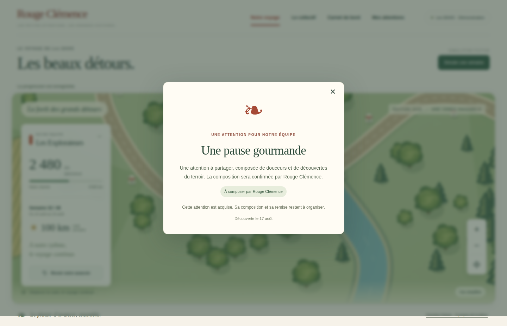

# V3-C — progression confirmée et attentions acquises

27 octobre 2026. Suite de V3-B, depuis le HEAD vérifié `f4b2523f1f42ee52d51fafe20a8e7821a471c3b6`, branche `work/v2-phase1-engine`, PR n° 1. CDC V3 lu lors de la reprise, §§4.4–7 et 8 réutilisés. Le moteur `src/domain/` et la géométrie du parcours sont inchangés. Aucun appel ni changement Firebase dans cette tranche.

## Périmètre couvert

- Un clic sur « Simuler une semaine » clôture la prochaine semaine fictive pour les quatre équipes via le moteur existant. Les scores synthétiques sont fixés côté serveur, jamais fournis par le navigateur. Le convoi reçoit la moyenne, pas la somme.
- La transition conserve ensemble résultats, convoi, droits cadeaux, tâches et événements. Une révision déjà traitée ne crée pas de nouvelle semaine ; les identifiants déterministes empêchent les doublons d'événements.
- La voiture unique avance après confirmation du serveur, avec le renderer V3-A/B conservé. Le mode réduit applique la position sans animation. Un rechargement retrouve la position acquise et ne rejoue rien automatiquement.
- Une attention est transmise uniquement après un franchissement réel. Le catalogue, les seuils, les budgets, les autres équipes et leurs événements restent privés. `dist-web` contient uniquement les fichiers de la liste autorisée ; l'ancienne fixture équipe statique a été retirée.
- Les attentions acquises restent dans « Mes attentions », au statut honnête « À composer ». La fenêtre de découverte ne signifie ni commande passée, ni composition terminée, ni livraison.
- L'attribution atomique d'une présentation permet au plus un affichage automatique par événement et collaborateur fictif, y compris dans deux onglets concurrents. Une coupure après attribution mais avant affichage peut empêcher la fenêtre d'être vue : la garantie porte sur l'attribution et l'historique, pas sur la perception humaine. L'attention reste toujours consultable.
- Si une réponse de progression se perd, l'interface bloque une nouvelle simulation et propose de relire l'état enregistré. Une attention acquise mais non présentée peut être découverte explicitement depuis l'historique.
- La carte collective « Notre simulation en cours » lit la même campagne que la carte équipe. Les variantes avant gel, après gel et TPE restent indépendantes. Le sélecteur n'annonce plus une semaine 24 fixe après progression.

## Architecture et accès de démonstration

`src/application/events.ts` est une transition pure autour du moteur, avec projection publique et attribution de présentation. `src/server/demo-service.mjs` fournit uniquement les contenus/scénarios fictifs. `file-store.mjs` sérialise les transactions par session dans un seul processus Node et remplace atomiquement un fichier synchronisé sur disque. Le répertoire privé est hors de la racine publique, en mode 0700, les fichiers en 0600. Une exception de transition ne persiste aucun changement.

`src/server/http.mjs` expose cinq endpoints locaux :

| Méthode / chemin | Résultat |
|---|---|
| POST `/api/demo/session` | Cookie opaque HttpOnly/SameSite strict et jeton CSRF |
| GET `/api/demo/team` | Équipe courante, historique, attentions déjà acquises |
| GET `/api/demo/collective` | Distance collective et niveaux publics de réception |
| POST `/api/demo/advance` | Clôture fictive conditionnée à la révision |
| POST `/api/demo/claim` | Attribution atomique des présentations autorisées |

Les écritures vérifient l'origine exacte et le jeton CSRF. Les corps sont bornés, leurs champs stricts ; aucun tenant, équipe ou score choisi par le client n'est accepté. Les réponses utilisent `no-store`, sans CORS. Les secrets de session ne sont ni affichés ni journalisés. Ces protections isolent les sessions de démonstration ; elles ne sont pas une authentification de salariés ni une preuve d'isolation Firebase multi-tenant.

L'adaptateur de fichiers est réservé à la démonstration locale. Il ne gère pas plusieurs processus, un déploiement distribué ou une sauvegarde externe. Un cookie expire après 24 heures ; les fichiers fictifs restent jusqu'au nettoyage manuel. Le serveur refuse `NODE_ENV=production`. Aucun SDK, règle ou service Firebase n'a été ajouté. Aucun staging n'est livré par cette tranche.

## Scénario vérifiable

La campagne démarre à 24 semaines / 1 680 km. Sept simulations de 100 km donnent 2 380 km, sans attention dans l'UI ou l'API. La huitième donne 2 480 km et une seule attention « Une pause gourmande », après franchissement du seuil privé 2 390 km. Ces valeurs ne sont documentées ici que pour la recette développeur ; ce fichier n'est pas servi aux collaborateurs.

À 42 semaines, le convoi atteint 3 480 km et le niveau 3. À 46 semaines, il atteint 3 880 km ; la formule reste figée au niveau 3 et à la distance de 3 480 km. L'équipe a quatre attentions acquises. Une simulation supplémentaire ne change rien. Le cinquième cadeau reste absent des données publiques.

## Vérifications

Exécuté localement : `npm run typecheck`, `npm run build:web`, `npm run test:visual` (**16 réussis**), `npm run test:events` (**12 réussis**) et `git diff --check`. Le nouveau test de campagne complète avait initialement visé un nom de champ erroné dans son assertion ; corrigé sur la projection existante, sans changement métier.

Les tests serveur comprennent concurrence réelle de requêtes HTTP, refus CSRF/origine/portée/corps, cadeau absent avant franchissement, session distincte, reprise du même état dans un nouveau processus Node, transaction interrompue, parcours complet avec gel, report/joker sans doublon.

Au commit fonctionnel `2561af1546e2c0fe1149bc2b61a7ac10116b03ad`, [la CI visuelle 40514225508](https://github.com/gkerckhofs-a11y/le_voyage/actions/runs/40514225508) est réussie : typecheck, build, **12 tests événements/HTTP**, **16 tests géométrie/projections/sortie publique**, **40 tests navigateur réussis et 2 ignorés**. Les deux exclusions concernent le tactile sur desktop ; le scénario tactile mobile réussit. La recette navigateur dure 47,5 secondes, sans retry. Elle comprend les douze nouveaux cas (quatre scénarios sur trois profils) et les 28 cas précédents, dont le kiosque et le gel. [La CI moteur 40514225525](https://github.com/gkerckhofs-a11y/le_voyage/actions/runs/40514225525) est également réussie : 29 tests et instantané de simulation 12 semaines inchangé. Aucune régression constatée dans cette couverture.

Vérification manuelle locale : huit clics successifs, voiture passant de 1 680 à 2 480 km, puis fenêtre « Une pause gourmande » affichée avec statut « À composer par Rouge Clémence ». Après rechargement, même distance, aucune nouvelle fenêtre et attention conservée dans l'historique. Aucune donnée réelle utilisée.

### Captures réelles de la CI inspectées

Captures issues du commit fonctionnel ci-dessus, conservées sans retouche. Viewports 1440×900, 1920×1080 et 390×844. Les captures de révélation en page complète mesurent respectivement 1440×928, 1920×1108 et 390×869 ; le fond modal couvre la hauteur du viewport, d'où la petite bande de bas de page visible dans ces captures complètes. L'écran mobile initial mesure 390×844.

[Desktop 1920](evidence/v3c-reveal-desktop-1920.png) · [Révélation mobile](evidence/v3c-reveal-mobile-390.png) · [Parcours mobile avant progression](evidence/v3c-team-mobile-390.png)

L'artefact CI `journey-map-evidence`, identifiant `12739925490`, contient aussi les captures collectives/kiosque et le rapport Playwright. Son SHA-256 déclaré est `8d8d64b31be439183dd1cf01cccc6fcdfb40146b9400e3585d59d018910d20d3`. Les captures versionnées survivent à son expiration prévue le 10 novembre 2026. Le commit de preuves ne modifie pas le code fonctionnel ; la PR indique son dernier statut CI.

## Restant et prochain incrément

Raccorder l'adaptateur transactionnel et les identités Firebase Auth sur émulateurs isolés ; tester les refus inter-tenant avec utilisateurs authentifiés, les transactions concurrentes, les règles et les événements persistés. Ne pas exposer de staging connecté à Firestore production. Les invitations, votes, trois questions hebdomadaires, préférences (dont sans alcool), cadeaux datés, cockpit et suivi prestataires restent des lots ultérieurs. Le bouton de simulation ne remplace pas ces parcours.

Aucune fusion, aucun déploiement production, aucune réservation, aucun envoi. Direction artistique vectorielle existante conservée. Paramètres prototype et validations juridiques/fiscales restent ouverts ; aucune promesse d'efficacité RH ou de conformité automatique.
