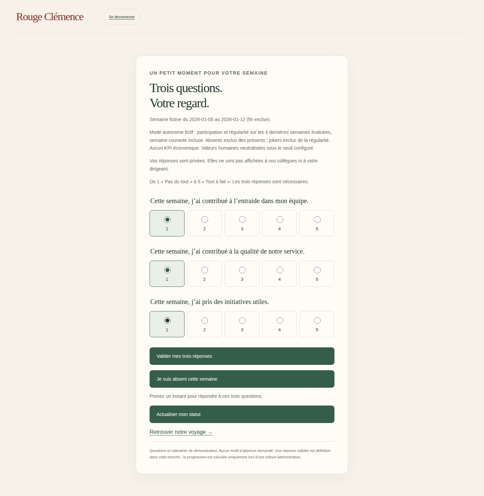
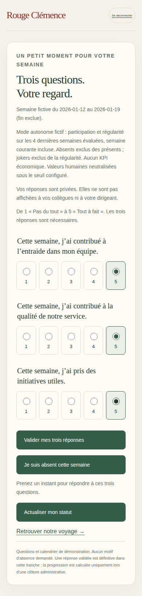

# V3-D10 — Mode autonome et TPE explicite

## Périmètre

Suite de `90a0b08`, branche `work/v2-phase1-engine`, PR #1. Nouvelle campagne fictive autonome, une seule équipe, départ à zéro, un participant et une administration non participante. Les campagnes KPI existantes sont conservées sans migration ni changement de mode. Aucun indicateur économique dans ce nouveau scénario.

## Politique de démonstration, à valider

Le mode autonome utilise la participation des éligibles présents et une régularité explicitement configurée : moyenne des notes de participation des quatre dernières semaines évaluées, semaine courante incluse. Une note de participation vaut `1 + 4 × répondants / présents`. Les absences sont retirées des présents. Les jokers et les semaines inactives ne contribuent pas à cet historique ; une non-réponse avec des présents y contribue avec une note de 1, mais sa distance reste le plancher de 40 km. Une absence totale refuse toujours l’évaluation ordinaire et demande un joker explicite ou une attente.

Cette formule de régularité est l’hypothèse du moteur existant, pas une décision produit définitive. Elle est annoncée dans les écrans et figée à l’ouverture du questionnaire. Une campagne autonome sans politique explicite, ou avec un historique manquant, est refusée plutôt que remplacée par des KPI fictifs.

Seuil de cinq répondants et valeurs humaines neutres à 3/5 conservés. Une TPE à un participant répondant obtient 85 km lorsque participation et régularité valent 5 : `25 + 15 × (0,25×5 + 0,25×5 + 0,50×3) = 85`. Ses réponses à 1 ou 5 ne modifient donc pas ce résultat. **La participation ou non-réponse peut néanmoins être inférable dans une TPE** ; ce mécanisme ne constitue pas une garantie d’anonymat. Présentation et politique doivent être validées pour le pilote.

## Réalisation

- `src/server/scoring-policy.mjs` : validation de la politique, libellé public, calcul exact via `rollingRegularity`, historique privé cohérent avec les semaines évaluées. Aucun score de régularité ni compteur personnel transmis aux clients.
- `src/server/weekly-questionnaire.mjs` : snapshot du mode/politique à l’ouverture ; entrée autonome vers le moteur existant ; historique et progression enregistrés ensemble. Les membres `participationEnabled:false` restent hors du roster. Les réessais de clôture ne doublent ni l’historique ni les kilomètres.
- `src/server/demo-service.mjs` : nouvelle fixture `fiction-tpe-auto` / `fiction-autonomous-2026`, sans résultats préchargés. Le modèle de campagne et les seuils de 46 semaines sont réutilisés ; seuls le mode et les identifiants sont distincts.
- `src/server/firebase-http.mjs` : participant TPE et administration TPE fictifs, droits séparés, simulation synthétique bloquée dès la création. Aucun utilisateur réel créé.
- `scripts/demo-collective.mjs`, `src/server/week-coordination.mjs`, interfaces : identité TPE, mode annoncé au participant et dans la coordination ; connexion dédiée. Une voiture côté équipe, une voiture côté collectif ; ce dernier reprend exactement la distance de l’unique équipe.
- `src/web/main.ts` : affichage sûr à zéro semaine, sans accès à une dernière semaine inexistante. Le moteur pur reste inchangé.

## Limites et suite

Émulateurs uniquement. Paramètres chargés côté serveur, pas encore d’éditeur annuel ni de collecte réelle. Historique privé de participation limité naturellement au calendrier de campagne ; politique de conservation et traitement des départs après ouverture à finaliser. La durée du formulaire n’a pas été mesurée avec des utilisateurs. Les campagnes Lex EKHO existantes restent en mode KPI fictif ; aucune conversion rétrospective.

Prochaine tranche : cockpit cadeaux P0 à partir des droits réellement acquis — tâches, statuts, budget alloué, coûts et marges, composition et contraintes sans alcool — sans exposer les réponses humaines. Aucun déploiement production.

## Vérifications

Commits fonctionnels `3e35044` et correction `e36ad4c` sur `work/v2-phase1-engine`, PR #1. La première CI (40534685178) a révélé un refus d’historique vide au démarrage de la carte. Le garde a été corrigé sans retirer l’assertion du départ à zéro.

- `npm run typecheck`, `npm run build:web`, `npm run test:visual` : réussis localement après correction ; 16 tests de géométrie/projection.
- `npm run test:events` : 12 réussis ; `PATH=/tmp/rc-java21/bin:$PATH npm run test:firebase` : 20 réussis localement avant la correction UI.
- [CI Firebase sur e36ad4c](https://github.com/gkerckhofs-a11y/le_voyage/actions/runs/40535621635), `npm run test:firebase:web` : 20 tests serveur et 12 parcours navigateur réussis sans retry, 2 ignorés (anciens scénarios desktop de collecte/coordination ; leurs versions mobile sont exécutées).
- Nouveau parcours TPE exécuté à 1440×900 et 390×844 : départ à zéro sur desktop, une voiture, ouverture, trois réponses, clôture, gain unique de 85 km, distance du collectif identique. Le mobile poursuit la même campagne à la semaine suivante ; les deux tailles exécutent toutes les interactions.
- Serveur : sept semaines simulées, régularité glissante, non-réponse à 40 km, absences exclues, joker sans historique de participation, clôture rejouée, refus de politique ou d’historique manquant, absence de fuite de l’historique privé.
- [CI cartes](https://github.com/gkerckhofs-a11y/le_voyage/actions/runs/40535621751), [accès](https://github.com/gkerckhofs-a11y/le_voyage/actions/runs/40535621607) et [moteur](https://github.com/gkerckhofs-a11y/le_voyage/actions/runs/40535622808) réussies sur le même commit.

Captures réelles issues de Playwright CI, inspectées : formulaire avant validation avec valeurs fictives 1 sur desktop, 5 sur mobile. Captures pleine page, pas une mesure du temps de réponse ni une certification d’accessibilité. Aucun rendu local Firebase revendiqué (runtime de preview Java indisponible), aucun staging ou déploiement production.

