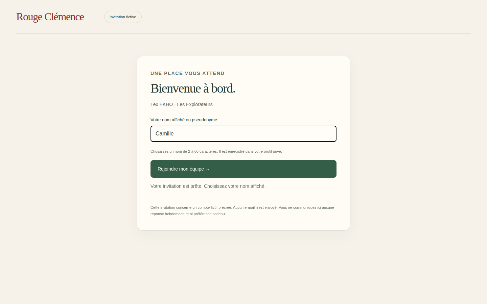
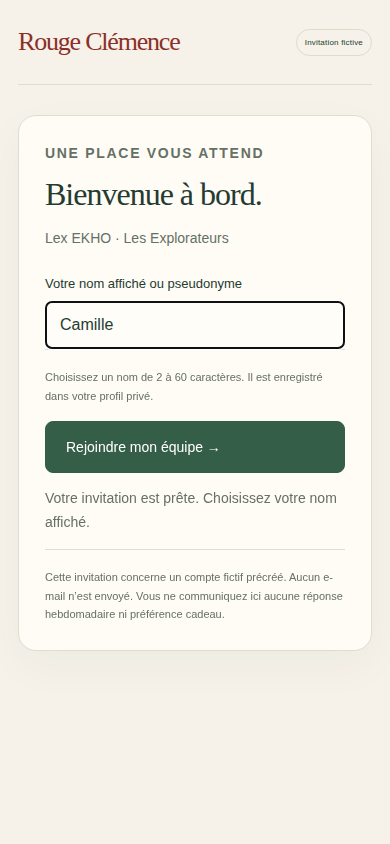

# V3-D4 — Invitations contrôlées et accueil personnel

## Périmètre

Continuation de `9215239`, branche `work/v2-phase1-engine`, PR #1. CDC V3 §3.2 et séparation des clients : création/révocation par un membre autorisé, invitation liée à une identité Firebase préexistante, accueil avec pseudonyme privé et affectation à une équipe. Moteur métier et géométrie des cartes inchangés. Aucun accès ni déploiement Firebase Cloud.

## Réalisation

- `src/server/invitations.mjs` : jeton aléatoire 256 bits, empreinte SHA-256 seule conservée, destinataire UID vérifié, permission `canInvite` relue dans chaque transaction, expiration et révocation. L’acceptation écrit ensemble l’affectation, le profil privé et le statut. Les réessais ne doublonnent pas l’affectation et ne modifient pas le pseudonyme déjà accepté.
- `src/server/firebase-http.mjs` : routes privées avec session HttpOnly et CSRF ; une session sans équipe ne peut pas lire le voyage. Le périmètre est fixé côté serveur. La révocation du lien ne retire pas une adhésion déjà acceptée.
- `web/invitations.html`, `src/web/invitation-admin.ts` : administration fictive, création et révocation du lien courant pour Camille.
- `web/invitation.html`, `src/web/invitation.ts` : authentification fictive du destinataire, accueil, pseudonyme, acceptation puis accès au voyage. Jeton dans le fragment du lien, transmis par POST, retiré de l’adresse après acceptation. Aucun service tiers ni envoi de courriel.
- `tests/firebase/invitations.test.mjs` : destinataire incorrect, digest, acceptations concurrentes, profil privé, expiration, révocation, permission retirée et adhésion désactivée.
- `tests/firebase-browser/invitation.spec.mjs` : création/révocation, accueil, réponse réseau perdue puis réessai, carte avec une seule voiture, desktop/mobile.

## Paramètres et limites explicites

Durée de 24 heures : choix technique provisoire configurable, à valider. La permission `canInvite` est une capacité technique dédiée ; l’interface définitive des rôles administratifs reste à construire. Le destinataire doit déjà posséder un UID : inscription réelle, vérification d’adresse et distribution sécurisée des invitations ne sont pas réalisées. Les comptes et noms d’équipe de l’écran restent des fixtures Lex EKHO.

Le profil est privé et n’est pas exposé dans les cartes. Le transfert entre équipes est refusé. Le retrait d’une adhésion empêche sa réactivation par un ancien lien. Il n’existe pas encore de liste administrative durable des invitations dans l’UI ; après rafraîchissement, le lien courant n’y est plus disponible. Le serveur conserve les dossiers dans Firestore Emulator seulement. La simulation des semaines conserve son effectif fictif initial : le nouveau membre n’alimente pas encore les dénominateurs de participation. Votes de nom/couleur, préférences cadeaux et questionnaires restent les prochains incréments, sans promesse de parcours collaborateur complet.

## Vérifications

Commit fonctionnel testé : `c17c7be2bcb9a5e05cd58272723348cc82114f66`.

- Local : `npm run typecheck`, `npm run build:web`, `npm run test:visual` (16/16), `npm run test:events` (12/12), `PATH=/tmp/rc-java21/bin:$PATH npm run test:firebase` (5/5), `git diff --check` : succès.
- [CI Firebase 40523129493](https://github.com/gkerckhofs-a11y/le_voyage/actions/runs/40523129493) : `npm run test:firebase:web`, 5 tests serveur et 4 parcours navigateur réussis, sans retry. Desktop 1440×900 et mobile 390×844 : connexion, invitation, révocation, acceptation après réponse perdue, carte, collectif, déconnexion, séparation de l’autre entreprise.
- [CI cartes 40523129207](https://github.com/gkerckhofs-a11y/le_voyage/actions/runs/40523129207) : typage/build, 12 événements, 16 projections, 40 tests navigateur réussis ; 2 tests tactiles ignorés sur desktop, exécutés sur mobile.
- [CI accès 40523129289](https://github.com/gkerckhofs-a11y/le_voyage/actions/runs/40523129289) et [CI moteur 40523129421](https://github.com/gkerckhofs-a11y/le_voyage/actions/runs/40523129421) réussies.

Captures réelles issues de l’artefact `firebase-login-evidence` de la CI Firebase, inspectées : champs et CTA lisibles, aucun débordement visible aux deux tailles. Le navigateur local n’est pas revendiqué comme validé : sa prévisualisation reste bloquée par le runtime Java. Aucun jeton d’invitation dans les captures. Pas de régression détectée dans la couverture exécutée ; pas de certification d’accessibilité ni de validation d’identité réelle.

## Prochain incrément

Vote du nom et de la couleur de l’équipe, puis préférences cadeaux privées dont l’exclusion d’alcool. Maintenir les réponses individuelles hors des cartes et conserver les tests d’isolation. L’intégration de l’effectif réel aux semaines actives devra être traitée explicitement avant le questionnaire collaborateur.
