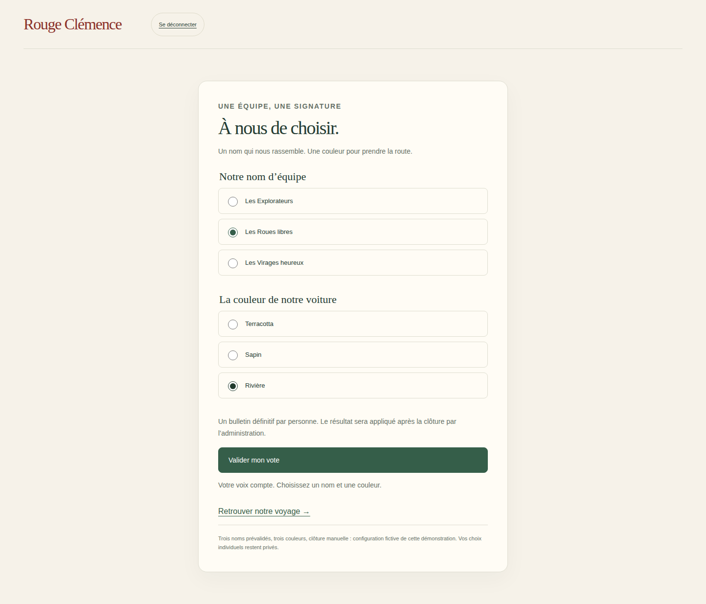
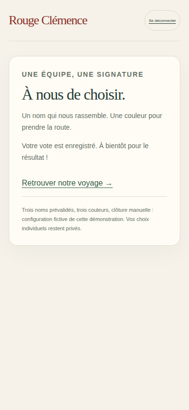

# V3-D5 — Nom et couleur votés par l’équipe

## Périmètre et décisions explicites

Suite de `6326da6`, branche `work/v2-phase1-engine`, PR #1. CDC V3 §3.2 : vote nom/couleur, candidats limités, clôture et arbitre. Moteur métier inchangé. Les préférences cadeaux restent la prochaine tranche.

Configuration de démonstration : trois noms prévalidés, palette de trois couleurs nommées, clôture manuelle par permission `canManageTeam`. Un bulletin définitif par membre authentifié. Ces choix sont des paramètres provisoires, pas des règles métier supplémentaires présentées comme validées. Pas de candidature libre, ni de modèle de véhicule à voter dans cette tranche.

## Réalisation

- `src/server/team-vote.mjs` : vérification Firebase Auth et appartenance relue en transaction ; bulletin unique, réessai identique accepté, modification refusée. Les autres bulletins et leurs auteurs ne sont jamais transmis. Résultat public après clôture seulement. L’arbitre reçoit les candidats en tête, pas les choix individuels ni leurs nombres.
- Clôture : majorité simple sur chaque choix ; en cas d’égalité, sélection parmi les premiers et motif obligatoire. Décision et identité d’équipe enregistrées atomiquement. Une seconde clôture ne réécrit pas le résultat. Un scrutin sans bulletin ne peut pas être clos.
- `src/server/firebase-emulator.mjs` : lecture de l’identité votée dans la transaction, utilisée par les projections de carte sans toucher au score, à la progression ou aux cadeaux.
- `web/equipe.html`, `src/web/team-vote.ts` : formulaire mobile/desktop, radios accessibles avec libellés, confirmation privée, espace de clôture autorisé. Accès depuis le voyage Firebase ou l’administration fictive.
- `src/server/firebase-http.mjs` : routes de vote à périmètre fixé par session, origine/CSRF et corps stricts.

## Limites

Émulateurs uniquement, aucune écriture Cloud. Configuration préchargée côté serveur, sans éditeur administratif ni date limite automatique. Le scrutin conserve les votes déjà exprimés si un membre est retiré ensuite ; une politique d’annulation/réouverture reste à valider. Collection privée bornée à 100 bulletins par scrutin pour cette démonstration ; un stockage par bulletin sera nécessaire pour des volumes réels. Les votes ne modifient pas l’effectif fictif de la simulation hebdomadaire. Aucun classement ni exposition des autres équipes. Les motifs d’arbitrage restent privés. Les couleurs portent des noms ; aucun audit de daltonisme complet n’est revendiqué.

## Recette

Commits : `0968d7b` (vote), `ec68c9a` (nom voté repris dans l’accueil des invitations, avec test).

- Local : `npm run typecheck`, `npm run build:web`, `npm run test:visual` (16/16), `npm run test:events` (12/12), `PATH=/tmp/rc-java21/bin:$PATH npm run test:firebase` (7/7) et `git diff --check` réussis. Une première assertion utilisait une mauvaise propriété de la projection ; elle a été corrigée vers `journey.team.name`/`color`, puis la recette a été relancée avec succès.
- [CI Firebase sur ec68c9a](https://github.com/gkerckhofs-a11y/le_voyage/actions/runs/40525573071) : `npm run test:firebase:web`, 7 intégrations serveur et 6 parcours navigateur réussis, aucun retry. Desktop 1440×900 et mobile 390×844 : invitations, connexion/déconnexion et vote. Réponse de vote perdue puis réessai, bulletin retrouvé après refresh, clôture administrative sur mobile, nom voté et une seule voiture sur la carte.
- [CI cartes](https://github.com/gkerckhofs-a11y/le_voyage/actions/runs/40525573022), [accès](https://github.com/gkerckhofs-a11y/le_voyage/actions/runs/40525572980) et [moteur](https://github.com/gkerckhofs-a11y/le_voyage/actions/runs/40525572979) réussies sur ce même commit.
- Captures réelles du formulaire desktop et de la confirmation mobile : artefact `firebase-login-evidence`, [première CI fonctionnelle](https://github.com/gkerckhofs-a11y/le_voyage/actions/runs/40525378491), commit `0968d7b`. La correction suivante ne change pas ces écrans. Captures inspectées : texte lisible, choix et confirmation visibles, aucun débordement constaté. La capture mobile montre la confirmation du bulletin déjà enregistré sur desktop, pas un second vote.

Pas de régression détectée dans cette couverture. Prévisualisation manuelle locale Firebase toujours indisponible dans son environnement Java ; tests navigateur exécutés en CI. Aucune mise en production.

## Suite

Préférences cadeaux privées : vin, bière, thé, chocolat et exclusion d’alcool, sans lecture des préférences d’autrui. Puis questionnaire hebdomadaire, avec définition explicite de l’effectif éligible avant raccordement au moteur.
