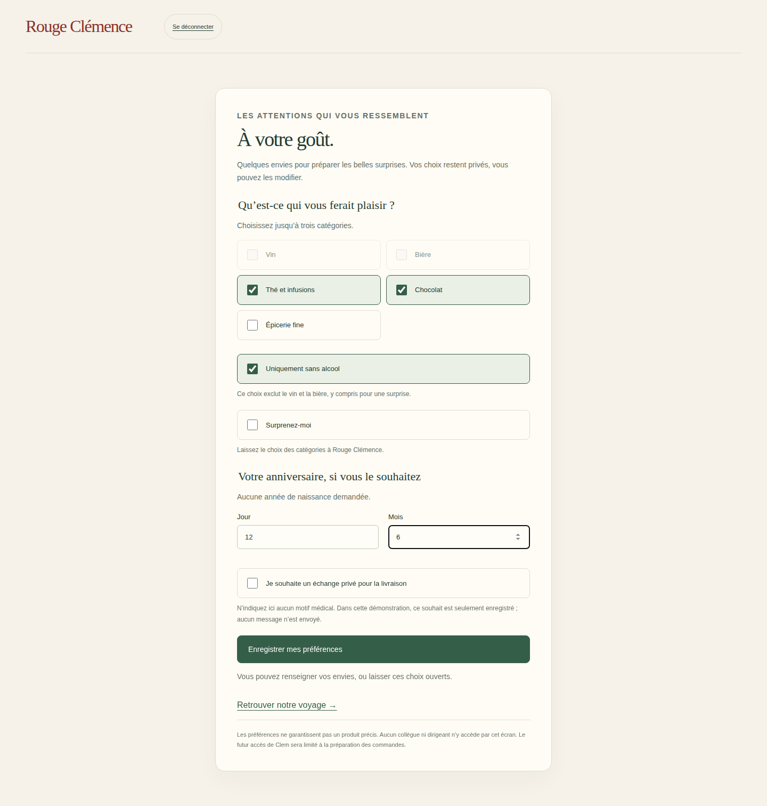
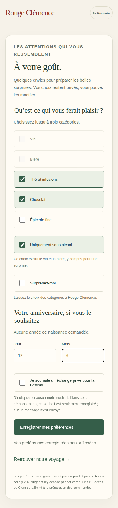

# V3-D6 — Préférences cadeaux privées

## Périmètre

Suite de `735f8f1`, branche `work/v2-phase1-engine`, PR #1. CDC V3 §3.2 : vin, bière, thé/infusions, chocolat, épicerie fine ; trois choix maximum dans cette démonstration ; uniquement sans alcool ; surprenez-moi ; anniversaire facultatif sans année ; souhait d’échange privé. Aucun moteur de progression ni seuil cadeau modifié.

## Réalisation

- `src/server/gift-preferences.mjs` : identité Firebase vérifiée, appartenance relue dans la transaction, document privé par tenant et UID authentifié. Aucun paramètre permettant de désigner un collègue. Validation stricte des catégories, du nombre de choix, des booléens et du jour/mois. Vin et bière refusés avec l’exclusion d’alcool ; « surprenez-moi » ne contient pas de catégories explicites mais conserve l’exclusion d’alcool.
- Révision optimiste : une ancienne version ne remplace pas une modification plus récente. Une sauvegarde identique est idempotente. Historique minimal limité aux vingt dernières dates/révisions, sans copie des anciens goûts ni de l’anniversaire supprimé. Ce plafond est une décision technique de démonstration ; politique de conservation à valider avant usage réel.
- `src/server/firebase-http.mjs` : route `/api/my-gift-preferences`, session à périmètre fixé côté serveur, contrôle origine et CSRF, corps strict. Ni lecture par identifiant tiers ni route de liste. Les permissions d’invitation ou de clôture de vote ne donnent pas accès aux goûts des collègues.
- `web/preferences.html`, `src/web/gift-preferences.ts` : choix personnels modifiables, catégories alcool désactivées et retirées lorsque l’exclusion est cochée, champs anniversaire effaçables. Après réponse perdue ou conflit, relecture explicite avant nouvelle sauvegarde pour éviter un écrasement involontaire.
- Lien « Mes goûts » depuis le voyage Firebase et lien depuis l’écran équipe. Aucun goût dans les projections équipe/collectif.

## Limites et suite

Émulateurs uniquement. La demande d’échange privé est un indicateur enregistré, pas un message envoyé ni une tâche de contact opérationnelle. Aucun champ libre médical. L’accès opérationnel Clem limité aux commandes, la sélection des produits/substituts et les catégories configurables restent à intégrer au cockpit ; l’exclusion d’alcool est ici protégée dans le profil, pas encore éprouvée dans une préparation de commande réelle. La date facultative ne programme aucun cadeau automatiquement.

Les préférences sont communes aux campagnes du même tenant pour une même identité. Les trois choix maximum sont le réglage de démonstration retenu à partir de la recommandation du cahier des charges. « Surprenez-moi » remplace les catégories sélectionnées ; l’utilisateur peut le décocher et sélectionner à nouveau ses envies. Aucune conformité juridique automatique revendiquée.

Prochain incrément : trois questions hebdomadaires, réponses privées et effectif éligible, puis absence/report selon le moteur existant. Préserver le gel de réception et l’idempotence des cadeaux.

## Vérifications

Commit fonctionnel testé : `4e86c3ca05b3c098c2b3cf0e892d26145e867888`.

- Local : `npm run typecheck`, `npm run build:web`, `npm run test:visual` (16/16), `npm run test:events` (12/12), `PATH=/tmp/rc-java21/bin:$PATH npm run test:firebase` (9/9), `git diff --check` réussis. Le premier essai a détecté une validation rejetée de façon synchrone plutôt que par la promesse de sauvegarde ; l’API a été rendue uniformément asynchrone, puis les neuf tests ont réussi.
- [CI Firebase 40526852320](https://github.com/gkerckhofs-a11y/le_voyage/actions/runs/40526852320) : `npm run test:firebase:web`, 9 intégrations serveur et 8 parcours navigateur réussis, sans retry. Desktop 1440×900 et mobile 390×844 : exclusion vin/bière, modification des goûts, anniversaire effaçable, réponse de sauvegarde perdue, relecture/refresh, surprise sans alcool, refus d’écriture sans CSRF et autre client sans ces préférences. Parcours invitation, vote, connexion et déconnexion conservés.
- [CI cartes](https://github.com/gkerckhofs-a11y/le_voyage/actions/runs/40526852776), [accès](https://github.com/gkerckhofs-a11y/le_voyage/actions/runs/40526851962) et [moteur](https://github.com/gkerckhofs-a11y/le_voyage/actions/runs/40526851987) réussies sur ce commit.

Captures réelles de l’artefact `firebase-login-evidence` de cette CI, inspectées : champs, sélection, état désactivé de l’alcool et CTA lisibles, sans débordement visible. Captures pleine page, avec défilement sur mobile. Données exclusivement fictives. Le navigateur local Firebase n’est pas revendiqué comme validé, sa prévisualisation restant limitée par le runtime Java. Pas de régression détectée dans la couverture exécutée, pas de certification d’accessibilité.

