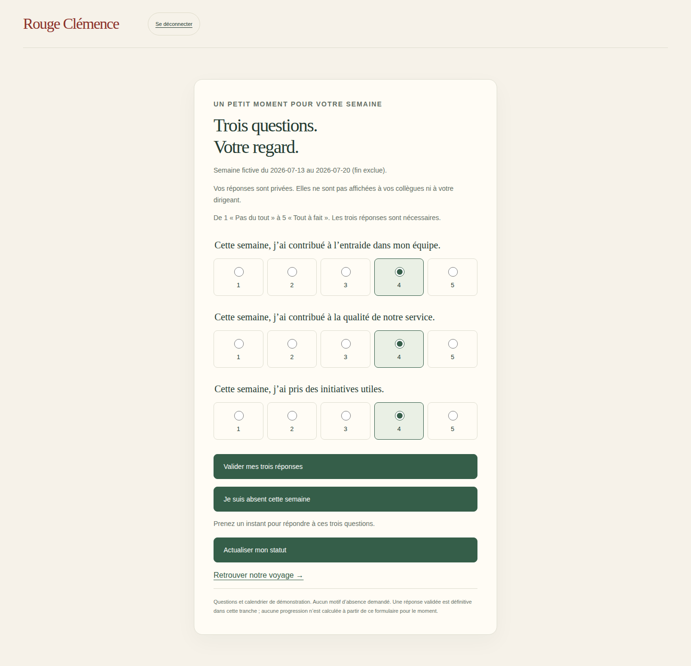
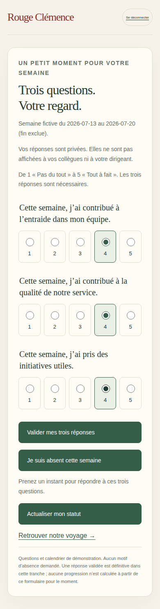

# V3-D7 — Collecte privée des trois réponses hebdomadaires

## Périmètre de cette tranche

Suite de `292b50e`, branche `work/v2-phase1-engine`, PR #1. CDC V3 §§3.3, 4.2–4.4, 6. Collecte personnelle, absence sans motif, éligibilité figée et séparation des données. Cette tranche ne clôture pas les réponses vers le moteur : le socle de démonstration utilise des KPI et réponses synthétiques. L’ouverture d’un questionnaire désactive donc la simulation de progression pour cette campagne. Aucun changement du moteur pur ni conversion silencieuse de sa configuration KPI en mode autonome.

## Fonctionnement

- L’administration fictive ouvre la prochaine semaine active éligible non clôturée. La liste des membres actifs affectés à l’équipe est figée en transaction. Dans cette fixture, les comptes administratifs affectés à l’équipe sont aussi participants. Une arrivée après ouverture est inéligible pour ce questionnaire et sera considérée à une prochaine ouverture ; un compte retiré perd son accès. Règle d’éligibilité de démonstration à contractualiser avant usage réel.
- Trois questions positives fictives (entraide, qualité de service, initiatives), réponses entières 1–5. Aucune mention de dossier, client ou collègue identifiable. Un triplet validé est définitif dans cette tranche ; un réessai identique est accepté sans doublon. Une réponse différente ou pour une semaine périmée est refusée.
- Absence personnelle sans motif, annulable avant réponse. Une personne absente ne peut pas répondre tant qu’elle n’a pas annulé son absence. Le futur calcul devra exclure ces absences du dénominateur ; aucun taux n’est calculé ni publié ici.
- Les API ne retournent que le statut et les réponses du demandeur. Aucun effectif, compteur de réponses, liste nominative ou réponse d’un collègue, même pour l’administrateur. Les documents privés restent inaccessibles aux SDK clients selon les règles Firestore existantes.
- L’ouverture enregistre `collectionMode` dans la campagne. L’API de simulation synthétique la refuse ensuite ; le bouton est masqué au prochain chargement. Les autres écritures de progression préservent ce marqueur.

## Fichiers

`src/server/weekly-questionnaire.mjs` (transactions et DTO personnel), `src/server/firebase-http.mjs` (routes strictes avec session/CSRF), `src/server/firebase-emulator.mjs` (blocage de simulation et conservation des métadonnées), `src/web/weekly-questionnaire.ts`, `web/semaine.html`, navigation, CSS et tests ciblés.

## Limites / prochaine tranche

Émulateurs et données fictives uniquement. Dates affichées = calendrier simulé, pas semaine réelle du jour ; aucune échéance automatique ni notification. Pas encore de report, joker, correction motivée d’une réponse, relecture opérationnelle, politique de rétention des réponses ou clôture du questionnaire. Limite de démonstration : au plus 100 membres actifs dans le tenant lors de l’ouverture. Les membres partis après ouverture restent dans le snapshot ; la règle de traitement à la clôture reste à valider. Aucun engagement sur une réponse en moins de 45 secondes : parcours à mesurer avec des utilisateurs.

Prochain incrément : clôture transactionnelle dans un mode explicitement configuré, effectif présent, absence totale, non-réponse, régularité, seuil de confidentialité, report/joker et événements idempotents. Avant ce raccordement, aucun kilomètre ni cadeau n’est calculé à partir des réponses saisies. Le voyage conserve ses distances fictives déjà acquises.

## Vérifications

Commit fonctionnel testé : `452fec8a33c6416ea13973249927f7a61d8c333a`.

- Local : `npm run typecheck`, `npm run build:web`, `npm run test:visual` (16/16), `npm run test:events` (12/12), `PATH=/tmp/rc-java21/bin:$PATH npm run test:firebase` (11/11) et `git diff --check` réussis.
- [CI Firebase 40528572717](https://github.com/gkerckhofs-a11y/le_voyage/actions/runs/40528572717) : `npm run test:firebase:web`, 11 tests serveur, 9 parcours navigateur réussis, 1 ignoré, sans retry. Le nouveau scénario est exécuté en dernier dans le projet mobile : ouverture administrative, absence/annulation, trois réponses, réponse réseau perdue, relecture/refresh et bouton de simulation masqué. Son exécution séparée dans le projet desktop est ignorée pour ne pas bloquer la campagne partagée avant les autres parcours de simulation.
- Le même scénario mobile produit une capture en 390×844 et une seconde après redimensionnement en 1440×900. Cette seconde capture prouve le rendu desktop, pas un parcours desktop indépendant. Artefact `firebase-login-evidence`, captures inspectées : trois groupes de choix et boutons lisibles, aucun débordement visible, défilement nécessaire.
- [CI cartes](https://github.com/gkerckhofs-a11y/le_voyage/actions/runs/40528572756), [accès](https://github.com/gkerckhofs-a11y/le_voyage/actions/runs/40528572535) et [moteur](https://github.com/gkerckhofs-a11y/le_voyage/actions/runs/40528572797) réussies sur ce commit.

Pas de régression détectée dans cette couverture. Pas de test humain du temps de réponse, ni de validation de clôture autonome, de calcul sur les nouvelles réponses ou de certification d’accessibilité. Prévisualisation locale Firebase non revendiquée comme validée ; navigateur exécuté en CI. Aucun déploiement production.

