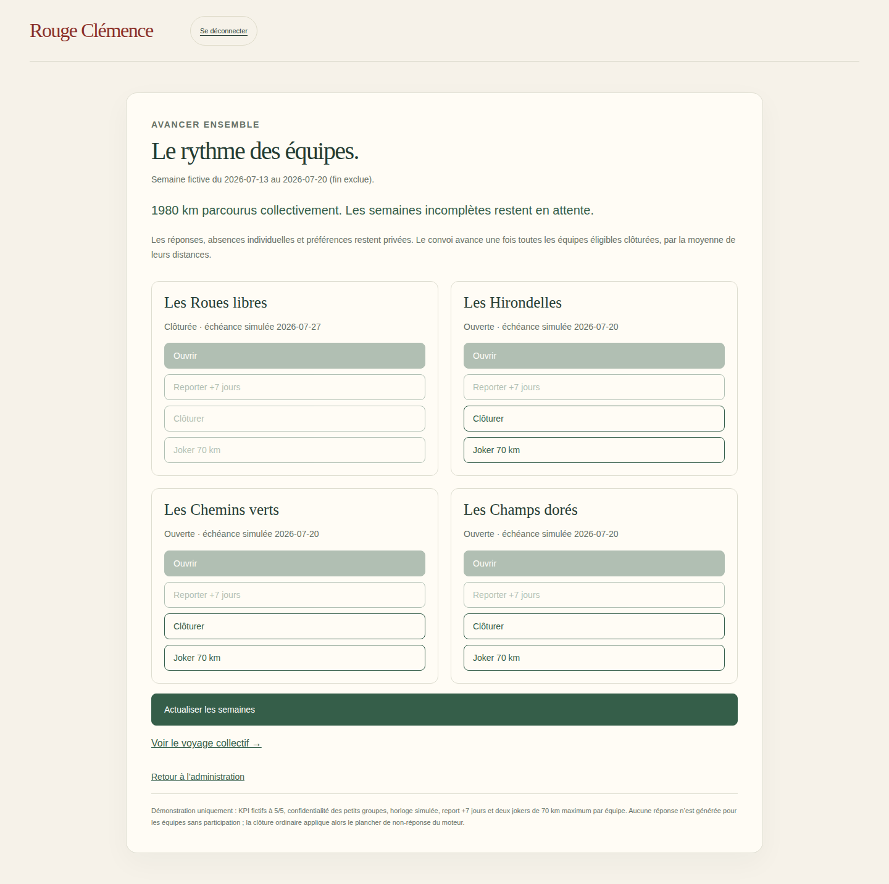
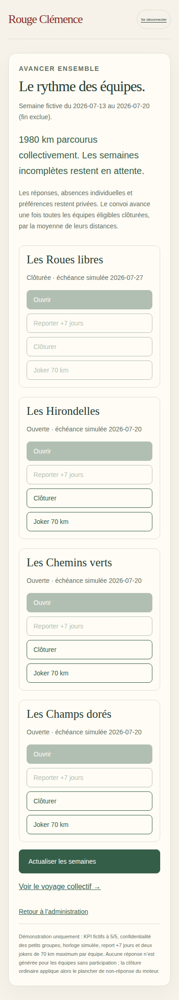

# V3-D9 — Coordination des semaines multiéquipes

## Périmètre

Suite de `255b75c`, branche `work/v2-phase1-engine`, PR #1. Pilotage administratif des semaines des équipes autorisées, sans réponses individuelles, effectifs ni classement. Le moteur pur est inchangé. Les scénarios autonome/TPE explicitement configurés restent la prochaine tranche.

## Réalisation

- `src/server/coordination-access.mjs` : capacité dédiée `canCoordinateWeeks` et liste privée `coordinatedAssignments` par campagne/équipe. Cette autorisation n’est pas ajoutée aux appartenances de participation. UID, tenant et appartenance active restent vérifiés ; la capacité est relue dans la transaction.
- `src/server/week-coordination.mjs` : prochaine semaine active encore incomplète pour le convoi ; équipes autorisées et états à ouvrir/ouverte/clôturée, échéance, actions permises et distance collective. Projection explicite sans réponses, identités des membres, absences, compteurs de participation ou kilomètres individuels des équipes. Les résultats personnels du service de questionnaire ne sont pas retransmis.
- `src/server/weekly-questionnaire.mjs` : voie de coordination restreinte aux commandes d’ouverture/report/clôture depuis le service administratif, avec droits vérifiés avant et pendant la transaction. Une ouverture périmée est refusée pour éviter d’ouvrir silencieusement une semaine suivante après un retry.
- `src/server/firebase-http.mjs` : routes avec session, origine, CSRF et corps stricts ; tenant/campagne fixés par la session. L’administration fictive dispose des quatre affectations de coordination, tout en restant participante uniquement de son équipe initiale. Trois comptes Auth Emulator supplémentaires représentent chacun une autre équipe ; aucune réponse n’est générée pour eux.
- `src/server/demo-service.mjs`, `src/server/firebase-emulator.mjs` : noms/couleurs fictifs propres aux cartes de ces comptes. Un collaborateur conserve une seule voiture, son équipe seule et son questionnaire.
- `web/coordination.html`, `src/web/coordination.ts` : états, ouverture, report, clôture, joker et actualisation après commande ou réponse perdue. Aucune clôture collective en bloc, aucun classement. Accès au collectif inchangé.
- `web/connexion.html` : trois accès supplémentaires dans une section de démonstration repliable, Les Hirondelles / Les Chemins verts / Les Champs dorés. Ces identités sont fictives, pas des comptes salariés réels.

## Convoi et confidentialité

Pour 85, 70, 40 et 85 km, la moyenne est `(85 + 70 + 40 + 85) / 4 = 70 km`. Les trois premières clôtures ne créent aucun nouveau kilomètre collectif. La quatrième clôture et ses réessais produisent un seul événement de convoi. Les scores humains restent neutralisés dans les petits groupes selon la configuration précédente ; les deux KPI à 5/5 restent fictifs et annoncés.

L’administrateur n’est pas inscrit dans les autres rosters du fait de sa capacité de coordination. Les membres ordinaires ne peuvent pas accéder à la coordination. Le sélecteur de comptes est une commodité de démonstration, pas une authentification destinée à des salariés réels.

## Limites et suite

Émulateurs uniquement. Repartir de données vierges pour charger les nouvelles permissions et les trois nouveaux comptes. Le mode reste KPI fictif et l’horloge reste simulée. Un report devient indisponible si la date logique de la campagne a déjà dépassé sa fenêtre initiale ; pas de retour en arrière silencieux. Limite de 100 membres actifs à l’ouverture conservée.

Pas encore de cockpit multi-clients, de mode autonome configuré dans cette interface, de campagne TPE d’accueil complète, de clôture planifiée ni de KPI réel. Prochain incrément : scénarios autonome et TPE explicites avec régularité configurée, puis cockpit cadeaux. Aucun déploiement production.

## Vérifications

Commit fonctionnel testé : `3c86bca4f71875cb2f70b933a86dc28a8d396304`.

- Local : `npm run typecheck`, `npm run build:web`, `npm run test:visual` (16/16), `npm run test:events` (12/12), `PATH=/tmp/rc-java21/bin:$PATH npm run test:firebase` (17/17), `git diff --check` réussis.
- [CI Firebase 40532415760](https://github.com/gkerckhofs-a11y/le_voyage/actions/runs/40532415760) : `npm run test:firebase:web`, 17 tests serveur et 10 parcours navigateur réussis, 2 ignorés, sans retry. Scénario de coordination mobile : trois ouvertures, connexion des Hirondelles avec sa seule voiture, réponse personnelle, coordination refusée au membre, trois clôtures complémentaires dont joker et non-réponse, dernière réponse réseau perdue puis relecture, gain collectif unique de 70 km et retour au véhicule collectif.
- Tests serveur : quatre progressions et un seul événement convoi, aucune progression collective avant la quatrième clôture, admin absent des rosters des autres équipes, aucune donnée individuelle dans la projection, droits retirés, périmètre réduit et ouverture périmée refusée.
- [CI cartes](https://github.com/gkerckhofs-a11y/le_voyage/actions/runs/40532415763), [accès](https://github.com/gkerckhofs-a11y/le_voyage/actions/runs/40532415873) et [moteur](https://github.com/gkerckhofs-a11y/le_voyage/actions/runs/40532415626) réussies sur ce commit.

Captures réelles de l’artefact `firebase-login-evidence`, inspectées : quatre cartes administratives, états et actions lisibles, aucune réponse ni distance par équipe ; aucun débordement visible. Mobile 390×844 puis redimensionnement à 1440×900 pour la capture desktop, pleine page. Les deux scénarios de clôture/coordination s’exécutent en fin de projet mobile, sur la campagne partagée ; leurs exécutions desktop séparées sont ignorées. Les captures desktop ne constituent donc pas des parcours desktop indépendants. Le scénario de coordination dépend de la clôture de l’équipe initiale réalisée par le scénario précédent.

Pas de régression détectée dans cette couverture ; aucune certification d’accessibilité ni de charge. Prévisualisation locale Firebase non revendiquée comme validée ; navigateur exécuté en CI. Aucun déploiement production.

