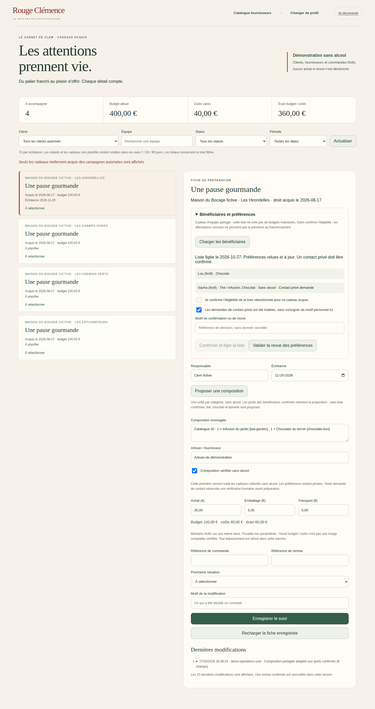
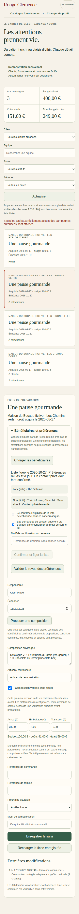

# V3-E3 — Bénéficiaires confirmés et préférences privées

## Reprise et périmètre

Départ réel `95baf9f`, branche `work/v2-phase1-engine`, PR #1. Suite des §§7.2–7.3 du cahier des charges V3 : rattacher les préférences existantes aux cadeaux acquis. Le modèle actuel porte un budget **total d’équipe**, pas des droits individuels ; cette tranche adapte la composition du cadeau partagé. Elle ne transforme pas silencieusement ce budget en budgets par personne.

## Éligibilité : décision explicite, pas reconstitution

Le moteur existant ne conserve pas de liste nominative au moment d’un franchissement. Le cockpit présente donc les affectations connues de la bonne équipe et campagne, sans les déclarer automatiquement éligibles à une date passée. Une affectation inactive est signalée ; aucun motif de départ ou d’absence n’est lu. Les membres explicitement non participants sont exclus des candidats.

Au statut « à sélectionner », Clem sélectionne les personnes, atteste leur éligibilité au cadeau acquis et inscrit un motif administratif sans information personnelle sensible. La confirmation fige uniquement UID et nom affiché avec l’auteur, la date et la source `manual-confirmation`. Elle ne modifie ni les kilomètres, ni le droit acquis, ni le budget. Une liste déjà confirmée est immuable dans cette tranche. Sa correction nécessitera une procédure explicite ultérieure, jamais un effacement silencieux.

La règle d’éligibilité contractuelle annuelle reste à définir dans l’onboarding. L’attestation de démonstration ne remplace pas cette validation. Aucun effet rétroactif des entrées/sorties sur une liste figée.

## Lecture opérationnelle minimale

Après confirmation seulement, les opérateurs autorisés sur la campagne peuvent consulter les choix, le sans-alcool, « surprenez-moi », la demande de contact privé et la révision courante des préférences. Aucun anniversaire, réponse humaine, motif médical, adresse ou donnée d’une autre entreprise n’est transmis. Le catalogue et les écrans hiérarchiques/collaborateurs ne reçoivent pas ces listes.

Les préférences ne sont pas copiées dans la liste figée : elles sont relues. La revue de Clem conserve une empreinte, les numéros de révision, un motif, l’auteur et la date, pas un historique des anciens goûts. Une modification ultérieure invalide la revue. Une demande de contact exige une confirmation humaine ; aucun message n’est envoyé et aucun contenu de conversation privée n’est enregistré.

## Préparation et composition partagée

- La proposition d’un cadeau avec liste figée exige une revue à jour. Les catégories compatibles sans alcool sont ordonnées par nombre de choix puis ordre stable thé/chocolat/épicerie ; une unité par catégorie, sous le budget total existant et les contraintes catalogue E2.
- Sans choix renseigné ou avec « surprenez-moi », le trio neutre est proposé explicitement. Des choix exclusivement vin/bière ne sont pas remplacés silencieusement : proposition refusée, adaptation manuelle nécessaire dans cette démo sans alcool.
- La reprise reste un brouillon à relire. Les restrictions et allergies ne sont pas inférées à partir des catégories. La revue humaine reste nécessaire.
- Dès qu’une liste est figée, toute sauvegarde vers les états de préparation, commande et remise exige une revue toujours à jour, vérifiée dans la transaction. Les brouillons et incidents restent enregistrables. Une demande privée non traitée bloque la progression du suivi.
- Les cadeaux partagés sans liste confirmée gardent le flux E1/E2. Les cadeaux déjà remis restent verrouillés ; de nouveaux goûts n’en réécrivent pas le contenu.

## Démonstration

Ajout de quatre membres **fictifs** seulement dans Maison du Bocage : Sacha/Lou chez Les Hirondelles, Noa/Alex chez Les Chemins verts. Aucune ancienne campagne ou préférence écrasée. Sacha et Noa ont chacun un bouton de connexion vers leur profil privé ; Lou et Alex sont des références de démonstration pour la composition. Cette création actuelle ne prétend pas documenter leur présence historique au franchissement.

En staging, Les Hirondelles permettent l’essai sur un cadeau non remis. Les listes et préférences sont partagées entre testeurs utilisant ces profils fictifs.

## Contrôles et limites

Autorisation opérateur et campagne relues dans chaque transaction ; droit acquis vérifié ; candidat d’une autre équipe refusé ; liste plafonnée à 50 personnes, lecture des membres plafonnée à 100 par client ; audit de confirmation/revue atomique ; mutation idempotente, refus de révision ou empreinte périmée. Aucun anniversaire ou ancien goût dans l’audit. Limite de 1 000 revues par liste.

## Vérification

- `firebase emulators:exec --project demo-rc-voyage --config firebase/emulators.json --only auth,firestore 'node --test tests/firebase/gift-beneficiaries.test.mjs'` : 4/4 réussis. Le premier passage ciblé, incluant suivi et catalogue, avait 9/9 succès ; après ajustement des fixtures, les quatre nouveaux tests ont été rejoués.
- `npm run typecheck`, `npm run build:web`, `npm run test:visual` : réussis, 16 tests de géométrie/projection.
- Code fonctionnel `755587b`, correction de recette `80d7325`. Le premier passage CI avait 30/30 tests serveur et 16/18 parcours navigateur réussis, avec deux anciens scénarios ignorés. Les deux échecs concernaient l’ancienne assertion catalogue « infusion en premier » ; la personnalisation classe désormais le chocolat en premier selon les choix. L’assertion corrigée vérifie le préfixe et la présence des deux produits sans imposer l’ordre générique. Le classement déterministe est testé côté serveur.
- Captures ci-dessous issues des nouveaux scénarios réussis du premier passage (desktop 1440×900, mobile 390×844), inspectées visuellement. Le panneau privé, la revue après changement et les champs de préparation sont lisibles. Limite ergonomique : le rappel de contact reste affiché après sa confirmation ; la revue à jour et la case cochée indiquent le traitement.

[CI finale Firebase](https://github.com/gkerckhofs-a11y/le_voyage/actions/runs/40562092531) sur `80d7325` : **30/30 tests serveur et 18/18 parcours navigateur réussis**, 2 anciens scénarios desktop ignorés. Commande `npm run test:firebase:web`. CI moteur, frontière d’accès et cartes également vertes. Aucun changement du moteur dans cette tranche.

## Serveur de test

Image fonctionnelle `755587b`, [Cloud Build réussi](https://console.cloud.google.com/cloud-build/builds;region=europe-west1/3338a9f6-4333-42d5-bc4c-5cbbe0518eb2?project=632904531433), digest `sha256:766a3e7e92f31803ccfeeb0e88b8b8d6debc9ff0dc9504cf720936e56b773ec8`. La correction suivante `80d7325` ne modifie que le test navigateur catalogue.

Révision prête `voyage-test-00008-fbz` dans le seul projet `rc-voyage-test-20261027`, accès Google conservé. `/test-access` répond 200 ; sans session, GET `/api/gifts/ops` et POST `/api/gifts/beneficiaries/read` répondent 401. Les quatre profils de préférences fictifs sont vérifiés côté administration, sans lecture publique ni modification des préférences existantes. Aucun achat, envoi ou réinitialisation des cadeaux.

[Accès au test](https://rc-voyage-test-20261027.web.app/test-access). Choisir « Cockpit Clem · démo », Les Hirondelles, puis « Bénéficiaires et préférences ». Les parcours métier détaillés ont été exécutés sur émulateurs en CI ; aucune connexion Google personnelle ni recette métier Cloud authentifiée n’est revendiquée dans cette tranche. Fichiers principaux : `gift-beneficiaries.mjs`, `beneficiary-data.mjs`, raccordements `gift-operations.mjs`/`supplier-catalog.mjs`/HTTP, panneau cockpit et fixtures fictives.

Restent : droits et budgets individuels configurés annuellement, correction contrôlée d’une liste, conservation/suppression, calendrier/export, cadeaux datés/surprises, prévisions, budgets engagé/payé et réception. Cette tranche ne clôture pas la phase cockpit P0 et n’apporte aucune garantie juridique ou d’absence d’allergène. Production et main inchangés.
