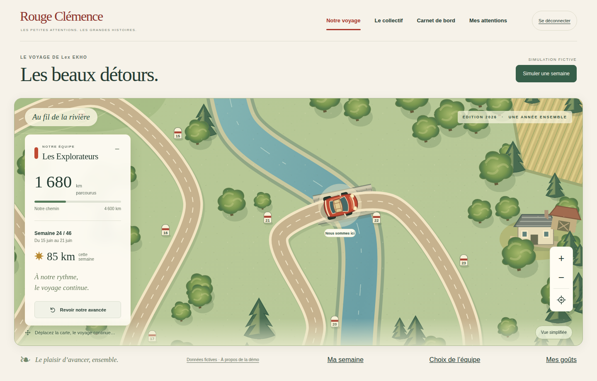
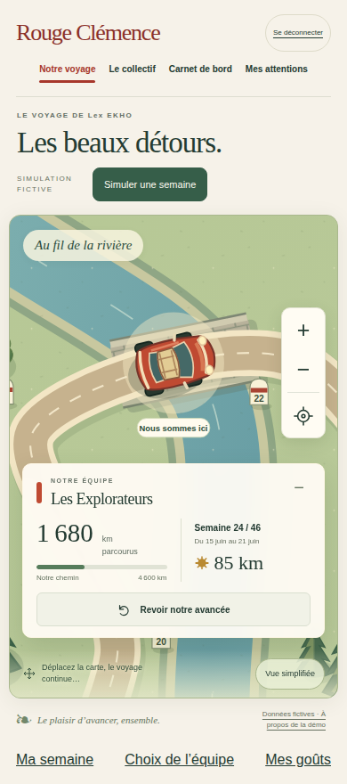
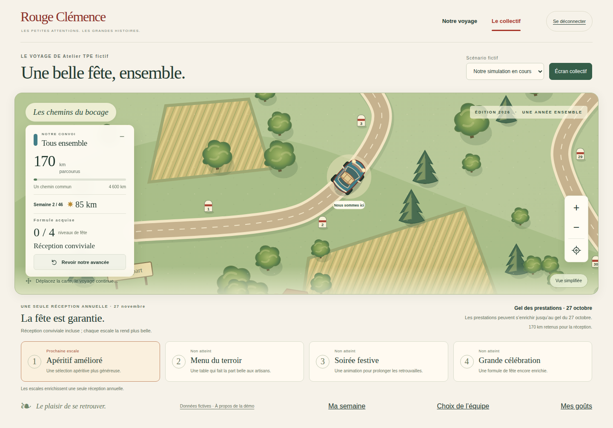
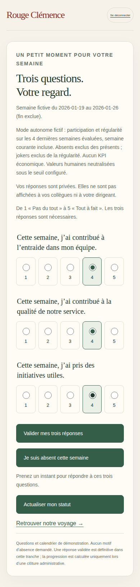

# Préproduction — raccordement Cloud du 27 octobre 2026

## Périmètre autorisé

Accord explicite de l’utilisateur pour Blaze et les services du serveur du projet de test. Projet unique autorisé : `rc-voyage-test-20261027` (`632904531433`). Le compte de facturation déjà associé au Voyage a été réutilisé sans exposer son identifiant. Production `le-voyage-f0ae3` et main inchangés.

## Réalisation

- Auth/Firestore réels dans le projet de test, données exclusivement fictives ; intégration des services existants, sans réécriture du moteur.
- `firestore-adapter.mjs` extrait les transactions existantes ; `firebase-emulator.mjs` conserve son refus de tout contexte non local.
- `staging-config.mjs` impose l’ID du projet de test, refuse les variables d’émulateur, valide les origines HTTPS et les secrets. `test-environment.mjs` vérifie que les services utilisent réellement un adaptateur Auth/Firestore du projet attendu.
- `serve-staging.mjs` initialise les comptes et campagnes fictifs s’ils n’existent pas. Aucun écrasement de campagnes existantes. Compte de service runtime dédié : droits Firestore et Auth dans ce projet uniquement, accès aux deux secrets nécessaires.
- Toutes les pages et API sont protégées par une authentification HTTP Basic de test, identifiant `voyage`. Le mot de passe est dans Secret Manager, jamais dans Git ou les logs. Une fois ce contrôle passé, le sélecteur permet de jouer les différents profils fictifs, y compris administrateur ; ce n’est pas un modèle d’accès pour des clients réels.
- Sessions applicatives opaques en mémoire, 55 minutes, cookie `__session` HttpOnly/Secure/SameSite=Strict pour traverser Firebase Hosting, CSRF et origines autorisées. Une nouvelle instance ou un redéploiement impose une reconnexion ; données métiers persistantes dans Firestore. Ce pilote n’offre pas de sessions distribuées.
- Cloud Run `voyage-test`, région `europe-west1`, minimum zéro, maximum une instance par révision, CPU 1, mémoire 512 Mio, concurrence 20. L’endpoint Run autorise l’invocation publique au niveau IAM mais refuse toutes les requêtes sans le contrôle applicatif de test. Aucun émulateur exposé sur Internet.
- Hosting ne sert aucun fichier directement : toutes les routes passent par le serveur protégé. Configuration `firebase/staging-hosting.json` explicitement limitée au site de test.
- Images construites par Cloud Build, stockées dans Artifact Registry, runtime référencé par digest. Compte de construction distinct ; source dans un bucket privé avec suppression automatique après sept jours.

## Vérifications et incidents

- Typecheck et build web locaux réussis.
- 21 tests d’intégration serveur sur émulateurs réussis, dont le cookie Hosting ; 10 tests de contrôle d’accès réussis ; 16 tests de géométrie/projections réussis avant les corrections de raccordement.
- Première révision Cloud non démarrée : plusieurs services refusaient encore les adaptateurs hors émulateurs. Correction explicite de la frontière test/production et revalidation locale. Aucun retrait silencieux des gardes de production.
- Première tentative de publication Hosting échouée pendant que le serveur n’était pas prêt. Publication Hosting ensuite réussie : version `1807d6a3fd8a1f9d`. Le premier POST en ligne a été refusé car le nom d’hôte du relais Cloud Run n’était pas dans la liste autorisée ; ajout de l’URI réellement retournée par Cloud Run, sans élargir aux autres domaines.
- Le téléchargement Chromium local a échoué ; la recette navigateur distante est prévue dans Cloud Build avec un secret injecté, sans traces contenant des identifiants.

## Limites du test

Données partagées entre testeurs utilisant un même profil. Ne saisir aucune donnée personnelle réelle. Les préférences et les semaines de test modifient les fixtures persistantes ; aucune remise à zéro automatique. Pas de cockpit cadeaux, pas d’éditeur annuel complet, pas d’invitations par email ni de réception réellement réservée. La connexion de test ne constitue pas l’authentification finale des entreprises.

Blaze peut entraîner des frais : maximum une instance ne constitue pas un plafond financier. Aucun budget avec notifications email n’a été configuré. Les comptes de service ne possèdent aucune clé privée téléchargée.

## Exploitation et retour arrière

Consulter les logs Cloud Run et les builds du projet de test ; ne pas journaliser corps de requête, cookies ou secrets. Pour retirer l’accès, révoquer l’invocation publique du service ou remplacer la version du secret d’accès et déployer une révision qui la référence. Pour revenir à une version antérieure, réaffecter le trafic Cloud Run à sa révision validée ; les écritures Firestore de test ne sont pas annulées par ce retour arrière. Aucun rollback de production.

Sources : code et tests de cette branche ; opérations Google Cloud du projet de test ; documentation Firebase Hosting/Cloud Run consultée le 27 octobre 2026 : https://firebase.google.com/docs/hosting/cloud-run et https://firebase.google.com/docs/hosting/manage-cache (cookie `__session`).

## Version en ligne et preuves finales

- Application : https://rc-voyage-test-20261027.web.app/connexion.html
- Code fonctionnel : `01d5d15dfe5fa2ee5b7644ba08792091daf3b3cd` ; correctif du script de recette uniquement : `428884bf2ffbb3f27796ceaef48fb450b018090a`.
- Cloud Run prêt : `voyage-test-00003-25z`, image `sha256:481c4b9fd6003ad3c2bf17282d1a4fc5c54181b9b78b5ce8216019366bdd49ac`, URI réelle `https://voyage-test-ymnttqqa3q-ew.a.run.app` ajoutée aux origines autorisées avec les deux domaines Hosting du projet de test.
- [Construction du conteneur réussie](https://console.cloud.google.com/cloud-build/builds;region=europe-west1/9d52ab01-bd08-4e5d-ba48-06f7344c641c?project=632904531433).
- [CI Firebase du code déployé](https://github.com/gkerckhofs-a11y/le_voyage/actions/runs/40539943677) : 21 tests serveur et 12 parcours navigateur réussis, 2 anciens scénarios desktop ignorés. CI [accès](https://github.com/gkerckhofs-a11y/le_voyage/actions/runs/40539943685), [cartes](https://github.com/gkerckhofs-a11y/le_voyage/actions/runs/40539943732) et [moteur](https://github.com/gkerckhofs-a11y/le_voyage/actions/runs/40539943692) réussies.
- [Recette sur le site Cloud réel réussie](https://console.cloud.google.com/cloud-build/builds;region=europe-west1/334cd8d2-ecf4-41e5-9aad-b301cbb67aab?project=632904531433) : `node scripts/smoke-staging.mjs`, Playwright 1.64.1, desktop 1440×900 et mobile 390×844. Connexion et refresh, préférences sans alcool persistantes, séparation Lex EKHO/Atelier, ouverture/réponse/clôture TPE avec +85 km, une voiture par carte, collectif et déconnexion. Les deux parcours passent sans retry dans cette exécution.
- Première recette Cloud : desktop réussi, mobile arrêté sur une course du script entre visibilité du formulaire et état de la préférence déjà enregistrée. Attente explicite du chargement ajoutée ; deuxième recette complète réussie. Aucun changement métier pour masquer le résultat.
- Contrôles HTTP directs en ligne : sans mot de passe 401 ; avec mot de passe page 200 ; login/session/équipe 200 ; requête ajoutant un tenant en paramètre 400 ; CSRF incorrect 403 ; logout 200, lecture après logout 401. Vérification des clés privées connues absentes du flux équipe.
- Six captures pleine page produites par la recette Cloud et conservées dans `docs/evidence/staging-*`. Inspection des cartes desktop/mobile, du collectif desktop et du formulaire mobile : aucun blocage visuel constaté. Cela ne certifie pas toute l’accessibilité ni la conformité finale au moodboard.

## Accès et scénario conseillé à Guilz

1. Ouvrir le lien ci-dessus. Identifiant HTTP : `voyage`. Mot de passe : secret `test-access`, version 1, dans le projet de test. Le compte Google qui a créé le projet dispose explicitement du droit de lecture de ce seul secret d’accès ; aucun secret affiché dans les logs ou ce dépôt.
2. Choisir **Explorer Lex EKHO** : carte, zoom, déplacement, historique, collectif et simulation. Ouvrir **Mes goûts** pour les préférences ; ne saisir que des données fictives.
3. Pour la collecte réelle de la démonstration, choisir **TPE autonome fictive → Administrer la TPE**, ouvrir la prochaine semaine ; revenir à la connexion, choisir **Participer à la TPE → Ma semaine**, répondre ; revenir à l’administration et clôturer. Le collectif suit la même progression que l’unique équipe.
4. Les fixtures gardent les actions de recette : la TPE a parcouru trois semaines (255 km), et le profil Lex EKHO a la préférence sans alcool activée. Ce ne sont pas des données d’entreprise. Ne pas attendre un départ vierge après rafraîchissement.
5. Après 55 minutes ou un redémarrage du serveur, sélectionner à nouveau un profil. Les données métiers restent présentes. Le démarrage après inactivité peut prendre du temps.

Prochaine étape : retours de test de Guilz avant reprise du cockpit cadeaux P0. Aucun déploiement de production ni fusion de main.

