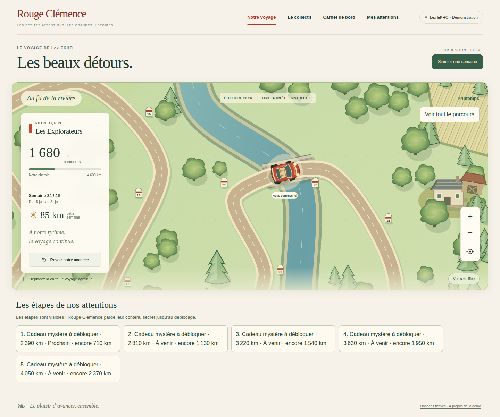
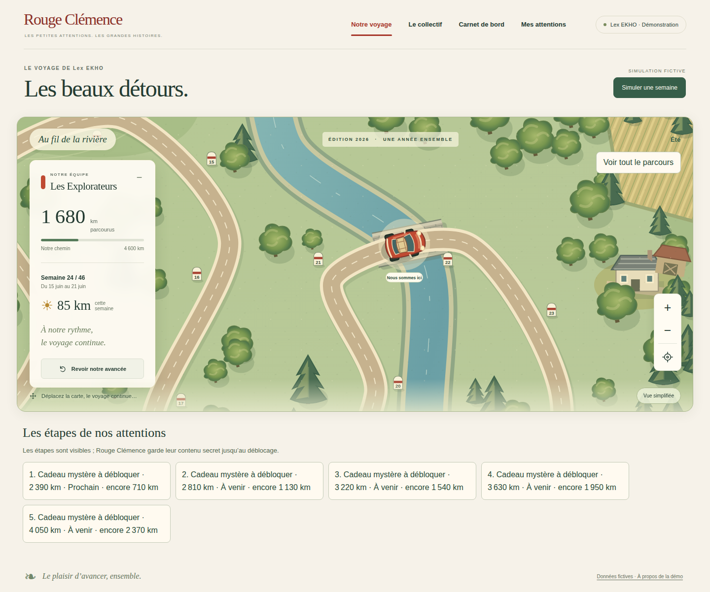
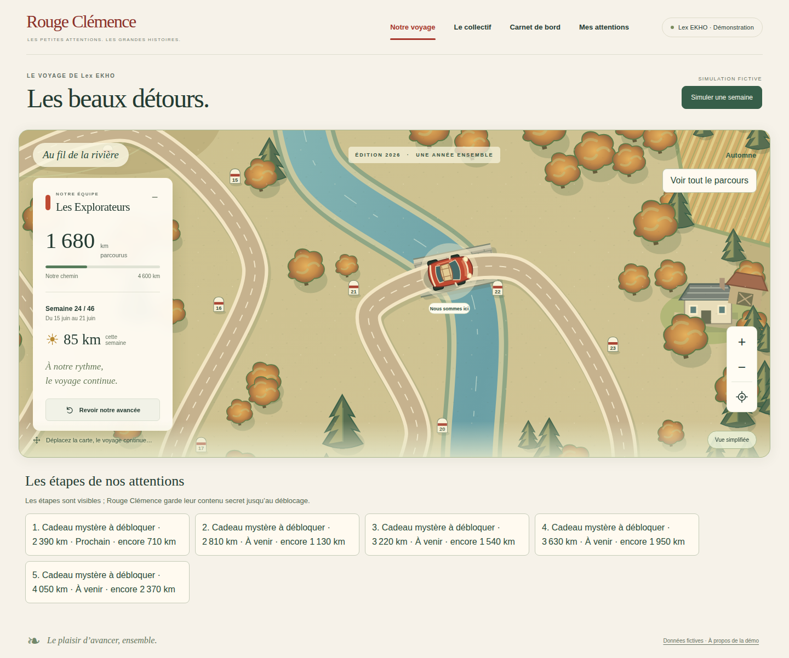
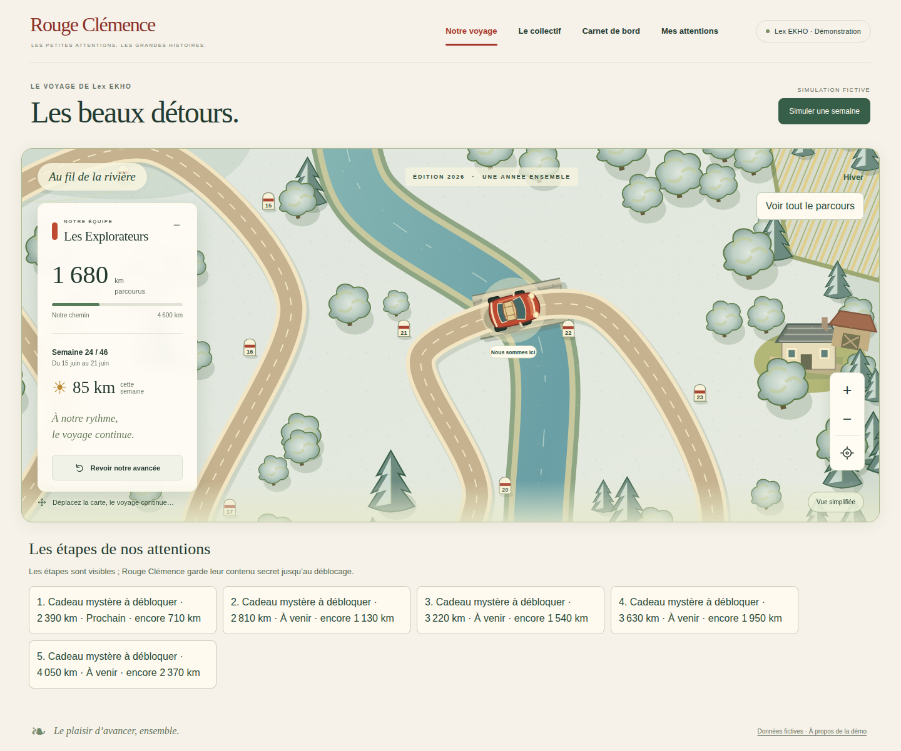
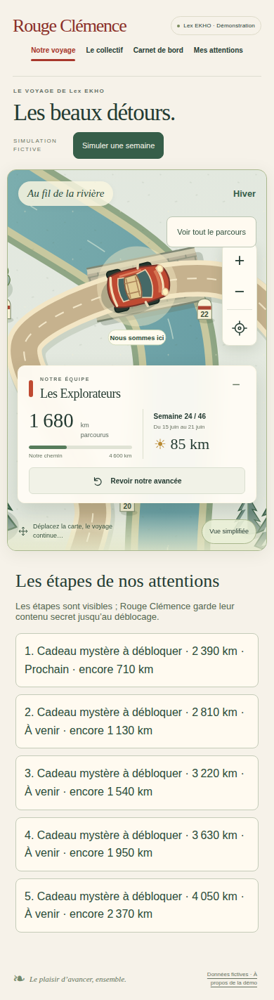
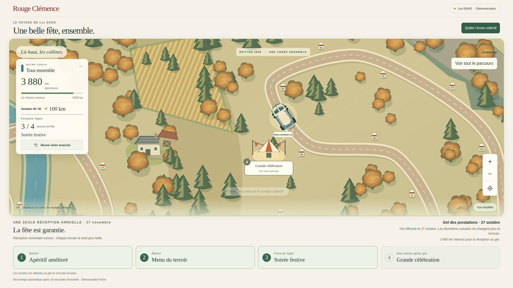

# V4-04 — Saisons du paysage

## Périmètre

Branche `work/v2-phase1-engine`, PR #1. Socle vérifié : `6eb37ac`.
Code : `04d46cc257cc7ae7f61b2dcfa0a0a5d4a44666df`.

- Les projections équipe et collectif exposent uniquement le fuseau public de la campagne (`calendar.timeZone`, Europe/Brussels par défaut).
- Le rendu commun choisit une palette selon le jour courant dans ce fuseau. Printemps : verts tendres et vergers roses ; été : verts soutenus ; automne : feuillages chauds ; hiver : végétation et terrains givrés.
- Douze variables de peinture changent sans remplacer les éléments SVG : même route, mêmes positions, mêmes 58 bornes, mêmes seuils, même caméra, même voiture/minibus. Aucun événement métier écrit.
- Actualisation à l'ouverture, toutes les 60 secondes et au retour à l'onglet. Pas d'animation saisonnière, ni image distante à télécharger ; la vue simplifiée reste disponible.
- Un libellé textuel indique la saison. Aucun changement des préférences, cadeaux, budgets ou niveaux gelés.

## Hypothèses et limites explicites

Les frontières météorologiques de l'hémisphère nord (1er mars, juin, septembre, décembre) sont une proposition de rendu pour les paysages wallons, pas une nouvelle règle métier. Elles sont centralisées dans `src/web/seasons.ts`.

L'instant est fourni par l'horloge du navigateur, converti dans le fuseau transmis par le serveur. Une horloge appareil incorrecte peut donc donner un mauvais décor ; elle n'influence aucun calcul métier. Une source horaire serveur et les snapshots saisonniers des archives restent à intégrer si requis. Aucun réglage de fuseau dans le questionnaire dirigeant n'est ajouté ici.

La densité et les positions des arbres restent déterministes : cette tranche ajoute des palettes, pas quatre illustrations entièrement distinctes. La date n'est jamais dérivée des kilomètres, de la semaine simulée, ni du mois de début.

## Vérifications locales

- `npm run typecheck` : réussi.
- `npm run build:web` : réussi, liste publique explicitement mise à jour pour `seasons.js` uniquement.
- `npm run test:visual` : 20/20 après actualisation des listes de champs publics attendus. Trois premiers échecs étaient les listes fermées attendues, désormais incluant le fuseau et le nouveau module.
- `npm run test:events` : 12/12.
- Dates couvertes : quatre frontières saisonnières, 29 février, changement d'année, même instant Bruxelles/New York, dates/fuseaux invalides.
- Test navigateur ajouté : passage réel du 29 février au 1er mars, comparaison du tracé, des paliers, de la position et de la caméra avant/après ; captures des quatre saisons aux trois dimensions desktop/mobile.

## Suite

Clôture narrative et stationnement près de la distance réellement gagnée, avec événement idempotent et variante sans mouvement. Puis calendrier glissant dans le questionnaire et archives. Aucune fusion sur main ni intervention sur le projet Firebase de production.

## CI et recette visuelle

Les quatre workflows du commit `04d46cc` ont réussi :

- [Carte, navigateur et captures](https://github.com/gkerckhofs-a11y/le_voyage/actions/runs/40575391372) : 20 tests visuels, 12 tests événements, **46 tests navigateur réussis, 2 exclus** (exclusions tactiles desktop existantes).
- [Isolation Firebase](https://github.com/gkerckhofs-a11y/le_voyage/actions/runs/40575391408).
- [Contrôle des accès](https://github.com/gkerckhofs-a11y/le_voyage/actions/runs/40575391491).
- [Moteur](https://github.com/gkerckhofs-a11y/le_voyage/actions/runs/40575391388).

Les 12 captures saisonnières sont dans l'artefact CI `12766297749` (rétention 14 jours). Sélection durable ci-dessous. Automne desktop, hiver mobile et kiosque collectif inspectés : pas de chevauchement nouveau observé ; formule collective gelée 3/4 malgré le franchissement post-gel du quatrième seuil. Pas de test manuel du compte Google personnel.

## Préproduction isolée

Cloud Build `679bc07e-f0b2-4239-b792-4aba97b55697` réussi ; image `sha256:fe7b6b01c5527ae4ed954be0c0dd21d39213643b079979e8491da07d8f0e9acc`. Révision prête `voyage-test-00011-d9b`, projet `rc-voyage-test-20261027`, accès Google conservé. Code servi : `04d46cc`. Aucun déploiement dans `le-voyage-f0ae3`, aucune migration de données.
