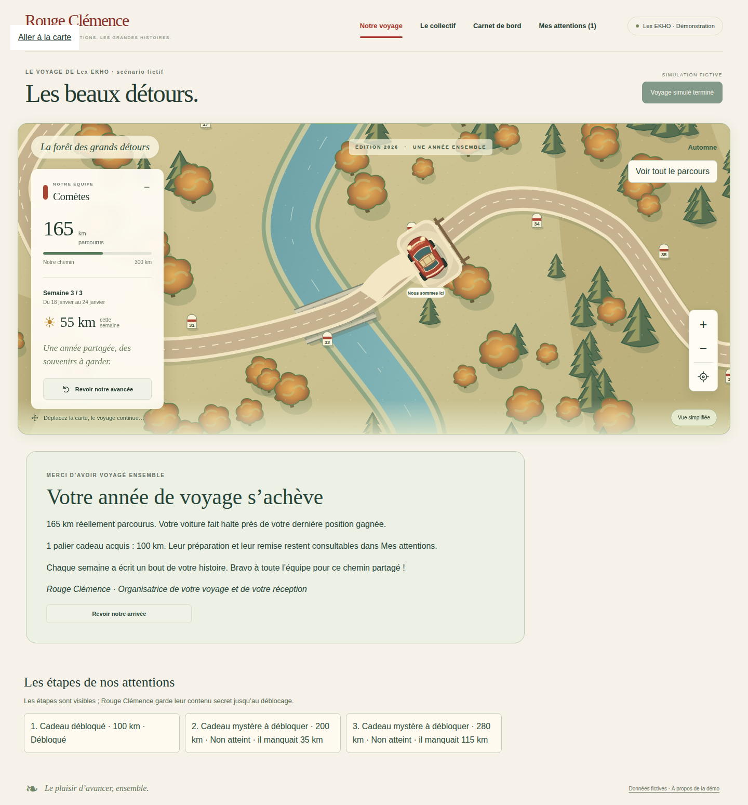
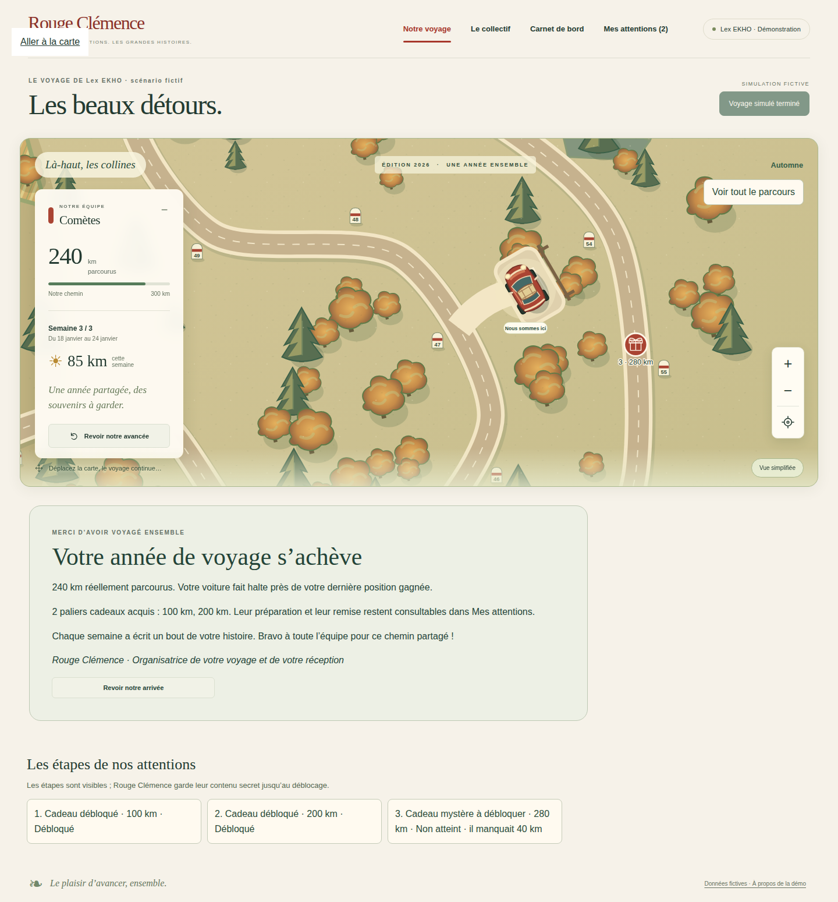
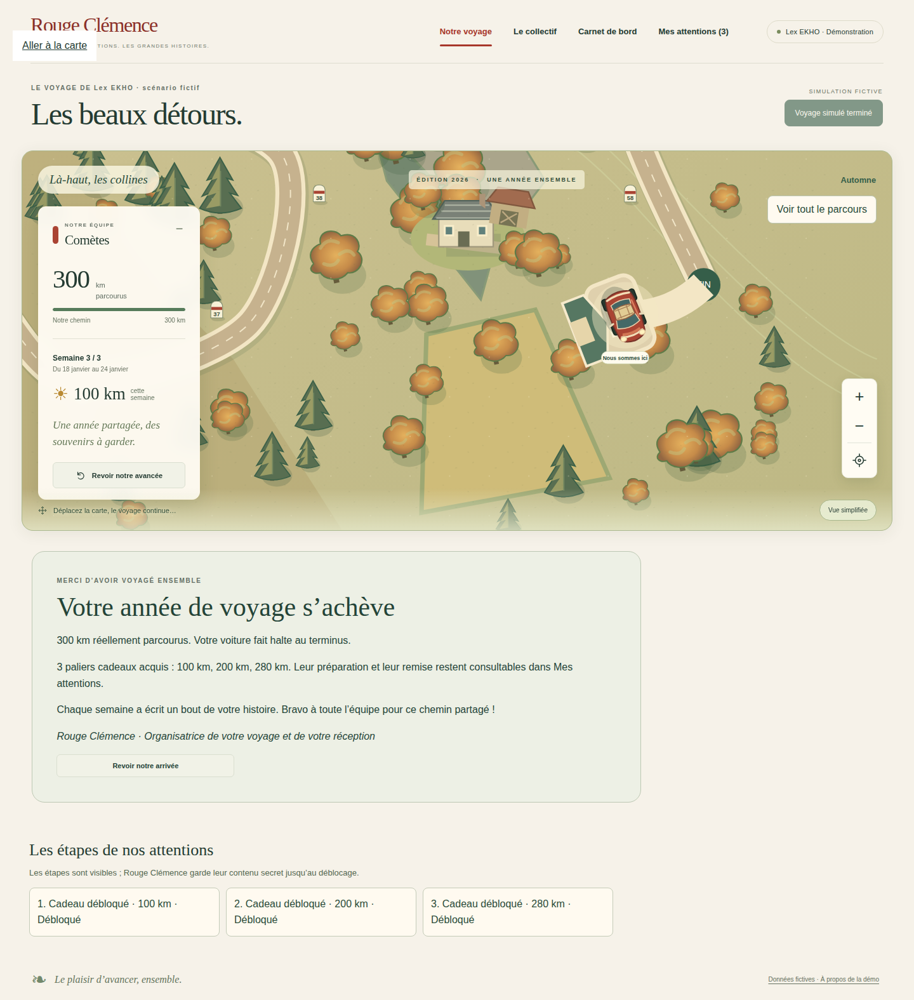
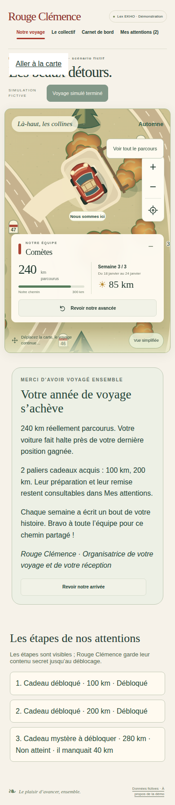

# V4-05B — Halte finale et bilan visuel d'équipe

Branche `work/v2-phase1-engine`, PR #1. Socle `024bf7d`, code initial `dbaf3dc`, correction de recette `f64d66841b842a5cb2ac87162a27b75ca9d4c09a`.

## Réalisation

- Le bilan V4-05A déclenche une halte illustrée à côté du point kilométrique réellement gagné. La route et la distance métier restent inchangées ; le décalage latéral est purement graphique (170 unités SVG).
- Une courte bifurcation ralentit la voiture vers son emplacement. Un garage est dessiné au terminus à 100 %, un banc de halte pour les parcours partiels. Une seule voiture reste présente.
- Un bilan signé Rouge Clémence affiche les kilomètres réels et les seuils cadeaux acquis. Il distingue la dernière position gagnée du terminus et renvoie aux attentions pour leur préparation/remise. Les autres paliers portent l'état « Non atteint ».
- Le bouton « Revoir notre arrivée » est volontaire. Au rafraîchissement, la voiture est déjà garée et la séquence ne se rejoue pas automatiquement. La présentation automatique suit uniquement l'événement réclamé dans la transaction finale.
- La préférence de réduction des mouvements applique directement la position finale. Navigation, exploration, vue générale et recentrage restent disponibles.
- Les attributs `data-earned-x/y` conservent le point sur la route, distinct de la pose de stationnement. Le ratio gagné ne change jamais.

## Fichiers

`src/web/parking.ts`, `journey-map.ts`, `main.ts` ; `web/index.html`, `styles.css` ; tests `visual/parking.test.mjs`, `visual/public-build.test.mjs`, `browser/arrival.spec.mjs`.

## Vérifications locales

`npm run typecheck`, `npm run build:web` : réussis. `npm run test:visual` : **21/21 réussis**. Les trois scénarios de distance sont également couverts côté serveur par V4-05A.

## Périmètre et limites

La clôture collective du minibus avec le niveau de réception gelé reste la prochaine tranche. Aucune arrivée collective nouvelle n'est revendiquée ici. Le déclenchement par seule date de clôture avec semaines encore ouvertes et le rattrapage des campagnes déjà terminées avant V4-05A restent exclus, comme documenté dans V4-05A. Il n'y a pas de migration rétroactive.

Les tests de rendu 55/80/100 utilisent des bilans calculés par le moteur dans des campagnes fictives de trois semaines, injectés au niveau HTTP pour isoler le rendu. Un test distinct parcourt réellement les 22 semaines restantes de la démo serveur, puis clôture dans l'interface et recharge la page.

Aucun test manuel du compte Google personnel, aucune commande fournisseur ou intervention sur la production.

## Correction après inspection

La première capture à 55 % plaçait la halte en partie sur la rivière. La correction partage la géométrie existante de cette rivière et choisit une orientation plus dégagée, sans déplacer la route. Le test vérifie une distance de plus de 130 unités au centre de la rivière pour les trois poses finales de recette. Ce contrôle ne constitue pas un système général de collision avec tous les éléments du paysage. Le lien « Aller à la carte » visible sur les captures vient du focus clavier après rechargement.

## Captures de recette

Les captures montrent des scénarios fictifs calculés par le moteur, pas des résultats de Lex EKHO. Le collectif n'est pas modifié dans cette tranche.

## CI finale et staging

Commit final `f64d668` : les quatre workflows ont réussi.

- [Carte et navigateur](https://github.com/gkerckhofs-a11y/le_voyage/actions/runs/40584530921) : **52 tests navigateur réussis, 2 exclusions préexistantes**, 21 tests visuels/logiques et 18 tests événements. Captures desktop 1440/1920 et mobile 390 disponibles dans l'artefact `12771855544` (14 jours). Quatre captures retenues ci-dessus dans le dépôt. Capture corrigée à 55 % inspectée : voiture hors de la rivière.
- [Firebase isolé](https://github.com/gkerckhofs-a11y/le_voyage/actions/runs/40584530676).
- [Accès serveur](https://github.com/gkerckhofs-a11y/le_voyage/actions/runs/40584531129).
- [Moteur](https://github.com/gkerckhofs-a11y/le_voyage/actions/runs/40584531039).

Cloud Build final `8bbeeab6-ffa2-45ba-bd2c-1318d38ef74a` réussi. Image `sha256:583d9b808a884f001f971db10d2782d092caebd463dcfb21d1364aec2b3f6228`, révision prête `voyage-test-00013-twb`, projet isolé `rc-voyage-test-20261027`, accès Google conservé. La révision intermédiaire de cette tranche a été remplacée par la correction. Aucune modification du projet de production `le-voyage-f0ae3`, aucune fusion main ni migration de données.
