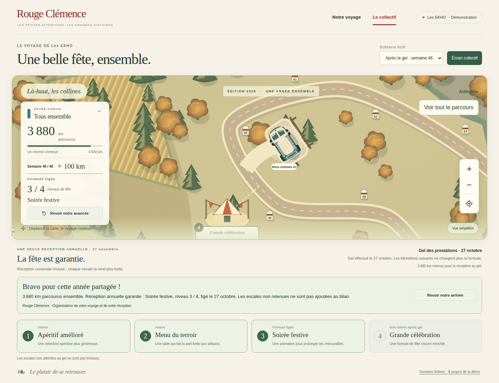
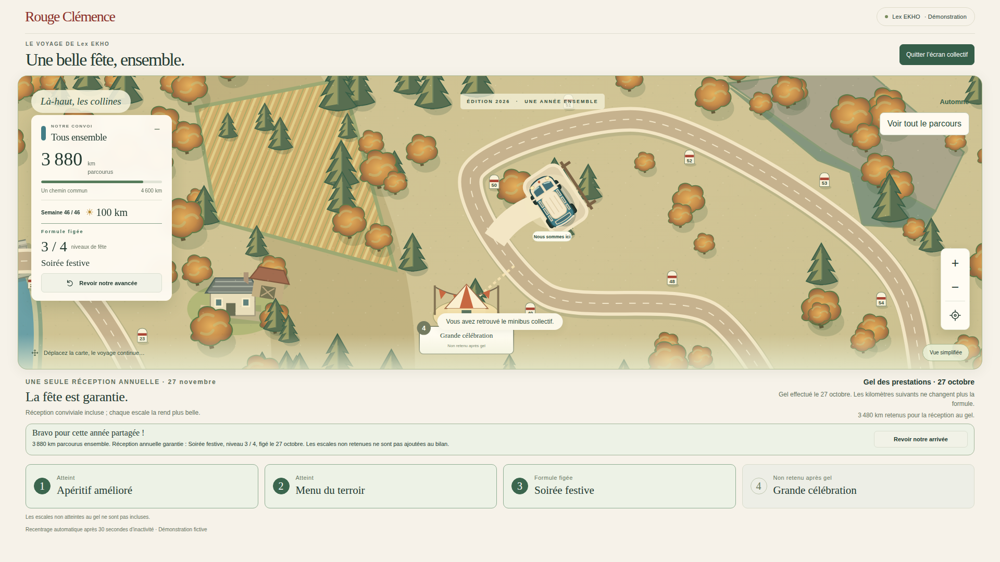
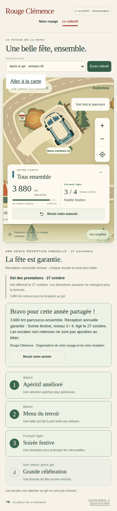

# V4-05C — Clôture collective et réception gelée

Reprise sur `351746f`, branche `work/v2-phase1-engine`, PR #1. Code `681d57d3c83ea99ce2d2dde8b47f452658ae6c34`.

## Exigences couvertes

- Le bilan collectif n'est exposé qu'après enregistrement de toutes les moyennes hebdomadaires actives et du gel de réception. Un gel seul ne termine pas le voyage ; une semaine sans moyenne empêche la clôture.
- La projection conserve la distance collective réellement gagnée et le niveau figé. Dans la démonstration achevée, 3 880 km parcourus restent associés au niveau 3/4, calculé sur 3 480 km au gel ; le quatrième niveau n'est jamais ajouté.
- Le minibus unique stationne près du point gagné, via le composant de halte déjà testé pour l'équipe. Bilan signé Rouge Clémence, réception annuelle garantie, état des escales conservé.
- La relecture est volontaire, accessible au clavier et compatible avec la réduction des mouvements. Aucun rejeu automatique lors de l'ouverture ou du rafraîchissement d'un écran collectif partagé.
- L'écran kiosque ajuste sa hauteur de carte pour garder le bilan et les niveaux visibles.

## Persistance et limites

La clôture collective est une **projection déterministe des résultats et du gel déjà persistés**, avec identifiant stable par campagne. Ce n'est pas un nouvel événement écrit dans le journal, ni un accusé de présentation par personne : le collectif se charge déjà achevé et ne joue l'animation que sur demande. Les relectures ne modifient aucune donnée et ne créent aucune réservation.

Une campagne complète déjà existante peut donc afficher ce bilan sans migration si ses moyennes et son gel sont enregistrés. Cette règle diffère de l'événement de clôture d'équipe V4-05A. Pas de fermeture forcée à une date limite, de résolution automatique des reports en attente, de réservation de prestataires ou de modification du niveau gelé.

## Fichiers

- `src/application/closure.ts` : calcul collectif pur et filtrage de complétude.
- `src/presentation/collective-view.ts` : projection publique autorisée.
- `src/web/collective.ts`, `web/collectif.html`, `web/collective.css` : bilan, stationnement et relecture.
- `tests/visual/collective.test.mjs`, `tests/browser/collective.spec.mjs` : complétude, stabilité, confidentialité, absence de rejeu, clavier, mouvement réduit et kiosque.

## Vérifications locales

- `npm run typecheck`, `npm run build:web` : réussis.
- `npm run test:visual` : 22/22 réussis.
- `npm run test:events` : 18/18 réussis.
- La projection reste identique après sérialisation JSON, n'expose pas de données individuelles ni de budgets et ne permet pas de modifier le gel via l'objet retourné.

## Déploiement

Le 28 octobre 2026, `firebase hosting:sites:list --project rc-voyage-test-20261027` échoue : « Failed to authenticate, have you run firebase login? ». Aucun déploiement effectué pour cette tranche. Dernier déploiement vérifié précédemment : V4-05B, révision `voyage-test-00013-twb`. L'état live actuel n'a pas été revalidé par l'API d'administration faute d'authentification. Aucun secret demandé ou copié, aucune modification de production ou de main.

## Suite

Raccordement du calendrier glissant au questionnaire dirigeant et choix explicites des semaines partielles/29 février, avant clôture par date limite et archives. Reprendre les dépendances du cockpit P0 ensuite, sans réécrire les parcours livrés.

## CI et preuves visuelles

Quatre workflows réussis au commit `681d57d` :

- [Carte et navigateur](https://github.com/gkerckhofs-a11y/le_voyage/actions/runs/40621144786) : **55 tests navigateur réussis, 2 exclusions tactiles desktop préexistantes**, 22 tests visuels/logiques, 18 tests événements.
- [Firebase isolé sur émulateurs](https://github.com/gkerckhofs-a11y/le_voyage/actions/runs/40621144769) : réussi, indépendant de l'accès au compte Firebase distant.
- [Accès serveur](https://github.com/gkerckhofs-a11y/le_voyage/actions/runs/40621144740) : réussi.
- [Moteur](https://github.com/gkerckhofs-a11y/le_voyage/actions/runs/40621144767) : réussi.

Artefact de recette `12786419876` (rétention 14 jours), sélection durable ci-dessous. Captures mobile et kiosque inspectées : minibus unique visible, bilan lisible, niveau 3/4 et quatrième escale non retenue. Le test kiosque vérifie l'absence de débordement vertical à 1920×1080. Le lien de saut visible sur mobile correspond au focus clavier conservé après rechargement.

Aucune régression observée dans ces suites. Pas de test manuel avec le compte Google personnel.
