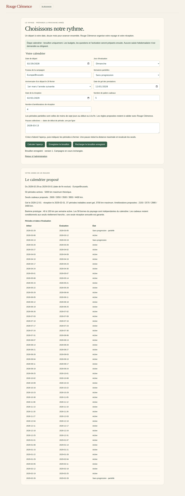
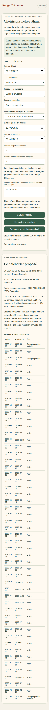

# V4-06A — Calendrier annuel : aperçu et brouillon administratif

Branche `work/v2-phase1-engine`, PR #1. Socle vérifié `84a08b2`. Code `d8fe73e4f98d83d60cacb76ec3eabe66cab92ae9`.

## Première étape du questionnaire dirigeant

Aucun questionnaire annuel n'existait dans le dépôt avant cette tranche. `campagne.html`, accessible depuis l'administration fictive, raccorde le planificateur pur V4-01 à un formulaire et un service Firestore autorisé.

- Départ libre et douze mois glissants, fuseau Europe/Brussels prérempli et modifiable.
- Jour d'évaluation, traitement des périodes partielles et anniversaire d'un départ le 29 février : choix explicites requis.
- Aperçu des périodes avec leur début, date d'évaluation, statut actif/fermé et caractère partiel. Les dates de début servent à saisir les pauses collectives ; une pause recalcule les maxima et les seuils.
- Nombre de paliers cadeaux et d'améliorations de réception ; seuils calculés avec les barèmes prototypes existants. Les budgets ne sont pas traités dans cette étape.
- Date de gel et date de réception. Le nombre de périodes traitables avant gel respecte la convention actuelle du moteur : date de traitement au plus tard la veille du gel.
- Sauvegarde d'un brouillon distinct de la campagne active ; rechargement après rafraîchissement. L'aperçu seul n'enregistre rien.

## Accès, concurrence et données

`canPlanCampaign` est une capacité dédiée, vérifiée sur la membership active dans le tenant, la campagne et l'équipe autorisés, puis revérifiée dans la transaction. Le scope vient de la session serveur, jamais du formulaire. POST protégé par origine et CSRF existants.

Le brouillon est stocké dans `tenants/{tenant}/campaigns/{campaign}/annualDrafts/next`, avec version, auteur et date de mise à jour. La campagne active n'est pas modifiée. Un identifiant de mutation empêche le doublon du dernier enregistrement ; un numéro de version bloque les écrasements concurrents. Les métadonnées d'auteur ne sont pas renvoyées au formulaire.

Dans l'adaptateur de démonstration isolé, cette capacité est attribuée au seul compte `demo-rc-admin`, y compris pour sa membership déjà présente si la capacité est absente. Une révocation explicite (`false`) est conservée au redémarrage. Il ne s'agit pas d'un mécanisme de provisioning de dirigeants en production.

## Tests locaux

- `npm run typecheck`, `npm run build:web` : réussis.
- `npm run test:events` : 20/20 réussis.
- `npm run test:visual` : 22/22 réussis ; liste publique étendue aux seuls fichiers d'interface nécessaires. Le planificateur et le service restent côté serveur.
- Tests ajoutés : passage d'année, 29 février, semaines partielles, pause réduisant les maxima, champs inconnus refusés, contrôle d'accès et révocation, révision obsolète, répétition concurrente, relecture Firestore, invariance du payload de campagne.

## Limites et décisions restantes

Cette étape ne crée ni n'active une nouvelle campagne et ne remplace pas encore le questionnaire dirigeant complet. Questions/valeurs, mode KPI facultatif, budgets, cadeaux datés, surprises, équipes et validation annuelle restent à raccorder. Les choix par défaut de cinq cadeaux et quatre améliorations sont des propositions de démonstration.

Le formulaire actuel demande gel et réception à l'intérieur de l'année, dans cet ordre. Une réception après la date de fin n'est pas prise en charge par ce premier formulaire ; cette restriction doit être arbitrée avant activation, pas présentée comme une règle commerciale validée. Il n'y a pas de prorata des périodes partielles : exclusion ou crédit hebdomadaire complet, selon le choix explicite.

Un seul brouillon « prochaine campagne » est conservé, avec sa dernière mutation ; pas d'historique complet des modifications de brouillon ni d'export à ce stade. Les pauses se saisissent par date de début de période et non via un calendrier graphique.

Aucun déploiement demandé au service Firebase distant dans cette tranche : la dernière vérification d'authentification a échoué en V4-05C. Les tests Firebase reposent sur les émulateurs. Dernier déploiement vérifié précédemment : V4-05B `voyage-test-00013-twb`. Aucune production, main, migration de campagne ou donnée RH réelle modifiée.

## Prochain incrément

Compléter ce brouillon avec budgets cadeaux et niveaux de réception en coûts totaux, puis paramètres du questionnaire et revue annuelle avant création explicite d'une nouvelle campagne. Ne pas appliquer ces réglages aux campagnes actives.

## CI et captures

Quatre workflows verts au commit `d8fe73e` :

- [Firebase isolé](https://github.com/gkerckhofs-a11y/le_voyage/actions/runs/40640514620) : **31 tests serveur réussis, 20 tests navigateur réussis, 2 exclusions préexistantes**. Le nouveau parcours vérifie sauvegarde/rechargement, refus sans CSRF et égalité du voyage actif avant/après.
- [Cartes et frontières publiques](https://github.com/gkerckhofs-a11y/le_voyage/actions/runs/40640514632) : réussi.
- [Accès serveur](https://github.com/gkerckhofs-a11y/le_voyage/actions/runs/40640514645) : réussi.
- [Moteur](https://github.com/gkerckhofs-a11y/le_voyage/actions/runs/40640514591) : réussi.

Captures issues des émulateurs, artefact `12795885550` (rétention 14 jours), conservées ci-dessous. Inspection desktop/mobile : formulaire en deux colonnes puis une colonne, boutons accessibles sans débordement horizontal. Le tableau annuel est volontairement long et défile verticalement. La saisie de date native reflète la locale du navigateur de test ; les valeurs enregistrées restent des dates ISO.

Scénario de recette : départ le 29 février 2028, anniversaire au 1er mars 2029, périodes partielles exclues et pause du 13 mars 2028. Résultat : 50 périodes actives, 5 000 km maximum théorique, 37 périodes traitables avant gel. Ce sont des données fictives et des maxima, pas une prévision de performance.

Aucune régression observée dans les suites exécutées. Aucun test manuel de compte Google personnel ni nouvelle mise en ligne revendiqués.
