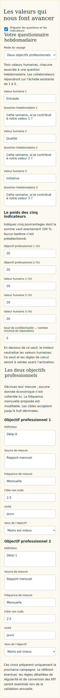
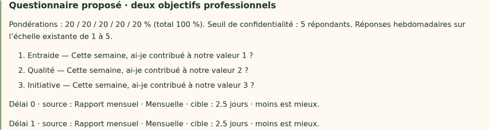

# V4-06C — Paramètres du questionnaire annuel en brouillon

28 octobre 2026. Branche `work/v2-phase1-engine`, PR #1 ; point de départ vérifié `59926739bda8403622b0ba6da2b8911fee0d446d` (budgets V4-06B).

## Périmètre livré

La préparation annuelle permet désormais d'ajouter trois valeurs humaines et leurs questions, le mode autonome ou KPI, cinq pondérations totalisant exactement 100 %, et un seuil de confidentialité. Aucun poids, question, valeur ou seuil n'est prérempli arbitrairement. La borne minimale de deux répondants est celle du moteur existant, pas un seuil commercial recommandé.

Le mode KPI exige deux définitions complètes : définition, source, fréquence modifiable (mensuelle proposée), cible décimale non nulle, unité et sens « plus/moins est mieux ». Le passage au mode autonome exclut les KPI de l'enregistrement. Les décimales françaises sont acceptées par le formulaire, puis validées avec l'arithmétique exacte existante (huit décimales au plus). Aucun arrondi ne permet d'accepter un total différent de 100 %.

Les champs longs utilisent des zones de texte. L'aperçu reprend les paramètres avec rendu texte, sans insertion HTML. Les anciens brouillons sans questionnaire restent lisibles ; la section reste facultative tant que la campagne n'est pas activée. Les budgets V4-06B sont conservés : enveloppes cadeaux par équipe, formules de réception en coûts totaux non cumulés, base HT/TTC explicite, sans conversion de TVA.

## Source et limites

Cette tranche suit les exigences V4 du questionnaire annuel retrouvées dans le contexte du projet (cahier daté du 27 octobre 2026, section 3.1 et paramètres du moteur), ainsi que la suite explicitement décrite dans `V4-06A.md`. Le fichier V4 intégral n'est pas présent dans ce dépôt ; aucune relecture intégrale n'est revendiquée ici.

Le brouillon reste dans `annualDrafts/next`, sous les contrôles d'accès et de concurrence existants. La validation serveur refuse les propriétés inattendues et les configurations incomplètes. Aucune question, pondération, distance, cadeau ou configuration de campagne active n'est remplacé. Le questionnaire hebdomadaire actuel conserve ses questions existantes.

Reste avant activation : nombre et composition des équipes, référent KPI éventuel, politique détaillée de régularité et de conversion des KPI, estimation maximale entreprise, revue contractuelle/confidentialité et création explicite d'une nouvelle campagne. Le questionnaire annuel complet et son activation ne sont donc pas déclarés terminés. Aucune saisie hebdomadaire du dirigeant n'est ajoutée.

## Vérifications locales

- Typecheck et build web réussis.
- 38 tests du domaine, 26 tests événements/application, 23 tests géométrie/projection/frontière publique : réussis.
- 31 tests Firebase sur émulateurs : réussis, dont sauvegarde/relecture des paramètres, rejet d'un total incorrect sans changement de révision, contrôle d'accès et invariance exacte du payload actif.
- Deux parcours navigateur ciblés, ordinateur 1440×900 et mobile 390×844 : réussis. Calendrier, budgets, questionnaire autonome puis KPI, virgule décimale, refresh, rejet de poids incorrects, suppression des KPI en autonome, absence de débordement horizontal et campagne active inchangée.
- Simulation historique de douze semaines identique au fichier de référence.

Le téléchargement du navigateur verrouillé Playwright a échoué localement. Les deux parcours locaux utilisent Chromium Headless Shell 141 (build 1194), avec la bibliothèque Playwright du dépôt et une configuration temporaire, sans changement du verrouillage des dépendances. Java 21 a été utilisé pour les émulateurs. Ces preuves locales ne remplacent pas la CI avec le navigateur verrouillé.

Aucun déploiement Firebase, aucune fusion `main`, aucune migration ni donnée réelle. Le dernier déploiement de test documenté reste V4-05B ; les modifications de cette tranche sont uniquement dans la branche de travail.

Captures inspectées après passage des questions longues en zones de texte :

