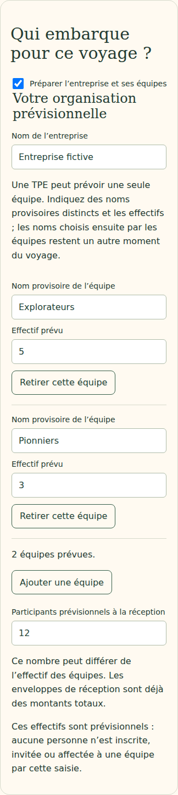
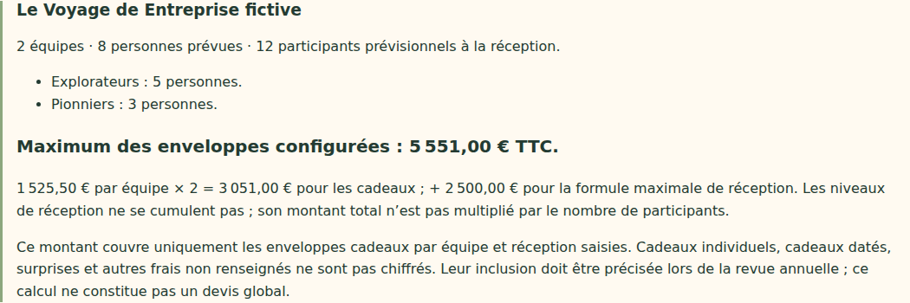

# V4-06D — Organisation prévisionnelle et maximum des enveloppes configurées

28 octobre 2026. Branche `work/v2-phase1-engine`, PR #1. Socle vérifié : `5d8248253dfcc85ceef701dfd211288b8bf2e583` (V4-06C).

## Fonctionnement

Le brouillon annuel accepte désormais le nom de l'entreprise, les équipes prévues avec leur nom provisoire et leur effectif, ainsi que le nombre de participants prévisionnels à la réception. Une seule équipe est possible pour une TPE. Les participants à la réception peuvent différer de la somme des effectifs ; aucun nombre de personnes n'est déduit implicitement.

L'interface permet d'ajouter et retirer les équipes, de sauvegarder et de recharger. Les noms provisoires ne remplacent pas le vote du nom de l'équipe. Aucun compte, aucune invitation, aucune affectation ni équipe active n'est créé. Les champs ne demandent pas de liste nominative. La désactivation de la section la retire du brouillon lors de l'enregistrement ; les anciens brouillons restent lisibles.

Le maximum affiché couvre **uniquement les enveloppes configurées** :

`(somme des budgets cadeaux par équipe × nombre d'équipes prévues) + montant total de la formule maximale de réception`

Exemple de test fictif : 1 525,50 € par équipe × 2 équipes + 2 500,00 € de réception = **5 551,00 € TTC**. Les niveaux de réception ne sont pas additionnés et leur montant n'est pas multiplié par le nombre de participants. Modifier les effectifs seuls ne change donc pas ce calcul. Aucun total n'est affiché si les budgets ou l'organisation manquent. Les multiplications et additions utilisent des entiers exacts ; un dépassement de la plage sûre est refusé.

Le récapitulatif précise que les cadeaux individuels, cadeaux datés, surprises et frais non renseignés ne sont pas chiffrés. Aucun montant ne leur est attribué. Le résultat n'est pas présenté comme un devis complet ; l'inclusion des coûts reste à préciser lors de la revue annuelle. La base HT/TTC est celle choisie dans les budgets, sans conversion de TVA.

## Validation et accès

Les paramètres sont validés côté serveur : objets attendus uniquement, noms non vides, noms d'équipes distincts après normalisation Unicode/casse/espaces périphériques, effectifs entiers positifs, participants entiers non négatifs, sommes exactes. La limite de 100 équipes et de 160 caractères par nom est une borne technique de ce prototype, pas une règle commerciale issue du cahier des charges. Les noms restent de simples libellés de brouillon, pas des identifiants d'accès.

La préparation annuelle nécessitait une correction de transport : la limite HTTP commune de 4 Kio pouvait refuser des données pourtant valides, y compris de longues questions de V4-06C. Seules les routes annuelles d'aperçu/sauvegarde acceptent maintenant jusqu'à 128 Kio. Les autres routes restent à 4 Kio. Le décodage UTF-8 est effectué après assemblage des blocs pour préserver un nom accentué coupé entre deux blocs réseau. L'origine et le CSRF sont contrôlés avant lecture du corps annuel ; la capacité dédiée, le scope de session et la révision sont toujours vérifiés avant sauvegarde.

## Référence et suite

Exigences retrouvées dans le contexte du cahier V4 du 27 octobre : entreprise, équipes/TPE, effectifs, participants prévisionnels et estimation maximale avant validation. Le cahier intégral n'est toujours pas présent dans le dépôt ; aucune relecture intégrale n'est revendiquée.

La préparation reste incomplète avant activation : bénéficiaires équipe/personnes par palier, cadeaux datés et surprises, sites et coordonnées, lieu et détails de réception, référent éventuel, règles de régularité/conversion KPI, revue des coûts et clauses/version contractuelle, puis création explicite d'une nouvelle campagne. Cette tranche ne constitue ni une validation contractuelle ni une activation.

## Vérifications

- Typecheck et build web réussis.
- 38 tests domaine, 32 tests événements/application/transport, 23 tests géométrie/projection/frontière publique réussis.
- 31 tests Firebase sur émulateurs réussis : organisation persistante, total exact, refus des équipes invalides sans changement de révision, payload actif inchangé.
- Parcours ciblés ordinateur/mobile : organisation à deux équipes, sauvegarde/rechargement, doublon refusé, calcul pour une équipe, suppression de la section, absence de débordement horizontal ; invariance du voyage actif.
- Cas HTTP : aperçu de 100 équipes avec texte multioctet au-delà de 4 Kio accepté ; dépassement de 128 Kio refusé ; limite de 4 Kio maintenue sur une autre route.
- Simulation historique de douze semaines inchangée.

Les parcours locaux utilisent le Chromium Headless Shell 141 déjà disponible (configuration temporaire, dépendances du dépôt inchangées) et Java 21 pour les émulateurs. Les résultats de CI sont référencés dans la PR.

Aucun déploiement Firebase, aucune fusion main, aucune migration de campagne active. Dernier staging documenté : V4-05B ; cette tranche n'y est pas annoncée disponible.

Captures inspectées :

