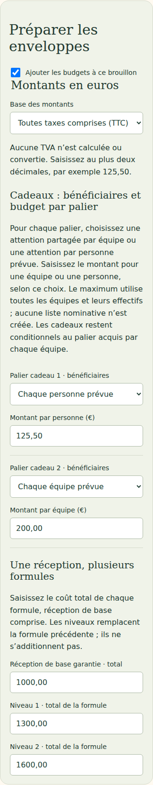
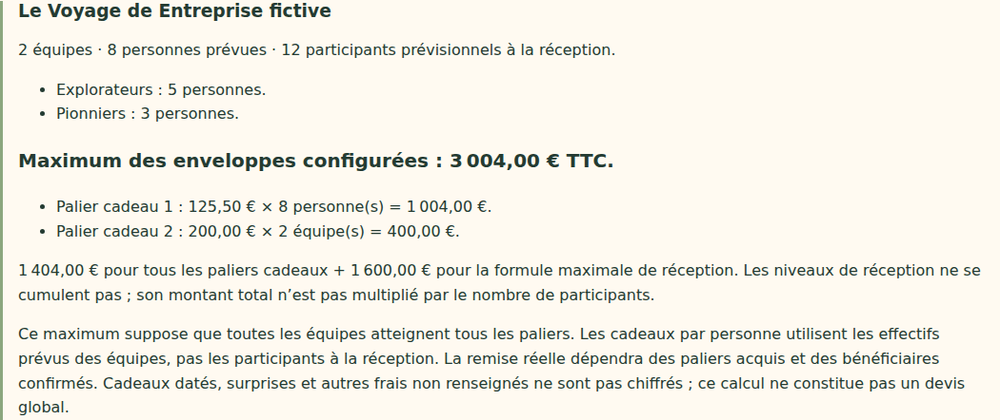

# V4-06E — Enveloppes de progression par équipe ou par personne

28 octobre 2026. Branche `work/v2-phase1-engine`, PR #1. Socle vérifié : `1845eb963ce4fcf90f69eb2a523e1539c6efec8f` (V4-06D).

## Changement livré

Le brouillon annuel permet de choisir, pour chaque palier de progression, une attention partagée par équipe prévue ou une attention par personne prévue. Le montant saisi est un montant **unitaire**, explicitement libellé par équipe ou par personne. Les nouveaux paliers exigent un choix ; aucune unité n'est déduite du montant ou de l'effectif.

Les choix portent, dans cette tranche, sur toutes les équipes prévues ou sur toutes les personnes de leurs effectifs. Ils ne constituent pas encore une sélection d'équipes spécifiques, une liste nominative ou une confirmation des bénéficiaires réels. La remise effective reste conditionnée au palier acquis par chaque équipe et à la confirmation des bénéficiaires.

Le maximum prévisionnel calcule chaque ligne séparément : montant unitaire × nombre d'équipes, ou montant unitaire × effectif total. Il additionne ensuite ces lignes et la seule formule maximale de réception. Les participants à la réception ne servent jamais à calculer les cadeaux individuels. Les seuils de progression, le calendrier, le moteur et les droits acquis ne changent pas.

Exemple fictif validé : deux équipes de cinq et trois personnes ; palier 1 à 125,50 € par personne et palier 2 à 200,00 € par équipe ; réception maximale à 1 600,00 €. Calcul : **125,50 × 8 + 200,00 × 2 + 1 600,00 = 3 004,00 € TTC**. Passer le second effectif de trois à quatre personnes porte le maximum à **3 129,50 € TTC**. Modifier uniquement les participants à la réception laisse le maximum inchangé.

Le récapitulatif détaille les quantités et montants de chaque palier. Il indique l'hypothèse que toutes les équipes atteignent tous les paliers. Cadeaux datés, surprises et frais non renseignés restent non chiffrés ; le résultat n'est pas un devis global.

## Compatibilité et contrôle

- Les anciens brouillons `giftPerTeamCents` restent lus comme des budgets par équipe. Une lecture seule ne les migre pas. Le formulaire présente explicitement cette unité ; une nouvelle sauvegarde écrit les allocations avec unité.
- Le nouveau format `giftAllocations` comporte une unité `team` ou `person` et un montant entier en centimes par palier. Un seul des deux formats est accepté ; fournir les deux est refusé.
- Unités manquantes/inconnues, propriétés inattendues, montants invalides et dépassements de la plage exacte sont refusés côté serveur. Aucun arrondi flottant.
- Un total « par équipe » n'est plus exposé pour les configurations mixtes : les anciennes propriétés correspondantes valent `null`. Les nouvelles lignes portent leurs unités explicites.
- Ajouter un palier conserve les montants et unités des lignes existantes, et laisse la nouvelle unité à choisir. Les anciens brouillons et les campagnes actives ne sont pas modifiés automatiquement.
- Accès administratif, tenant de session, CSRF, révision et contrôle de concurrence existants conservés. Aucun compte, invitation, droit individuel ni commande n'est créé.

## Validation

Typecheck/build réussis ; 38 tests domaine, 34 tests événements/application/transport, 23 tests géométrie/projection/frontière publique réussis. Les 31 tests Firebase sur émulateurs passent, dont sauvegarde/relecture d'un budget mixte, refus de deux formats simultanés sans nouvelle révision et payload de campagne active inchangé.

Quatre parcours navigateur ciblés ordinateur/mobile couvrent : anciens budgets par équipe, changement explicite en montant par personne, rechargement, calcul mixte, effet d'un changement d'effectif, indépendance du nombre de convives, nouvelle unité obligatoire, refus des requêtes ambiguës, et régression du formulaire annuel complet. Captures inspectées ; absence de débordement horizontal vérifiée.

Simulation historique de douze semaines identique. Tests locaux avec Chromium Headless Shell 141 déjà disponible et configuration temporaire ; dépendances du dépôt inchangées. CI référencée dans la PR.

## Limites et suite

Les exigences de choix équipe/personnes par palier proviennent du contexte retrouvé du cahier V4 du 27 octobre. Le cahier intégral n'est pas présent dans le dépôt ; aucune relecture intégrale n'est revendiquée.

La remise individuelle réelle, les sélections de bénéficiaires et leurs corrections, les cadeaux datés/surprises, les coordonnées et détails de réception, les politiques détaillées KPI/régularité, les clauses et la validation contractuelle restent à compléter avant activation. Aucun nouveau déploiement, aucune fusion main, aucune migration de campagne active. Dernier staging documenté : V4-05B.

