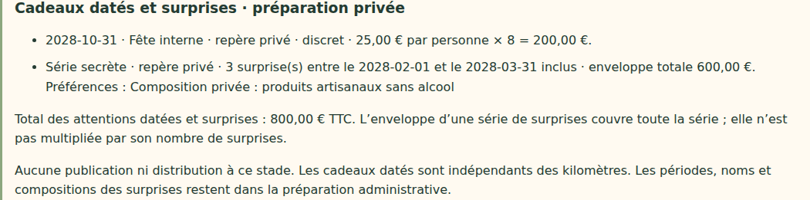

# V4-06F — Cadeaux datés et séries de surprises dans le brouillon annuel

28 octobre 2026. Branche `work/v2-phase1-engine`, PR #1. Socle vérifié : `880bbb7e83cc0d76d971d96c1e03dc05f506fa50` (V4-06E).

## Périmètre

La préparation annuelle distingue désormais deux types d'attentions, dans une section facultative :

- **Cadeau daté** : occasion, date civile précise, bénéficiaires prévisionnels (chaque équipe ou chaque personne prévue), montant unitaire et visibilité souhaitée « annoncé » ou « discret ».
- **Série de surprises** : nom interne, nombre, période (premier et dernier jours inclus), enveloppe totale de la série et préférences de composition. L'enveloppe n'est multipliée ni par le nombre de surprises ni par l'effectif. Aucun choix de visibilité publique n'existe pour une surprise.

Les dates doivent appartenir à la campagne annuelle configurée. Les cadeaux datés peuvent tomber pendant une pause ou après le gel de réception : leur planification n'utilise pas les kilomètres. La fin de période d'une surprise peut être identique au début. Aucun événement récurrent ni anniversaire nominatif n'est généré ; cette tranche ne collecte pas de date de naissance. Les séries ne sélectionnent pas encore leurs destinataires réels ni leurs dates finales de déclenchement.

L'interface permet l'ajout, la suppression, l'aperçu, l'enregistrement et le rechargement. Les anciens brouillons sans cette section restent lisibles. Un cadeau « annoncé » représente un souhait pour une future activation : il n'est pas publié depuis ce brouillon.

## Budgets exacts

Les cadeaux datés multiplient leur montant par le nombre d'équipes ou l'effectif prévu. Sans organisation, leur total reste inconnu ; aucun effectif n'est inventé. Les enveloppes des séries de surprises sont additionnées une seule fois. Les montants sont ajoutés au maximum des enveloppes déjà configurées (progression et réception).

Toutes les enveloppes d'un même aperçu doivent utiliser la même base HT/TTC ; un mélange est refusé, sans conversion implicite de TVA. Calculs en centimes entiers exacts, avec refus des dépassements de la plage sûre.

Exemple fictif testé : progression et réception 1 200,00 € TTC ; cadeau daté 25,00 € × 8 personnes = 200,00 € ; série de trois surprises, enveloppe totale 600,00 €. Maximum configuré : **2 000,00 € TTC**. Passer à quatre surprises sans changer l'enveloppe laisse ce maximum inchangé. Retirer le cadeau daté donne 1 800,00 € ; retirer toute la section revient à 1 200,00 €.

Ce maximum couvre les seules enveloppes saisies. Les frais non renseignés et les coûts finaux restent à valider ; ce n'est pas un devis global.

## Confidentialité et invariance

Les données restent exclusivement dans le document administratif `annualDrafts/next`. La capacité `canPlanCampaign`, le tenant de session, CSRF et les révisions existantes restent obligatoires. Un collaborateur standard reçoit 403 et un visiteur sans session 401 sur la lecture annuelle. Les valeurs de test privées sont absentes des réponses des API équipe et collectif ; celles-ci restent identiques avant et après l'enregistrement.

Aucune position, période, occasion ou composition de surprise n'est ajoutée aux cartes, aux fichiers de données publics ou au calendrier collaborateur. Les noms de champs dans le code de formulaire ne contiennent aucune configuration enregistrée. Les valeurs sont rendues avec `textContent`, jamais comme HTML.

Aucun déclenchement, droit à cadeau, kilomètre, tâche de préparation ou commande n'est créé. L'activation et la distribution restent hors périmètre. Les paramètres « annoncé/discret » ne changent aucun droit d'accès au brouillon.

## Validation et limites techniques

Validation serveur des champs connus, textes non vides et bornés, dates civiles, périodes ordonnées, unités/visibilités explicites, nombres et montants entiers. Au plus 20 cadeaux datés et 20 séries, avec 1 à 100 surprises par série : bornes techniques du prototype, non règles commerciales du cahier. Les anciennes limites HTTP de la préparation annuelle restent applicables.

- Typecheck/build réussis.
- 38 tests domaine, 38 événements/application/transport, 23 géométrie/projection/frontière publique réussis.
- 31 tests Firebase sur émulateurs réussis : sauvegarde/relecture, total exact, refus de bases fiscales incompatibles sans nouvelle révision, révocation d'accès et payload actif inchangé.
- Six parcours ciblés ordinateur/mobile réussis : attentions, budgets mixtes et préparation annuelle complète. Contrôles de confidentialité, suppression, période invalide, changement du nombre de surprises, rechargement et absence de débordement horizontal.
- Simulation historique de douze semaines identique.

Tests locaux avec Chromium Headless Shell 141 et configuration temporaire ; dépendances du dépôt inchangées. Résultats de CI référencés dans la PR. Captures vérifiées ; la présentation native des dates dépend de la locale du navigateur de test, les dates enregistrées restent au format ISO.

## Référence et suite

Les exigences « cadeaux datés indépendants des kilomètres », visibilité publique/discrète, et surprises définies par nombre/enveloppe/période/préférences proviennent du contexte retrouvé du cahier V4 du 27 octobre. Le fichier intégral n'est pas présent dans le dépôt ; aucune relecture intégrale n'est revendiquée.

Restent notamment : destinataires spécifiques et anniversaires nominatifs, calendrier opérationnel et déclenchement idempotent, raccordement au cockpit, publication contrôlée des seuls événements annoncés, coordonnées et réception, politiques détaillées KPI/régularité et revue contractuelle avant création explicite d'une campagne. Aucun déploiement Firebase ni fusion main. Dernier staging documenté : V4-05B.

