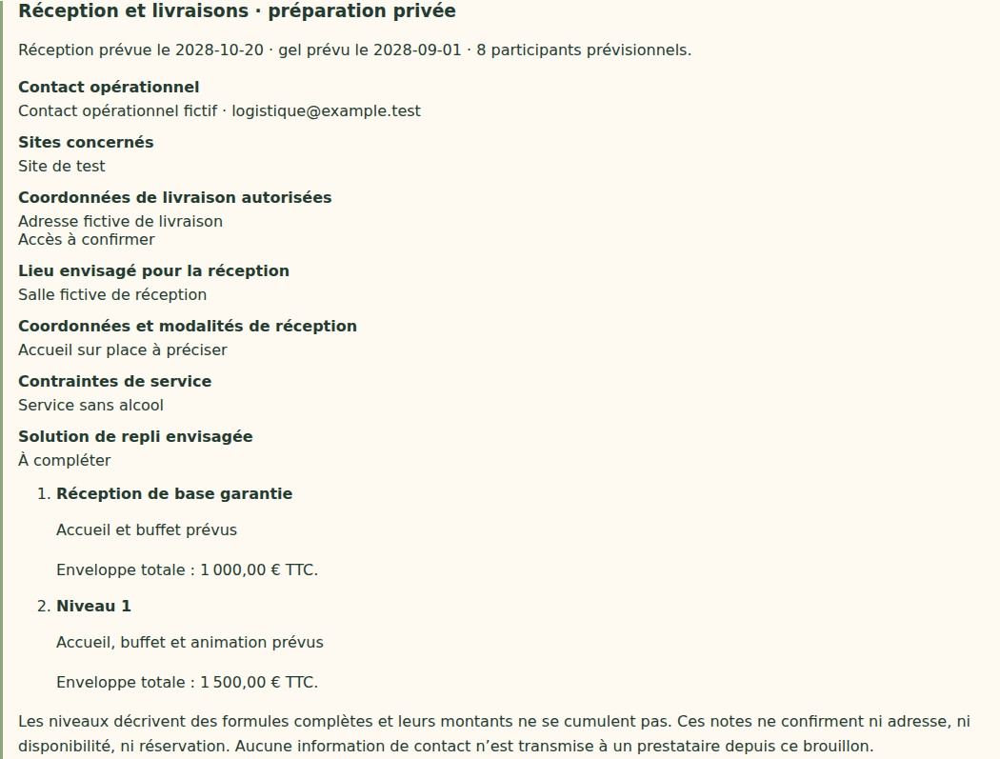

# V4-06G — Coordonnées et prestations de réception dans le brouillon annuel

28 octobre 2026. Branche `work/v2-phase1-engine`, PR #1. Socle vérifié : `bbdd10825c56f04cf04acdb69b58a13cfb97a371` (V4-06F).

## Fonctionnement livré

Une section facultative du brouillon permet de préparer le contact opérationnel, les sites, les coordonnées de livraison autorisées, le lieu et les modalités de réception, les contraintes de service et la solution de repli envisagée. Les champs sont des notes libres bornées : aucun format postal, téléphone, courriel ou découpage d'adresse supplémentaire n'est imposé. Les informations inconnues peuvent rester vides et sont affichées « À compléter ».

Une description est associée à chaque formule de réception : prestation de base garantie, puis chaque niveau d'enrichissement. Les cases peuvent rester à compléter dans le brouillon ; leur nombre doit correspondre au nombre de niveaux configurés. Ajouter un niveau préserve les descriptions existantes et ajoute une case vide ; réduire le nombre de niveaux retire les cases correspondantes, sans changement de la campagne active.

L'aperçu associe chaque description à son enveloppe totale provenant du budget existant. Il reprend la date de réception et le gel depuis le calendrier, ainsi que les participants prévisionnels depuis l'organisation. Aucun montant, date ou effectif concurrent n'est stocké dans les notes. Sans budget ou organisation, les éléments inconnus sont signalés, jamais inventés.

Les formules décrivent des prestations complètes et leurs budgets ne se cumulent pas. Les notes ne confirment ni disponibilité, ni réservation, ni validité d'une adresse. Aucun prestataire n'est contacté et aucune coordonnée n'est transmise.

## Données et validation

Les notes sont enregistrées sous `logistics` dans le seul document administratif `annualDrafts/next`. Les anciens brouillons sans ce champ restent lisibles. La désactivation de la section retire les notes lors de la prochaine sauvegarde ; le rechargement efface les anciennes valeurs de cette section si elle est absente du brouillon enregistré.

Validation serveur des propriétés connues, types texte, longueur bornée et correspondance exacte des descriptions avec les niveaux de réception. Les valeurs vides restent autorisées : aucune validation contractuelle complète n'est déduite de cette sauvegarde. Les limites sont techniques : contact 1 000 caractères, lieu 500, autres notes 2 000 et descriptions 1 000 par formule ; limite HTTP annuelle conservée à 128 Kio.

Le rendu utilise `textContent`, conserve les retours à la ligne et permet le retour à la ligne des textes longs. Une chaîne ressemblant à du HTML reste du texte inerte. Les contrôles d'accès, CSRF, révision et concurrence existants sont conservés. Aucun droit nouveau n'est accordé au collaborateur ni à l'animateur.

## Vérifications

- Typecheck et build web réussis.
- 38 tests domaine, 41 événements/application/transport et 23 géométrie/projection/frontière publique réussis.
- 31 tests Firebase sur émulateurs réussis : notes persistantes, budget total inchangé, refus d'un nombre incohérent de descriptions sans nouvelle révision, payload actif inchangé et accès révoqué.
- Huit parcours navigateur ciblés ordinateur/mobile réussis (préparation annuelle complète, budgets mixtes, attentions et logistique).
- Le parcours logistique vérifie sauvegarde/rechargement, notes à compléter, association description/budget, ajout de niveau conservant les textes, rendu HTML inerte, suppression de la section et absence de débordement horizontal.
- Confidentialité HTTP : visiteur sans session 401, collaborateur standard 403 sur le brouillon ; contact et adresse de test absents des API équipe/collectif. Les réponses de voyage restent inchangées.
- Simulation historique de douze semaines identique.

Tests locaux sur Chromium Headless Shell 141 déjà disponible et Java 21, sans changement des dépendances verrouillées. CI référencée dans la PR. Captures inspectées :

## Référence et limites

Les exigences contact opérationnel, sites, coordonnées de livraison/réception, lieu, prestations, contraintes de service et plans de secours proviennent du contexte retrouvé du cahier V4 du 27 octobre. Aucun format détaillé d'adresse n'y étant précisé dans les éléments retrouvés, il n'en est pas imposé. Le fichier intégral n'est pas présent dans le dépôt ; aucune relecture intégrale n'est revendiquée.

Cette section est une préparation privée, pas la fiche opérationnelle de réception avec prestataires confirmés, coûts réels, états de réservation ou exceptions au gel. Logo, référent éventuel, politiques détaillées KPI/régularité, mentions et version contractuelle restent à raccorder à la revue annuelle. La restriction existante des dates de gel et réception à l'intérieur de l'année est inchangée et reste à arbitrer avant activation.

Restent également les destinataires spécifiques, anniversaires nominatifs, déclenchements idempotents, publication contrôlée, raccordement au cockpit, validation et création explicite d'une nouvelle campagne. Aucun déploiement Firebase, aucune fusion main ni migration de campagne active. Dernier staging documenté : V4-05B.
