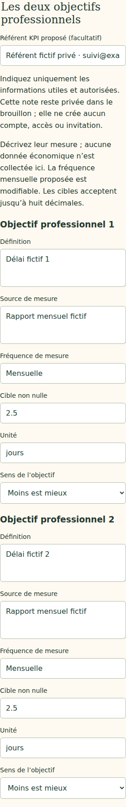
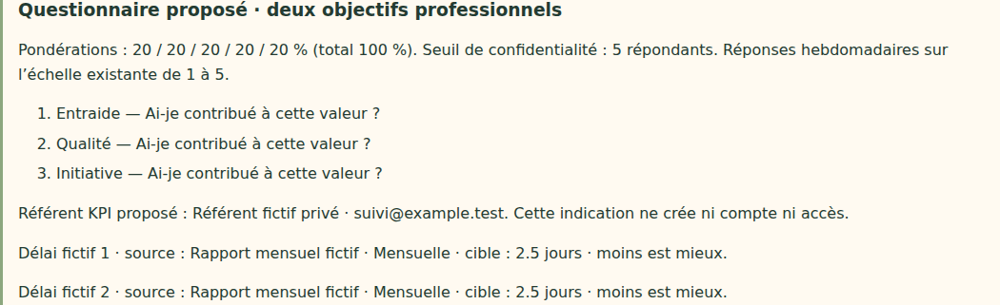

# V4-06H — Référent KPI proposé dans le brouillon annuel

28 octobre 2026. Branche `work/v2-phase1-engine`, PR [#1](https://github.com/gkerckhofs-a11y/le_voyage/pull/1). Socle : `87ccaaa967f36b5e67f549f3528ba2a5e02bdba6`. Le commit de cette tranche est référencé dans la PR.

## Périmètre

Le questionnaire annuel en mode KPI accepte désormais une désignation facultative du référent proposé. Le champ reste privé, est sauvegardé et rechargé avec le brouillon, et apparaît dans son aperçu. Sans désignation, l'aperçu indique « Non renseigné (facultatif) ». Aucune identité n'est déduite ou vérifiée, aucun compte, invitation, rôle ou accès n'est créé.

Le passage au mode autonome exclut cette information de la prochaine sauvegarde, avec les définitions KPI existantes. Le rechargement d'un brouillon sans référent efface la valeur du formulaire. Les anciens brouillons sans cette propriété restent compatibles. Aucune règle de progression, aucun budget ni calendrier actif ne change.

Le champ `questionnaire.kpiReferent` est un texte de 500 caractères au maximum (borne technique). Le formulaire omet le texte vide ou composé d'espaces. L'API refuse les types non textuels, les valeurs vides présentes, les dépassements et un référent dans un questionnaire autonome. L'aperçu supprime les espaces périphériques. Le rendu utilise `textContent` et permet le retour à la ligne des chaînes longues.

## Fichiers modifiés

- `src/application/annual-questionnaire.ts` : propriété facultative et validation.
- `src/web/annual-questionnaire-form.ts`, `web/campagne.html`, `web/annual-plan.css` : saisie, restauration, aperçu et retour à la ligne.
- `tests/events/annual-questionnaire.test.mjs`, `tests/firebase/annual-planning.test.mjs`, `tests/firebase-browser/annual-kpi-referent.spec.mjs` : compatibilité, persistance, confidentialité et absence d'effets sur la campagne active.
- Ce compte rendu et deux captures dans `docs/evidence/`.

## Vérifications réellement exécutées

- Typecheck et build web réussis.
- 38 tests domaine, 42 tests événements/application/transport et 23 tests visuels/frontière publique réussis.
- 31 tests Firebase sur émulateurs réussis, dont persistance du référent, rejet de données malformées sans révision supplémentaire, document de campagne active inchangé et aucun membre supplémentaire.
- Quatre parcours navigateur réussis : référent facultatif et préparation annuelle complète, chacun sur ordinateur et mobile.
- Sauvegarde/rechargement, absence facultative, suppression en mode autonome, HTML inerte et texte de 500 caractères sans débordement vérifiés.
- Lecture annuelle refusée au visiteur non connecté (401) et au collaborateur standard (403). Référent absent des API équipe et collectif ; réponses actives identiques avant/après.
- Simulation historique de douze semaines identique ; `git diff --check` sans erreur.

Tests locaux sur Java 21 et Chromium Headless Shell 141 de substitution ; dépendances verrouillées inchangées. Un premier passage navigateur utilisait la sortie compilée antérieure à l'ajout du style de retour à la ligne et échouait sur la chaîne longue. Après reconstruction, les quatre parcours passent. Résultats CI du commit final à consulter dans la PR.

Captures inspectées :

Aucune capture kiosque ajoutée : ce changement concerne uniquement le formulaire administratif privé ; aucune interface kiosque n'a été modifiée ou testée spécifiquement dans cette tranche.

## Source, limites et suite

Exigence retrouvée via Personal Context le 28 octobre 2026 dans `RC_Le_Voyage_Cahier_des_Charges_Astra_V4.md` (27 octobre 2026) : mode autonome ou KPI avec référent facultatif. Le rôle prévu transmet les KPI agrégés, consulte l'historique et corrige avant gel avec motif ; il n'accède pas aux réponses individuelles ni aux seuils validés. Cette tranche ne livre que sa désignation dans le brouillon. Le fichier intégral n'étant pas disponible dans le dépôt, aucune relecture intégrale n'est revendiquée.

Restent à livrer : rattachement vérifié à un compte et droits du référent, collecte/historique/corrections des KPI, règles détaillées de conversion et régularité, logo, revue de confidentialité et clauses/version contractuelle, validation et création explicite de campagne. Les autres limites de V4-06G restent applicables. Aucun déploiement Firebase, aucune fusion dans main, aucune modification de campagne active. Dernier staging documenté : V4-05B.
