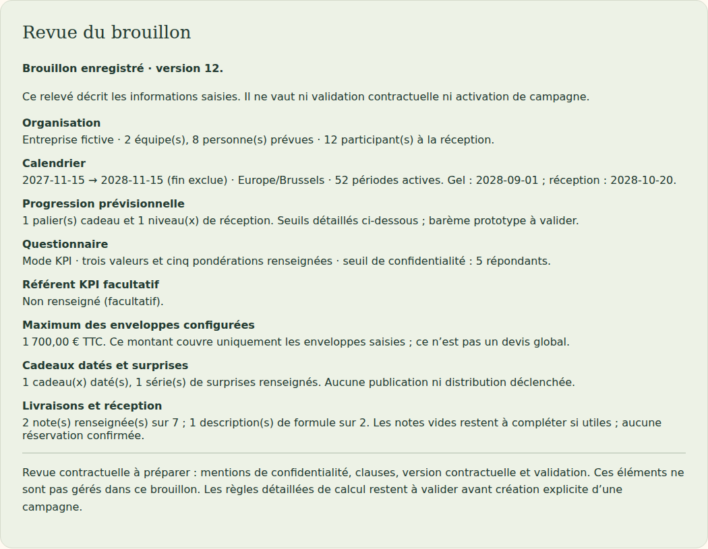
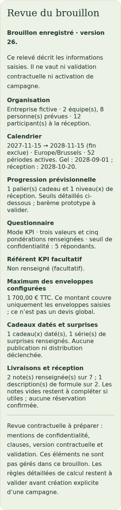

# V4-06I — Revue privée du brouillon annuel

28 octobre 2026. Branche `work/v2-phase1-engine`, PR [#1](https://github.com/gkerckhofs-a11y/le_voyage/pull/1). Socle : `0c6c2c9d49705009b0eba8fa7daf62c7f59cb755`. Commit de cette tranche et CI référencés dans la PR.

## Fonctionnement livré

L'aperçu annuel contient une revue synthétique de l'organisation, du calendrier, des paliers prévisionnels, du questionnaire, du référent facultatif, des enveloppes configurées, des attentions et des notes logistiques. Elle utilise exclusivement l'aperçu déjà calculé par le serveur ; elle ne stocke aucune donnée supplémentaire et ne recalcule aucun budget métier.

Le titre distingue « Aperçu non enregistré » et « Brouillon enregistré · version N ». La version vient de la réponse de sauvegarde ou de lecture. Une modification du formulaire masque la revue avec l'aperçu existant ; le rechargement rétablit la version enregistrée. Aucune certification, case d'acceptation, signature, création ou activation n'est ajoutée.

Les sections absentes sont signalées comme non renseignées. Un maximum entreprise absent n'est jamais affiché comme zéro : la revue indique les données manquantes (organisation, budgets de progression/réception, ou les deux). Un maximum effectivement calculé à zéro conserve sa valeur et sa base HT/TTC. Les attentions absentes ne signifient pas qu'aucun coût n'existe. Le total reste limité aux enveloppes configurées et n'est pas présenté comme un devis global.

Les nombres de notes logistiques et descriptions renseignées sont un relevé de saisie, pas un score de complétude contractuelle : les notes vides restent à compléter seulement si utiles. Le référent reste facultatif ; sa désignation ne confère aucun accès. La revue rappelle que mentions de confidentialité, clauses, version contractuelle et validation ne sont pas encore gérées dans ce brouillon.

## Fichiers modifiés

- `src/web/annual-review.ts` : rendu de la revue à partir de l'aperçu typé.
- `src/web/annual-plan.ts` : intégration et distinction entre aperçu et version enregistrée.
- `web/campagne.html`, `web/annual-plan.css` : section accessible et présentation responsive.
- `tests/visual/public-build.test.mjs` : module ajouté à la liste explicite des fichiers publics autorisés, sans données privées statiques.
- `tests/firebase-browser/annual-review.spec.mjs` : parcours de revue sur ordinateur/mobile.
- Ce compte rendu et deux captures dans `docs/evidence/`.

## Vérifications réellement exécutées

- Typecheck et build web réussis.
- 23 tests visuels/projections/frontière publique réussis.
- Quatre parcours navigateur sur émulateurs Firebase réussis : préparation annuelle existante et nouvelle revue, chacun sur ordinateur et mobile.
- Vérification des sections absentes, des trois combinaisons de données budgétaires manquantes, de la révision enregistrée, du calcul non enregistré et du rechargement.
- Cas chiffré fictif : 8 personnes × 12,50 € de cadeau + 1 500 € de réception maximale + 2 équipes × 20 € de cadeau daté + 60 € d'enveloppe surprise = 1 700 € TTC. La revue affiche le total calculé existant, sans multiplier à nouveau l'enveloppe surprise.
- Budget nul explicite affiché « 0,00 € HT » ; notes logistiques partiellement renseignées et référent facultatif correctement décrits.
- HTML de nom d'entreprise rendu comme texte inerte, absence de débordement horizontal et réponses actives équipe/collectif inchangées.
- `git diff --check` sans erreur.

Tests locaux sur Chromium Headless Shell 141 de substitution et Java 21, sans modification des dépendances verrouillées. Le moteur, la persistance serveur et les règles Firebase n'ont pas été modifiés ; leurs suites complètes sont exécutées par les workflows de la PR, dont le statut final est référencé dans sa description.

Captures inspectées :

Pas de capture ou recette kiosque spécifique : la revue est réservée au formulaire administratif, aucune interface kiosque modifiée.

## Référence et limites

Source : éléments du cahier `RC_Le_Voyage_Cahier_des_Charges_Astra_V4.md` du 27 octobre 2026 retrouvés via Personal Context le 28 octobre : la validation annuelle comprend estimation du budget maximal, calendriers et seuils prévisionnels, mentions de confidentialité, clauses, validation et version contractuelle. Cette tranche prépare seulement la lecture du brouillon existant ; elle ne livre pas cette validation. Le fichier intégral n'étant pas présent dans le dépôt, aucune relecture intégrale n'est revendiquée.

Restent notamment les contenus contractuels fournis/validés, leur versionnement et leur procédure d'acceptation, le logo, les règles détaillées KPI/régularité, les droits et opérations du référent et la création explicite de campagne. Aucun champ obligatoire commercial, règle de signature ou statut « prêt à activer » n'est inventé. Les limites V4-06H restent applicables. Aucun déploiement Firebase, aucune fusion main, aucune modification de campagne active. Dernier staging documenté : V4-05B.
