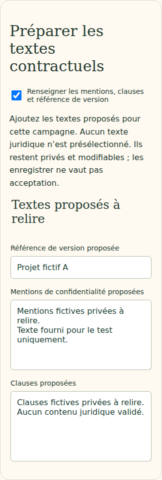
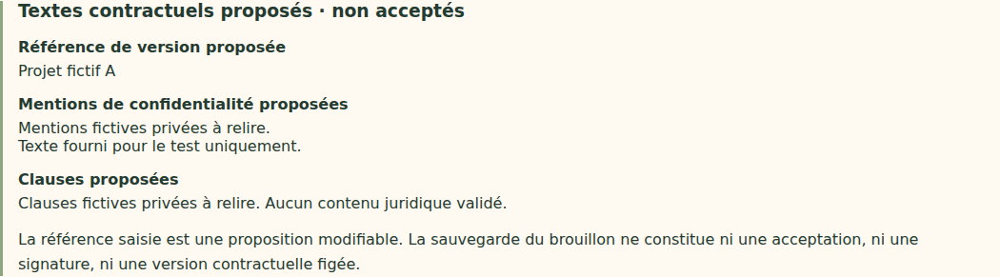

# V4-06J — Textes contractuels proposés dans le brouillon annuel

28 octobre 2026. Branche `work/v2-phase1-engine`, PR [#1](https://github.com/gkerckhofs-a11y/le_voyage/pull/1). Socle : `0346fdf8f0eeff9124128161448872c4599e2f48`. Commit de cette tranche et CI référencés dans la PR.

## Fonctionnement livré

Une section facultative permet de saisir les mentions de confidentialité proposées, les clauses proposées et une référence de version. Aucun texte juridique n'est prérempli. Ces éléments sont privés, modifiables, sauvegardés dans le brouillon et restitués après rechargement. Les champs peuvent rester vides ; l'aperçu indique alors « À compléter ».

La revue annuelle distingue les textes renseignés des textes à compléter. Elle rappelle que la référence de version est une proposition et que sauvegarder ne vaut ni acceptation, ni signature, ni version contractuelle figée. Aucun état de consentement ou bouton d'acceptation n'est ajouté. La révision technique du brouillon existant continue à protéger les sauvegardes concurrentes ; elle n'est pas assimilée à une version de contrat acceptée.

Désactiver la section retire l'objet `contract` lors de la sauvegarde. Recharger un brouillon sans cet objet efface les anciens textes du formulaire. Les anciens brouillons restent lisibles. Les textes ne modifient ni calendrier, ni budget, ni seuils, ni questionnaire, ni campagne active.

## Validation des données

L'objet ne peut contenir que `privacyNotice`, `clauses` et `versionReference`, tous de type texte. Limites techniques : 20 000 caractères par bloc de texte et 160 pour la référence. La limite HTTP annuelle de 128 Kio s'applique toujours à l'ensemble du brouillon. Les espaces périphériques sont supprimés dans l'aperçu ; les retours à la ligne internes sont conservés.

Les champs supplémentaires, notamment `accepted` ou `signedAt`, sont refusés. Ce contrôle empêche de faire passer une sauvegarde de brouillon pour une acceptation au moyen de propriétés supplémentaires. Il ne constitue pas une analyse de validité juridique du texte. Le rendu utilise du texte inerte, avec retour à la ligne des longues chaînes.

## Fichiers modifiés

- `src/application/annual-contract.ts`, `src/application/annual-plan.ts` : schéma facultatif et validation.
- `src/web/annual-contract-form.ts`, `src/web/annual-plan.ts`, `src/web/annual-review.ts` : saisie, sauvegarde/rechargement, aperçu et revue.
- `web/campagne.html`, `web/annual-plan.css` : section et styles.
- `tests/events/annual-contract.test.mjs`, `tests/firebase/annual-planning.test.mjs`, `tests/firebase-browser/annual-contract.spec.mjs` : validation, persistance et confidentialité.
- `tests/firebase-browser/annual-plan.spec.mjs` : remise à zéro de la nouvelle section dans le parcours existant.
- `tests/visual/public-build.test.mjs` : module de formulaire autorisé dans le build public ; aucun texte contractuel privé statique inclus.
- Ce compte rendu et captures `docs/evidence/v46j-*`.

## Vérifications

Typecheck et build web réussis ; 45 tests événements/application/transport et 23 tests visuels/projections/frontière publique réussis. Les 31 tests Firebase sur émulateurs passent, dont la persistance de textes privés, le refus du champ `accepted` sans incrément de révision et la conservation du document de campagne active.

Six parcours navigateur ciblés réussis : textes contractuels, revue annuelle et préparation annuelle existante, chacun sur ordinateur et mobile. Vérifications : ancien brouillon sans section, texte partiel puis complet, sauvegarde/rechargement, champ d'acceptation et données malformées refusés, HTML inerte, longue chaîne sans débordement, aperçu non enregistré, suppression de la section et restauration de champs vides. Lecture annuelle refusée au visiteur non connecté (401) et au collaborateur standard (403) ; textes absents des API équipe/collectif. Réponses actives inchangées.

Tests locaux sur Java 21 et Chromium Headless Shell 141 de substitution, dépendances verrouillées inchangées. CI complète du commit final référencée dans la PR. `git diff --check` sans erreur. Captures inspectées :

Aucune recette kiosque spécifique : seule l'administration privée est concernée.

## Source et limites

Source : éléments du cahier `RC_Le_Voyage_Cahier_des_Charges_Astra_V4.md` du 27 octobre 2026 retrouvés via Personal Context le 28 octobre, prévoyant mentions de confidentialité, clauses, validation et version contractuelle dans la préparation annuelle. Cette tranche prend en charge les textes proposés uniquement. Le fichier intégral n'étant pas présent dans le dépôt, aucune relecture intégrale n'est revendiquée.

Restent à définir/implémenter à partir des décisions du porteur : contenus contractuels validés, fixation et conservation de versions acceptées, personnes habilitées et procédure d'acceptation, modifications prospectives et création explicite de campagne. Aucun contenu juridique, obligation commerciale, délai ou règle de signature n'est inventé. Les autres limites V4-06I restent applicables. Aucun déploiement Firebase, aucune fusion main, aucune modification de campagne active. Dernier staging documenté : V4-05B.
