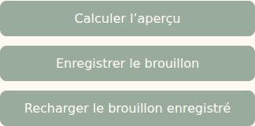

# V4-06K — Rechargement du brouillon sans actions concurrentes

28 octobre 2026. Branche `work/v2-phase1-engine`, PR [#1](https://github.com/gkerckhofs-a11y/le_voyage/pull/1). Socle : `62137b2d1bbcd7c7c5588e163e3606175ed2f86b`. Commit et CI de cette tranche dans la PR.

## Correction

Avant cette correction, le bouton de rechargement lançait une lecture sans bloquer le formulaire ni partager le verrou utilisé par calculer/enregistrer. Une saisie ou une sauvegarde pouvait donc intervenir avant le retour de la lecture, puis être remplacée visuellement par cette réponse tardive.

Le rechargement partage maintenant le verrou `busy`. Pendant la lecture, les champs et actions sont désactivés, l'ancien aperçu est masqué et un message de chargement apparaît. Une seconde demande de rechargement, calcul ou sauvegarde ne lance pas de requête concurrente. Après succès, les données et la révision enregistrées sont affichées, puis le formulaire est réactivé.

Après un échec de lecture, les champs conservent leur contenu et retrouvent leur état d'activation précédent ; l'ancien aperçu reste masqué. Un échec de lecture initiale laisse le formulaire bloqué, puisqu'aucune lecture administrative n'a encore réussi. Aucun stockage, contrôle d'accès serveur, budget ou règle de campagne n'est modifié.

## Fichiers

- `src/web/annual-plan.ts` : verrou, désactivation, état de chargement et restauration dans `finally`.
- `tests/firebase-browser/annual-reload.spec.mjs` : réponse volontairement retardée, actions concurrentes, échecs et reprise.
- Ce compte rendu et captures `docs/evidence/v46k-reload-*`.

## Vérifications

Typecheck/build réussis, 23 tests visuels/projections/frontière publique réussis. Huit parcours navigateur sur émulateurs Firebase réussis : rechargement, préparation annuelle, revue et textes contractuels, chacun sur ordinateur et mobile.

Le test retient la réponse GET, vérifie les champs et boutons désactivés, déclenche aussi des événements synthétiques et constate une seule lecture sans calcul/sauvegarde concurrent. Il vérifie ensuite la restauration du brouillon, un échec HTTP 503 conservant une saisie non enregistrée, la sauvegarde réussie après cet échec et un HTTP 403 initial laissant le formulaire désactivé. La simple lecture ne change pas la révision enregistrée.

Chromium Headless Shell 141 de substitution et Java 21 en local ; dépendances verrouillées inchangées. CI complète référencée dans la PR. `git diff --check` sans erreur. Captures des actions désactivées pendant la lecture :

Aucune recette kiosque spécifique : seule l'administration privée est concernée.

## Suite et déploiement

Cette tranche corrige un défaut observé dans le code existant ; elle n'ajoute aucune règle métier. Elle ne constitue pas la dernière tranche du cahier des charges. Les éléments encore ouverts, notamment procédure contractuelle, versions acceptées, création explicite de campagne, opérations du référent KPI et raccordements du cockpit, restent ceux documentés dans les tranches précédentes.

Le porteur demande d'être prévenu explicitement lorsque la dernière tranche sera effective et avant le passage au déploiement test. Aucun déploiement n'est effectué ici. Dernier staging documenté : V4-05B ; authentification Firebase distante à rétablir. Aucune fusion main, aucune modification de campagne active et aucune production.
