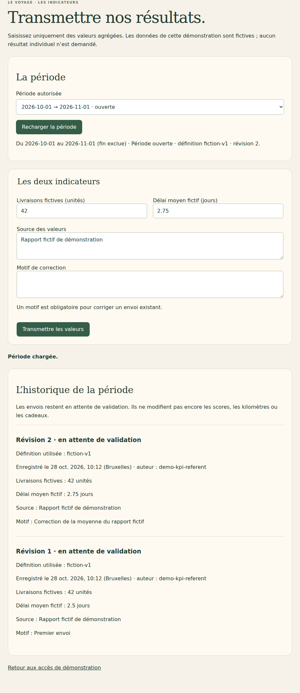
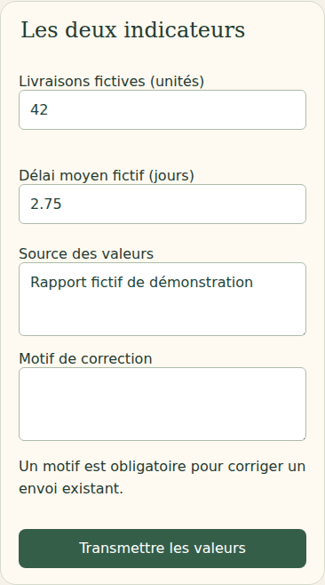

# V4-07B — Écran du référent KPI et périodes autorisées

28 octobre 2026. Branche `work/v2-phase1-engine`, PR [#1](https://github.com/gkerckhofs-a11y/le_voyage/pull/1). Socle : `dee19e1f03dd65c1e2ccd1be44be7b30df117419`. Commit final et CI dans la PR.

## Livré

L'écran `/kpi.html` permet au référent habilité de choisir une période, transmettre deux valeurs agrégées avec leur source, consulter les révisions et apporter une correction motivée. Les libellés, unités, dates, version de définition et état de période viennent du serveur. La virgule décimale est acceptée par le formulaire et transmise sous forme de chaîne décimale exacte.

L'historique affiche les anciennes valeurs, la source, le motif, l'auteur vérifié et l'horodatage rendu en heure de Bruxelles. Les définitions utilisées par le lot sont conservées pour interpréter ses anciennes valeurs. Les envois restent en attente de validation et ne modifient pas les scores, kilomètres ou cadeaux.

Une période gelée est consultable en lecture seule. Un changement des définitions ou dates par rapport au lot bloque aussi la correction. Pendant une requête, le formulaire et le sélecteur sont désactivés. Après erreur d'envoi ou conflit, un rechargement est nécessaire avant une nouvelle tentative. Après refus d'accès, les valeurs et l'historique sont effacés de l'écran. L'absence de période produit un état vide explicite.

La route POST `/api/kpi/list` renvoie uniquement les périodes de l'équipe de la session. Elle reprend les contrôles d'habilitation, de rattachement et de transaction du service existant. Les agrégats, sources et auteurs ne figurent pas dans cette liste. Elle est bornée techniquement à 60 périodes et refuse un dépassement au lieu de tronquer silencieusement. Un état de période invalide est refusé. Les droits ne sont jamais déduits d'un nom libre dans le brouillon annuel.

## Démonstration isolée

Un accès « Référent KPI · démo » ouvre un compte fictif dédié dans l'entreprise `fiction-kpi-demo`, séparée des entreprises de démonstration existantes. Seul ce compte reçoit à sa création l'habilitation KPI de son équipe ; les rôles des autres comptes ne changent pas. Il n'a pas accès au brouillon annuel. Sa campagne de test désactive la simulation synthétique d'avancement.

Deux périodes fictives sont créées uniquement si absentes : septembre 2026 gelé et octobre 2026 ouvert, avec deux définitions fictives. Elles ne constituent ni une règle de gel ni une planification automatique. Un état ou droit déjà présent n'est pas réinitialisé au redémarrage. L'environnement de test conserve ses protections existantes ; aucun projet Firebase supplémentaire n'est créé.

## Fichiers

- `src/web/kpi.ts`, `web/kpi.html`, `web/kpi.css` : saisie et historique responsive.
- `src/web/login.ts`, `web/connexion.html` : accès à la démonstration dédiée.
- `src/server/kpi-collection.mjs` : liste des périodes filtrée et validation partagée.
- `src/server/firebase-http.mjs` : route de liste, compte et périodes fictives.
- `tests/firebase/kpi-collection.test.mjs`, `tests/firebase/kpi-http.test.mjs` : liste, isolation et refus des portées injectées.
- `tests/firebase-browser/kpi.spec.mjs` : parcours ordinateur/mobile.
- `tests/visual/public-build.test.mjs` : nouveaux fichiers publics explicitement autorisés.
- Ce compte rendu et captures `docs/evidence/v47b-kpi-*`.

## Vérifications

Typecheck/build et 23 tests visuels/projections/frontière publique réussis. Les 33 tests Firebase passent. Le parcours KPI passe sur ordinateur et mobile : envoi, virgule décimale, correction exigeant un motif, révisions conservées, rechargement, conflit imposant une nouvelle lecture, HTML rendu comme texte, période gelée, accès refusé/révoqué, liste vide et réponses actives équipe/collectif inchangées. Le compte KPI ne peut pas lire le brouillon annuel ni lancer une simulation synthétique. Aucun débordement horizontal constaté.

Le premier passage navigateur utilisait une assertion générique de désactivation sur un `fieldset`, interprétée comme activée par Playwright malgré l'attribut `disabled`. L'assertion finale contrôle la propriété DOM, comme les tests annuels existants. Le parcours corrigé réussit.

Java 21 et Chromium Headless Shell 141 de substitution en local ; dépendances verrouillées inchangées. CI complète du commit final dans la PR. `git diff --check` sans erreur. Captures inspectées :

Pas de recette kiosque spécifique : cet écran est réservé au référent connecté, pas à une vue collective publique.

## Source et suite

Exigences du cahier V4 du 27 octobre retrouvées et documentées dans V4-07A : référent facultatif, transmission manuelle de KPI agrégés, historique et correction motivée avant gel, sans accès aux réponses individuelles ou modification des seuils validés. Aucun gel KPI automatique ni barème supplémentaire n'est inventé.

Restent l'attribution administrative des habilitations, la gestion des périodes, la règle précise de gel KPI, la validation des lots et leur conversion/réconciliation dans les scores sans retrait d'acquis. L'acceptation contractuelle, la création de campagne et les autres points ouverts restent à traiter. Aucune relecture intégrale du cahier absent du dépôt n'est revendiquée.

Aucun déploiement Firebase, aucune fusion main, aucune production. Dernier staging documenté : V4-05B. Cette tranche n'est pas la dernière ; le porteur sera prévenu explicitement avant le passage au déploiement test.
