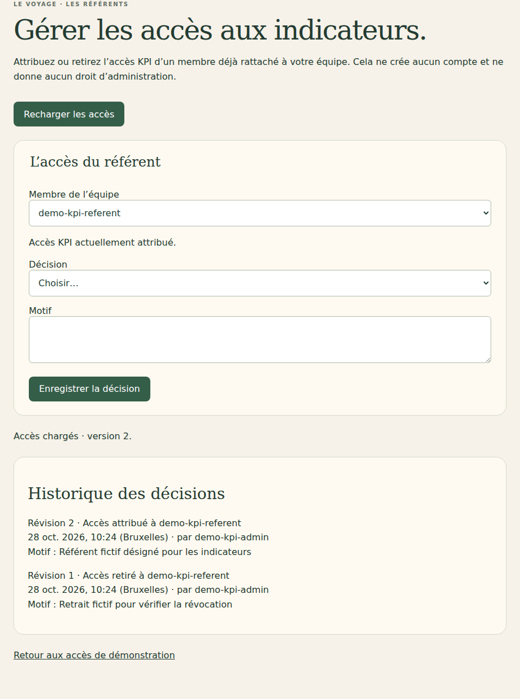
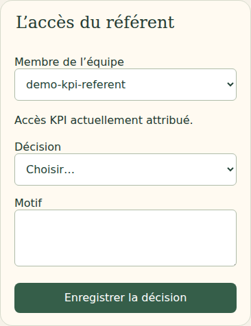

# V4-07C — Attribution et révocation des accès KPI

28 octobre 2026. Branche `work/v2-phase1-engine`, PR [#1](https://github.com/gkerckhofs-a11y/le_voyage/pull/1). Socle : `ce1e9023e641c2185bc4337bc2692fe73d7a653e`. Commit et CI finaux dans la PR.

## Fonctionnement livré

L'écran `/kpi-access.html` permet d'attribuer ou retirer l'accès KPI à un membre actif déjà rattaché à l'équipe de la session. Il montre l'état actuel, demande une décision explicite et un motif, puis affiche l'historique daté avec l'auteur vérifié. Les comptes sont identifiés par leur UID existant ; aucune identité n'est devinée et aucun courriel n'est envoyé.

Le droit d'administration `kpiManagementAssignments` est distinct du droit de référent `kpiAssignments`, tous deux limités à une campagne et une équipe. Un référent ne peut pas administrer les accès. Un administrateur ne reçoit pas automatiquement le droit de saisir les agrégats. La désignation textuelle du référent dans le brouillon annuel reste sans effet sur ces habilitations.

Routes POST `/api/kpi-access/read` et `/api/kpi-access/save`. La portée vient de la session et la protection CSRF s'applique. Le serveur contrôle la capacité du décideur et son rattachement actif avant puis dans la transaction, ainsi que l'existence de l'équipe et le mode KPI. Seuls les membres actifs de cette équipe sont proposés et modifiables ; compte absent, inactif ou étranger refusé.

La décision met à jour uniquement le droit KPI de l'équipe ciblée, en préservant les droits des autres équipes/campagnes. Elle ne crée ni compte, ni rattachement, ni droit de gestion. La modification du membre et le journal `kpiAccess/{teamId}` sont atomiques. Le journal conserve auteur, cible, décision, motif, date et révision. Une révision obsolète est refusée. Un doublon exact ne crée pas de seconde décision et ne rejoue pas une attribution après une révocation ultérieure.

La révocation est effective lors de la requête KPI suivante, y compris avec une session déjà ouverte. Les réponses de gestion ne contiennent pas d'agrégats, de réponses individuelles, d'adresse électronique ou de métadonnées privées du membre.

## Interface et démonstration

Les actions sont bloquées pendant les requêtes, avec un état de chargement/enregistrement explicite. Un conflit ou une erreur impose un rechargement avant une nouvelle décision. Un accès refusé efface la liste et l'historique de l'écran. Les textes d'historique sont insérés comme texte inerte, avec dates en heure de Bruxelles.

Le compte « Administrer les accès KPI · démo » est créé dans l'entreprise fictive KPI existante, avec uniquement l'habilitation de gestion de son équipe et sans participation. Les habilitations existantes ne sont pas réinitialisées au redémarrage. Aucun autre compte ne reçoit automatiquement ce pouvoir.

Bornes techniques du prototype : 200 membres actifs au maximum dans l'entreprise pour cette lecture et 100 décisions au maximum par journal d'équipe ; au-delà, refus explicite plutôt que troncature. Motif de 1 000 caractères maximum. Ces bornes ne sont pas des quotas commerciaux. Le provisioning des administrateurs réels reste une opération serveur à raccorder au futur cycle de création de campagne.

## Fichiers

- `src/server/kpi-access.mjs` : autorisation, projection, attribution/révocation et journal atomique.
- `src/server/firebase-http.mjs` : routes et compte fictif d'administration.
- `src/web/kpi-access.ts`, `web/kpi-access.html` : formulaire et historique ; styles KPI existants réutilisés.
- `src/web/login.ts`, `web/connexion.html` : accès de démonstration.
- `tests/firebase/kpi-access.test.mjs` : isolation, droits distincts, doublons, révisions, révocation et invariance.
- `tests/firebase-browser/kpi-access.spec.mjs` : effets immédiats dans une seconde session, parcours ordinateur/mobile.
- `tests/visual/public-build.test.mjs` : fichiers publics autorisés.
- Ce compte rendu et captures `docs/evidence/v47c-access-*`.

## Vérifications

Typecheck/build et 23 tests visuels/projections/frontière publique réussis. Les 34 tests Firebase passent. Quatre parcours navigateur réussis : gestion des accès et saisie KPI, chacun sur ordinateur/mobile.

Le test serveur vérifie notamment le refus sans capacité de gestion, la séparation des rôles, la restriction à l'équipe, la préservation d'un droit sur une autre campagne, les doublons concurrents, l'absence de réapplication d'une attribution après révocation, les révisions obsolètes, la révocation du décideur et le document de campagne inchangé.

Le parcours navigateur utilise deux sessions ouvertes : l'administrateur retire puis réattribue le droit, et la session du référent constate immédiatement les réponses 403 puis 200 sur la liste KPI. Le référent reste refusé sur l'administration. Motif obligatoire, historique après rechargement, CSRF, portée injectée, conflit, absence de débordement et réponse de voyage inchangée sont vérifiés. Un premier passage a mis en évidence un message de succès restant visible pendant la sauvegarde suivante ; un état d'attente explicite corrige cette ambiguïté. Les quatre parcours passent après correction.

Java 21 et Chromium Headless Shell 141 de substitution en local, dépendances verrouillées inchangées. CI complète référencée dans la PR. `git diff --check` sans erreur. Captures inspectées :

Pas de recette kiosque spécifique : administration privée, sans modification des vues collectives.

## Référence et suite

Cette tranche raccorde le contrôle d'accès serveur par entreprise, rôle et objet et le référent facultatif documentés dans V4-07A/V4-07B à un écran de gestion explicite. Elle n'invente ni règle de gel, ni barème KPI, ni droit de modifier les seuils. Le cahier intégral n'étant pas présent dans le dépôt, aucune relecture intégrale n'est revendiquée.

Restent la gestion des périodes, la règle précise de gel KPI, la validation et la conversion/réconciliation des lots, le provisioning réel des administrateurs, ainsi que les étapes contractuelles et de création de campagne déjà signalées. Cette tranche n'est pas la dernière. Aucun déploiement Firebase, aucune fusion main, aucune production. Dernier staging documenté : V4-05B. Le porteur sera prévenu explicitement avant le passage au déploiement test.
