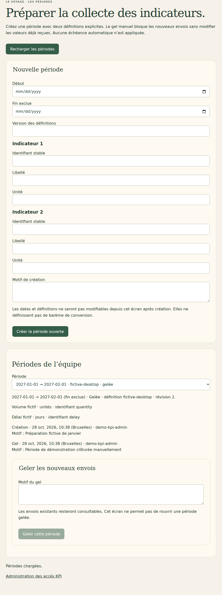
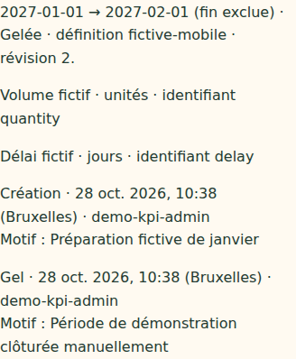

# V4-07D — Création et gel manuel des périodes KPI

28 octobre 2026. Branche `work/v2-phase1-engine`, PR [#1](https://github.com/gkerckhofs-a11y/le_voyage/pull/1). Socle : `2696a13685a4362ee2d39ae4ee7ca5d836273aa6`. Commit et CI finaux dans la PR.

## Fonctionnement livré

L'écran `/kpi-periods.html`, accessible depuis l'administration KPI, permet de créer une période ouverte avec dates explicites (fin exclue), deux définitions distinctes (identifiant stable, libellé, unité), référence de version et motif. Il liste les périodes de l'équipe et leur historique. Les définitions ne sont pas des barèmes de conversion.

Une action distincte permet de geler manuellement une période ouverte, avec motif. Le gel bloque les nouveaux envois côté serveur, conserve les lots et leurs révisions, et laisse les valeurs consultables au référent habilité. Il ne modifie ni scores, ni kilomètres, ni cadeaux. Aucune échéance automatique, aucun retraitement des scores et aucune réouverture ne sont ajoutés. Les dates et définitions ne sont pas modifiables depuis ces routes ou cet écran après création.

Les états de chargement/enregistrement bloquent les actions concurrentes. Un refus ou conflit impose un rechargement avant de poursuivre. Un refus d'accès efface les périodes affichées. Les identifiants sont contrôlés par le formulaire et le serveur ; les libellés et motifs sont rendus comme texte inerte. Les dates d'audit sont affichées en heure de Bruxelles.

## Autorisation et transactions

La capacité `kpiPeriodManagementAssignments` doit couvrir la campagne et l'équipe de la session. Elle est distincte de la capacité de gestion des accès et de celle du référent. Les contrôles sont refaits dans la transaction. Le compte d'administration fictif reçoit cette capacité lors de sa création ; le formulaire d'attribution des référents ne peut pas la conférer.

Routes POST `/api/kpi-periods/list`, `/create` et `/freeze`, avec session et CSRF. Aucune portée entreprise/équipe fournie par le navigateur n'est acceptée. Le serveur vérifie l'équipe réelle, la campagne et son mode KPI. La liste exclut les autres équipes et ne contient pas les agrégats.

La création utilise un identifiant dérivé de la clé de mutation. Deux appels identiques concurrents créent une seule période ; un contenu ou auteur différent sous cette clé est refusé. Rejouer la création après gel renvoie l'état gelé sans réouvrir. Le gel contrôle la révision ; son doublon exact ne produit pas de second événement. Une autre demande sur une période déjà gelée est refusée. Les périodes fictives antérieures sans journal utilisent la révision initiale zéro, puis reçoivent un événement de gel.

Les créations et gels conservent auteur, date serveur, motif et révision dans la période. Le service de collecte lit le même document de période dans sa transaction, de sorte que son contrôle d'état s'applique aussi à un référent déjà connecté.

Bornes techniques : 60 périodes par équipe, motif 1 000 caractères, référence de définition 160, libellé 500 et unité 100. Les dates doivent être valides et ordonnées, les deux identifiants distincts. Aucun découpage mensuel, interdiction de chevauchement ou correspondance automatique aux semaines de score n'est déduit : ces rapprochements restent à définir avec les règles KPI. Ces limites ne sont pas des quotas commerciaux.

## Fichiers

- `src/server/kpi-periods.mjs` : création, projection, gel, habilitation et audit.
- `src/server/firebase-http.mjs` : routes et habilitation de démonstration.
- `src/web/kpi-periods.ts`, `web/kpi-periods.html` : formulaire, liste et historique ; styles KPI existants réutilisés.
- `web/kpi-access.html` : lien vers la gestion des périodes.
- `tests/firebase/kpi-periods.test.mjs` : autorisation distincte, doublons, validation, gel et conservation des lots.
- `tests/firebase-browser/kpi-periods.spec.mjs` : administration et effets sur une session référent.
- `tests/visual/public-build.test.mjs` : fichiers publics autorisés.
- Ce compte rendu et captures `docs/evidence/v47d-periods-*`.

## Vérifications

Typecheck/build et 23 tests visuels/projections/frontière publique réussis. Les 35 tests Firebase passent. Quatre parcours navigateur réussis : gestion des périodes et saisie KPI, chacun sur ordinateur/mobile.

Le nouveau test serveur couvre notamment : droit de gestion des accès insuffisant sans capacité de périodes, dates/identifiants invalides, doublon de création concurrent, refus de remplacer une définition, envoi d'un agrégat, gel concurrent idempotent, conservation exacte de l'historique des valeurs, correction après gel refusée, portée étrangère refusée, capacité révoquée et document de campagne inchangé.

Le test navigateur crée une période, fait envoyer des valeurs par une seconde session de référent, gèle la période, relit l'envoi initial et vérifie le refus d'une correction tardive. Sont aussi vérifiés : motif de gel obligatoire, identifiant invalide bloqué dans le formulaire, persistance après rechargement, CSRF, portée injectée, refus d'administration au référent, absence de débordement et voyage inchangé.

Java 21 et Chromium Headless Shell 141 de substitution en local ; dépendances verrouillées inchangées. CI complète dans la PR. `git diff --check` sans erreur. Captures inspectées :

Pas de recette kiosque spécifique : écran administratif privé.

## Source et suite

Le cahier V4 du 27 octobre, selon les passages retrouvés et documentés dans V4-07A, prévoit des périodes, définitions, auteurs, validation et corrections avant gel pour les KPI. Le gel KPI précis et la réconciliation des scores restent indéterminés dans ces éléments. Cette tranche expose donc uniquement un gel manuel explicite, sans prétendre fixer la règle métier définitive. Aucune relecture intégrale du cahier absent du dépôt n'est revendiquée.

Restent la règle définitive de gel, la validation et conversion/réconciliation des lots, le rapprochement au calendrier et aux définitions de campagne, le provisioning réel des administrateurs et les étapes contractuelles/création de campagne déjà signalées. Aucun déploiement Firebase, aucune fusion main ni production. Dernier staging documenté : V4-05B. Cette tranche n'est pas la dernière ; le porteur sera prévenu avant le passage au déploiement test.
