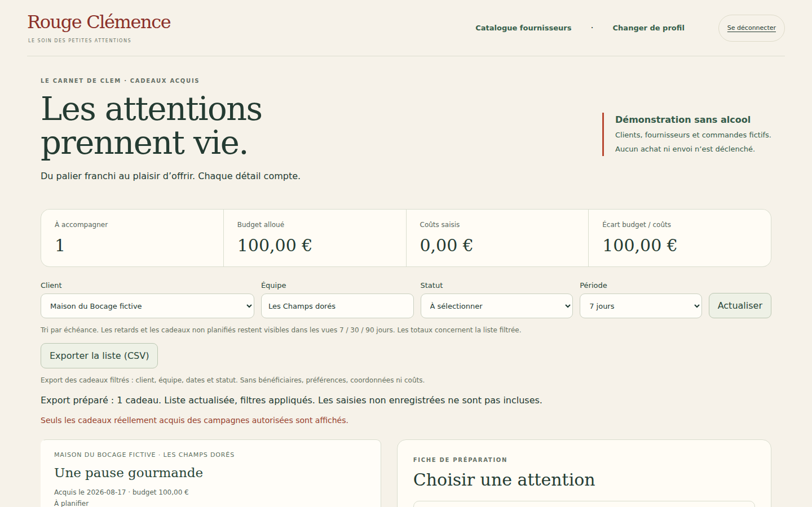
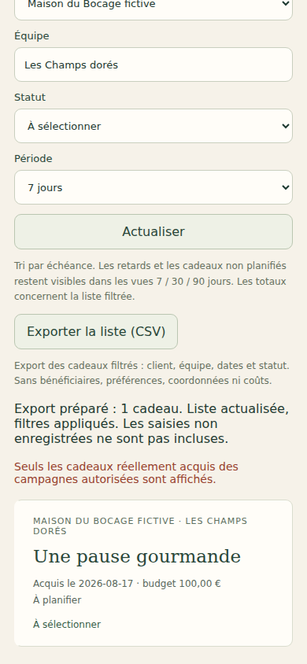

# V4-08A — Export minimal du cockpit cadeaux

## Besoin et source

Le cahier Rouge Clémence, **RC_Le_Voyage_Cahier_des_Charges_Astra_V4.md**, version 4 du 27 octobre 2026, section 7.2, demande une liste exportable et un export CSV minimal pour le cockpit Clem. Le fichier complet a été retrouvé et lu pendant cette tranche, contrairement aux recherches partielles signalées précédemment. Référence : [document V4](https://chatgpt.com/library?file_id=libfile_6bde9ba788ac8191b8defe25ec985ded&account_id=personal).

## Fonctionnement

Le bouton **Exporter la liste (CSV)** télécharge les cadeaux réellement acquis correspondant aux filtres actifs (client, équipe, statut, période). Il réutilise exactement la sélection de la liste : retards et cadeaux non planifiés restent inclus dans les horizons 7/30/90 jours. Le téléchargement relit d'abord le flux authentifié existant `/api/gifts/ops` : pas d'export de la copie en mémoire après un refus d'accès ou une erreur réseau. Aucun nouvel accès ni endpoint public ajouté.

Neuf colonnes explicites : date d'extraction UTC du serveur, campagne, identifiant cadeau, client, équipe, titre du cadeau acquis, date d'acquisition, échéance et statut français. Les identifiants distinguent les lignes de plusieurs campagnes. Les bénéficiaires, préférences, coordonnées, responsable, fournisseurs, compositions et coûts ne sont pas sérialisés. Les saisies non enregistrées ne sont pas incluses. Ce fichier sert au suivi interne ; il ne constitue ni un bon de livraison ni une commande.

UTF-8 avec marqueur BOM, séparateur point-virgule, cellules entre guillemets et guillemets internes doublés ; retours à la ligne conservés. Une apostrophe préfixe les cellules commençant par un déclencheur de formule de tableur, y compris après espaces/caractères de contrôle. Un filtre vide désactive le bouton. Pendant la demande, les doubles exports sont bloqués. Après échec, une nouvelle tentative doit relire le serveur.

## Vérifications

- Typecheck et build réussis ; **25 tests visuels/projections** réussis, dont deux tests dédiés au CSV.
- **3 tests Firebase ciblés** existants réussis : habilitations opérations indépendantes, portées et révocation, audit/idempotence, budget, statuts et confidentialité.
- **2 parcours navigateur** réussis, ordinateur 1440×900 et mobile 390×844 : export réel téléchargé, comparaison intégrale au flux fraîchement lu et à la liste filtrée, combinaison des quatre filtres, sélection vide, refus 403 et panne réseau sans téléchargement, récupération, client devenu inaccessible sans élargissement aux autres clients, absence de débordement horizontal.
- Tests CSV : champs privés ignorés même présents dans l'objet source ; accents, séparateurs, guillemets, retours à la ligne et protection des formules dans chaque colonne issue d'une fiche.
- Recette locale : Java 21, Chromium Headless Shell 141 de substitution ; dépendances verrouillées inchangées. Captures inspectées ci-dessous. CI complète suivie dans la PR.

Premier passage CI (`e7c183b`) : les 35 tests serveur passent, mais les deux nouveaux parcours échouent avant export. Le scénario choisissait la première fiche, déjà planifiée hors des sept jours par une recette précédente. Le filtre la masquait correctement. La recette choisit désormais explicitement un cadeau acquis non planifié ; aucun changement applicatif pour cette correction.

## Fichiers

`src/web/cockpit-export.ts`, `src/web/cockpit.ts`, `web/cockpit.html`, `tests/visual/cockpit-export.test.mjs`, `tests/visual/public-build.test.mjs`, `tests/firebase-browser/cockpit-export.spec.mjs`, ce compte rendu et ses deux captures.

## Limites et prochain incrément

L'export couvre les cadeaux acquis déjà présents dans le cockpit. Il n'ajoute pas de calendrier graphique, cadeaux datés/surprises opérationnels, prévisions de franchissement, filtrage par budget/type/urgence ou suivi des prestataires de réception. Les droits restent vérifiés au moment de la lecture ; un fichier déjà téléchargé ne peut pas être révoqué. Pas de journal persistant des téléchargements dans cette tranche.

Prochain incrément proposé dans le cockpit : prévisions explicites de proximité des paliers, sans créer de droit à cadeau avant franchissement (section 7.2). Les règles KPI non définies et l'activation contractuelle restent ouvertes.

Aucun achat, message, déploiement ou fusion main. Dernier staging documenté V4-05B. Cette tranche n'est pas la dernière ; le porteur sera prévenu avant le passage au déploiement test.
