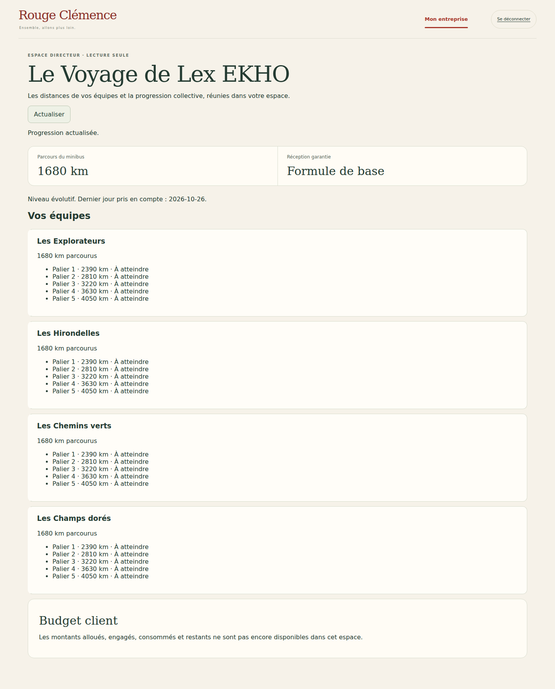

# V5 — R0 vérifié, premier incrément R1A

28 octobre 2026 — Rouge Clémence / Le Voyage.

## Sources et point de reprise

Lecture intégrale des 553 lignes du **cahier V5.0 du 28 octobre 2026**, joint sous `RC_Le_Voyage_Cahier_des_Charges_Astra_V5(1).md`, et des 11 lignes de sa synthèse. [Source V5](https://chatgpt.com/library?file_id=libfile_e4242a6f20c08191a9e5bc8a1ad5774f&account_id=personal). V5 prévaut ; les hypothèses chiffrées restent à tester.

Dépôt constaté `gkerckhofs-a11y/le_voyage`, branche dédiée existante `work/v2-phase1-engine`, [PR brouillon #1](https://github.com/gkerckhofs-a11y/le_voyage/pull/1), base `main`. HEAD local et distant identiques au début : `aa7668af2f9e706fdea5311ca719ecfc2e51035c`. Arbre de travail propre ; aucune régression de HEAD. Les quatre workflows de ce commit sont verts : Domain engine `40669596875`, Server access boundary `40669596740`, Journey map `40669596879`, Firebase `40669596972`. Inspection limitée aux fichiers/tests liés au checkpoint, sans nouvel audit historique.

## Matrice R0 — état réellement constaté avant cet incrément

Les statuts portent sur les fonctions citées, pas sur une déclaration de conformité globale d'une section.

| Zone | Déjà présent | À adapter / absent / bloqué | Preuves au HEAD de reprise |
|---|---|---|---|
| §1–2 multientreprise, droits | Auth vérifiée, affectations serveur, opérations séparées | **Absent** : front directeur ; **à adapter** : séparation complète des quatre espaces et dashboard organisateur | `src/server/access.mjs`, `gift-operations.mjs`, `tests/firebase/http.test.mjs`, `gift-operations.test.mjs` |
| §3 préparation annuelle | Brouillon organisation/calendrier, questions, budgets, logistique, mentions et revue | **Absent** : acceptation contractuelle et activation réelle de campagne ; **bloqué** : contenus/règles non validés | `src/server/annual-planning.mjs`, `src/application/annual-plan.ts`, `tests/events/annual-*.test.mjs`, `tests/firebase/annual-planning.test.mjs` |
| §3 invitations, votes, goûts | Invitations contrôlées, votes, profil privé modifiable, bénéficiaires figés et revue Clem | **À adapter R5** : parcours unique d'inscription et effet des préférences sur cadeaux déjà préparés | `src/server/invitations.mjs`, `team-vote.mjs`, `gift-preferences.mjs`, `gift-beneficiaries.mjs` et tests Firebase homonymes |
| §4 et §6 moteur | Calculs exacts, moyenne des équipes, congés, report/joker, idempotence ; TPE avec neutralisation | **Bloqué partiellement** : validation/réconciliation KPI, barème inverse ; hypothèses commerciales/RGPD non approuvées | `src/domain/scoring.ts`, `engine.ts`, `rolling-calendar.ts`, `src/server/weekly-questionnaire.mjs`, `tests/exact-scoring.test.mjs`, `engine.test.mjs`, `rolling-calendar.test.mjs` |
| §5 seuils, gel | Seuils V4 calculés, droits acquis, gel réception | **À adapter R3** : barème V5 versionné ; ne pas recalculer les campagnes existantes | `src/domain/scoring.ts`, `engine.ts`, `tests/exact-scoring.test.mjs`, `engine.test.mjs` |
| §7.1 flux | Cadeaux acquis et tâches ; cadeaux datés/surprises dans le brouillon annuel | **Absent** : déclenchement opérationnel daté/surprise et publication contrôlée complète | `src/server/gift-operations.mjs`, `src/application/annual-attentions.ts`, `tests/events/annual-attentions.test.mjs` |
| §7.2 cockpit | Liste 7/30/90, filtres client/équipe/statut, CSV, responsables/échéances, pipeline et audit ; catalogue, composition déterministe et coûts saisis | **Absent** : prévisions, calendrier graphique, filtres budget/type/urgence, comptabilité engagé/payé/restant consolidée, bons/étiquettes/groupements | `src/web/cockpit.ts`, `cockpit-export.ts`, `src/server/gift-operations.mjs`, `supplier-catalog.mjs`, tests Firebase/browser correspondants, `tests/visual/cockpit-export.test.mjs` |
| Deltas V5 sur le socle | Carte/zoom, voiture/minibus, saisons et arrivée existent | **À adapter R2/R4** : 58 repères encore fixes, identité/navigation/biomes ; **absent R6/R7** : Master Sheets et anticipation ; **bloqué** : fichier Master, droits d'accès, logo officiel | `src/map/geometry.ts:60`, `src/web/journey-map.ts`, `landscape.ts`, `parking.ts`, `src/server/supplier-catalog.mjs` |

**Conclusion du checkpoint : §7.2 n'est pas intégralement couvert.** Le code sain est conservé ; les fonctions absentes ne sont pas présentées comme déjà livrées. Aucun remplacement du moteur ni du cockpit.

## Firebase constaté

- Node 24, TypeScript et modules serveur natifs, frontend compilé statique, Firebase Admin. Pas de nouvelle application/framework/service ajouté.
- `firebase/emulators.json` : Auth 9099 et Firestore 8080 ; projet de recette `demo-rc-voyage`.
- `firebase/staging-hosting.json` : Hosting `rc-voyage-test-20261027`, réécriture vers Cloud Run `voyage-test`, région `europe-west1`.
- `src/server/staging-config.mjs` et `test-environment.mjs` : environnement isolé explicitement vérifié ; services refusés hors des conditions test.
- `firebase/firestore.rules` : lectures/écritures directes refusées ; accès privé via serveur. Pas de changement de règles ou de projet.
- URL configurée et historiquement testée : `https://rc-voyage-test-20261027.web.app/test-access`. Le contrôle HTTP distant de cette reprise a expiré (curl, code 28) : l'état du staging n'est **pas revalidé**. Les preuves anciennes ne sont pas une recette actuelle. Dernier déploiement documenté V4-05B ; aucun déploiement pendant R0/R1A.

## R1A — nouveau front directeur limité

**Nouveau** : `/entreprise.html` et `GET /api/director/progress`. Distances exactes de toutes les équipes de la campagne autorisée, paliers génériques acquis/à atteindre, kilomètres du collectif, base réception garantie, niveau et état de gel. Pas de classement par performance ni d'historique hebdomadaire détaillé. Budget client explicitement indisponible : aucun coût RC n'est utilisé comme substitut d'un montant contractuel engagé/consommé.

Habilitation dédiée `directorCampaigns: [campaignId]` sur `tenants/{tenantId}/members/{verifiedUid}`, avec `active`, `uid` et `tenantId` vérifiés dans la même transaction que la campagne. L'affectation d'équipe, les permissions d'organisation et le rôle opérateur cadeaux ne suffisent pas. Une révocation s'applique dès la prochaine lecture. Le tenant/campagne du payload doit correspondre au chemin.

Projection à liste blanche : aucune réponse, note, moyenne par question, résultat de formulaire, préférence nominative, coût fournisseur, marge, composition secrète ou budget privé. Les distances restent celles du moteur existant ; cette tranche ne prétend pas résoudre tous les risques d'inférence des petites équipes. Les tests existants de neutralisation TPE restent valides, la validation RGPD reste ouverte.

Profil fictif « Espace directeur · démo » ajouté sans affectation d'équipe ni droit de participation. Sa session n'accède qu'à la projection directeur, au contrôle de session et à la déconnexion. Les comptes existants ne reçoivent pas ce droit. Aucun endpoint d'attribution de rôle, aucune migration ni modification de campagne existante.

**Modifié** : connexion/session HTTP, liste des destinations de connexion, bouton de démonstration, liste blanche des fichiers publics. **Inchangé** : moteur, barèmes/seuils V4, cockpit/commandes, données historiques, Firebase/règles et main.

## Fichiers et validations ciblées

- Nouveaux : `src/server/director-progress.mjs`, `src/web/director.ts`, `web/entreprise.html`, `web/director.css`, `tests/firebase/director-progress.test.mjs`, `tests/firebase-browser/director.spec.mjs`, présent document et captures.
- Modifiés : `src/server/firebase-http.mjs`, `src/web/login.ts`, `web/connexion.html`, `tests/visual/public-build.test.mjs`.
- `npm run typecheck`, `npm run build:web` : succès.
- `npm run test:engine` : **32 tests réussis**, dont exactitude, moyenne, droits cadeaux, gel, reports/jokers, TPE et refus KPI sans politique.
- `node --test tests/visual/public-build.test.mjs` : **1 test réussi** ; seul le code frontend autorisé est publié.
- Émulateurs : `node --test tests/firebase/director-progress.test.mjs tests/firebase/http.test.mjs tests/firebase/gift-operations.test.mjs` : **7 tests réussis** ; portées/révocation, liste blanche, absence de mutation, isolation des services, deux types de cookie et cockpit existant.
- Playwright ciblé `tests/firebase-browser/director.spec.mjs` : **2 tests réussis** sur ordinateur/mobile. Directeur connecté, distances, budget indisponible, services interdits, injection de portée, retrait d'accès, déconnexion et refus pour collaborateur/organisateur/opérateur/référent.
- Premier passage navigateur : requête de test sans en-tête Origin refusée ; correction du test, pas assouplissement serveur. Java 21 et Chromium Headless Shell 141 de substitution en local ; dépendances verrouillées inchangées.
- Les workflows existants se déclenchent automatiquement sur la PR ; aucun lancement manuel d'une suite générale supplémentaire. Résultats réels reliés dans la PR.

Pas de nouvelle capture kiosque : ce front privé n'est pas le mode TV ; le mode TV et les cartes n'ont pas été modifiés. Les captures des autres espaces existants ne sont pas requalifiées comme recette des quatre espaces V5.

## Limites et suite

**R1 reste partielle.** À poursuivre : dashboard organisateur distinct, navigation des rôles multiples, provisioning autorisé et matrice complète. R8 raccordera budgets contractuels et réception détaillée ; ici le minibus est résumé en kilomètres, sans accès carte TV ni budget. La nouvelle vue possède une navigation unique en haut sur ordinateur et fixe en bas sur mobile. Logo officiel et navigation globale des espaces existants relèvent de R4 ; l'identité textuelle existante est conservée provisoirement sans redessin du logo.

Ensuite R2 bornes, R3 seuils versionnés, R4 identité/cartographie, R5 profil unique, R6 import Master, R7 prévisions, R8 direction/réception et R9 recette/pilote. Aucun changement de seuil existant. Aucun merge main, déploiement, migration de production ou nouveau service payant. Le passage au déploiement test sera annoncé après la dernière tranche vérifiée, selon l'instruction du porteur.
