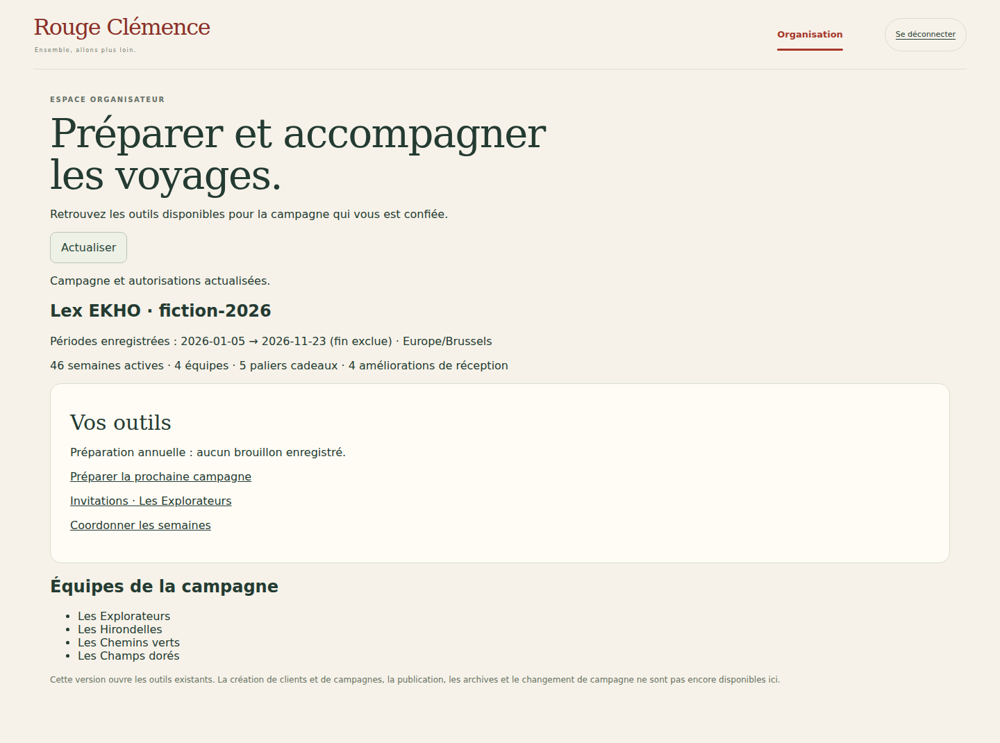
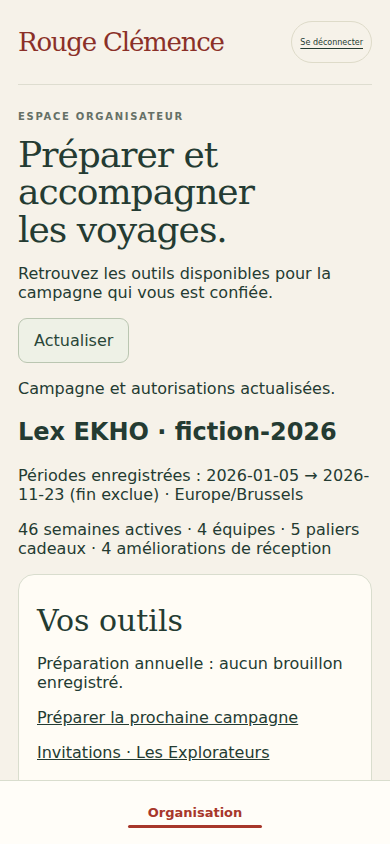

# V5 R1B — espace organisateur et outils existants

28 octobre 2026. Source : cahier V5, §§2, 2.1, 3.3 et tranche R1. Reprise de `af233342c58f4bc52a250e6b9e6494e42d3b88d0`, vérifié identique au HEAD de la PR #1, branche `work/v2-phase1-engine`. Aucun retour arrière.

## Livré

Nouvelle page `/organisateur.html` : entreprise/campagne affectée, bornes temporelles des périodes enregistrées (pas une nouvelle date contractuelle), semaines actives, équipes et nombres de paliers. L'état du brouillon annuel distingue absence de sauvegarde et révision enregistrée ; il ne constitue pas une validation contractuelle.

Les trois liens ouvrent les outils existants, selon leurs capacités respectives : préparation annuelle, invitations de l'équipe affectée et coordination des semaines. La navigation est unique en haut sur ordinateur et fixe en bas sur mobile sur ce tableau de bord. Les sous-écrans reçoivent un lien de retour et retirent, pour cette session, les liens vers questionnaire personnel, vote et carte collective non autorisés.

`GET /api/organizer/overview` utilise une projection explicite : aucune réponse, note, moyenne de formulaire, préférence nominative, coût fournisseur, marge ni contenu complet du brouillon annuel. Les dates sont celles des périodes enregistrées, pas une reconstitution d'un contrat manquant.

## Droits

Habilitation `organizerCampaigns: [campaignId]` dans le document membre tenant-scopé, vérifiée avec UID authentifié, activité et affectation campagne/équipe. Vérification initiale puis seconde lecture dans la transaction de projection. Chemin et identité du payload de campagne doivent correspondre. Les capacités `canPlanCampaign`, `canInvite` et `canCoordinateWeeks` restent indépendantes : le droit d'ouvrir l'espace organisateur ne les accorde pas automatiquement.

Le nouveau compte **Espace organisateur · démo** reçoit explicitement ces droits sur sa campagne fictive, avec `participationEnabled:false`. Aucun autre compte existant n'est promu. La session possède une liste fermée de routes d'organisation ; elle n'accède pas aux réponses personnelles, goûts, cockpit cadeaux, front directeur ou simulation synthétique. Chaque appel autorisé revérifie l'habilitation organisateur avant de déléguer au service existant, qui conserve ses contrôles propres. Le retrait bloque le prochain appel ; une déconnexion reste possible après retrait.

Aucune API d'auto-attribution de droits. Pas de changement de tenant/campagne depuis le navigateur dans cette tranche. Les démonstrations existantes restent disponibles, mais leur ancienne permission d'administration ne donne pas accès au nouveau tableau de bord.

## Inchangé / modifié / nouveau

- **Inchangé** : moteur, seuils V4, distances et acquis, règles Firebase, catalogue/commandes, modèle de brouillon annuel, logique d'invitation et coordination, main et production.
- **Modifié** : `src/server/firebase-http.mjs` (session/route/fixture), `src/web/demo-client.ts` (navigation selon espace), `src/web/invitation-admin.ts` (initialisation commune), `src/web/login.ts`, `web/connexion.html`, `tests/visual/public-build.test.mjs`.
- **Nouveau** : `src/server/organizer-dashboard.mjs`, `src/web/organizer.ts`, `web/organisateur.html`, `tests/firebase/organizer-dashboard.test.mjs`, `tests/firebase-browser/organizer.spec.mjs`, ce compte rendu et captures. Styles existants du front directeur réutilisés sans modification.

## Tests ciblés réellement exécutés

- `npm run typecheck` et `npm run build:web` : succès.
- `node --test tests/visual/public-build.test.mjs` : **1 test réussi**.
- Sous émulateurs Auth/Firestore : `node --test tests/firebase/organizer-dashboard.test.mjs tests/firebase/director-progress.test.mjs tests/firebase/http.test.mjs` : **6 tests réussis**. Deux nouveaux tests couvrent projection minimale, droits séparés, révocation, portée étrangère, identité falsifiée, correspondance payload, absence de mutation et garde HTTP des anciens outils. Les deux tests organisateur ont été rejoués après raccordement du sous-écran invitations : succès.
- Playwright ciblé : directeur **2 parcours réussis**, puis organisateur + invitation **4 parcours réussis** (chaque scénario en ordinateur et mobile). Accès au brouillon, création/révocation d'invitation fictive sans message, accès coordination, refus des autres espaces, retrait des liens personnels, perte d'accès et retour, navigation responsive et absence de débordement.
- Premier passage organisateur échoué : l'ancien écran invitations ne chargeait pas l'initialisation commune, les liens personnels restaient visibles. Correction applicative : initialisation commune et accès à sa route de session d'invitation, sous contrôle organisateur ; scénario enrichi pour créer/révoquer réellement l'invitation. Le contrôle serveur des questionnaires était déjà actif.
- Java 21 et Chromium Headless Shell 141 de substitution pour la recette locale. Aucune dépendance changée. `git diff --check` sans erreur. Suites intégrées automatiques de la PR suivies séparément, sans lancement manuel supplémentaire.

Captures inspectées. Aucune nouvelle capture kiosque : le mode TV n'est pas modifié ni exposé dans cette session privée.

## Limites et suite

R1 reste partielle : le tableau de bord est limité à la campagne de la session ; sélection multi-client, rôles multiples, attribution/révocation administrative de ces rôles et provisioning réel restent à réaliser. Création de clients/campagnes/équipes, publication et archivage ne sont pas annoncés comme disponibles. Les invitations existantes restent la démonstration nominative de Camille, pas un système générique d'envoi. Identité graphique textuelle héritée conservée, logo officiel attendu en R4.

Prochaine tranche : sélection explicite et sécurisée des espaces/affectations autorisés, puis clôture de la matrice R1 avant R2. Aucun déploiement test ou production, aucune fusion main, aucun service payant ni migration. Le staging n'a pas été recontrôlé pendant cette tranche ; son dernier état documenté reste V4-05B. Le porteur sera averti avant le passage au déploiement test après la dernière tranche vérifiée.
